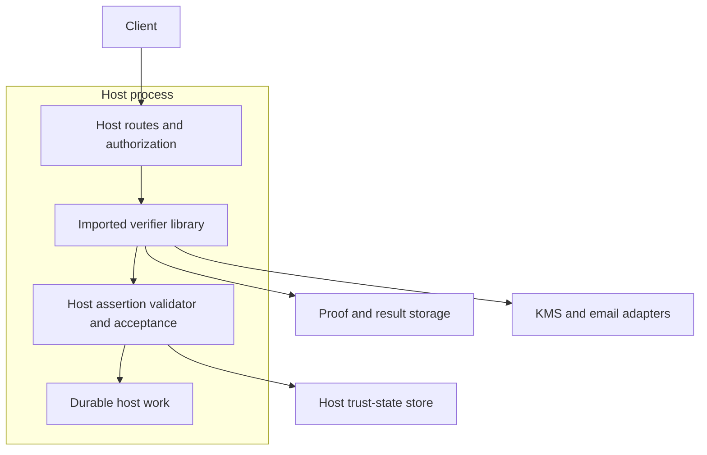
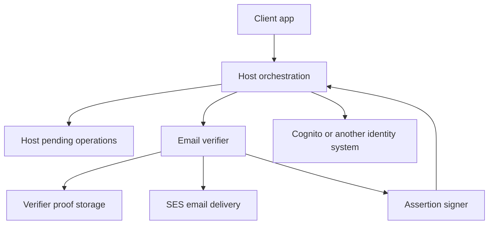
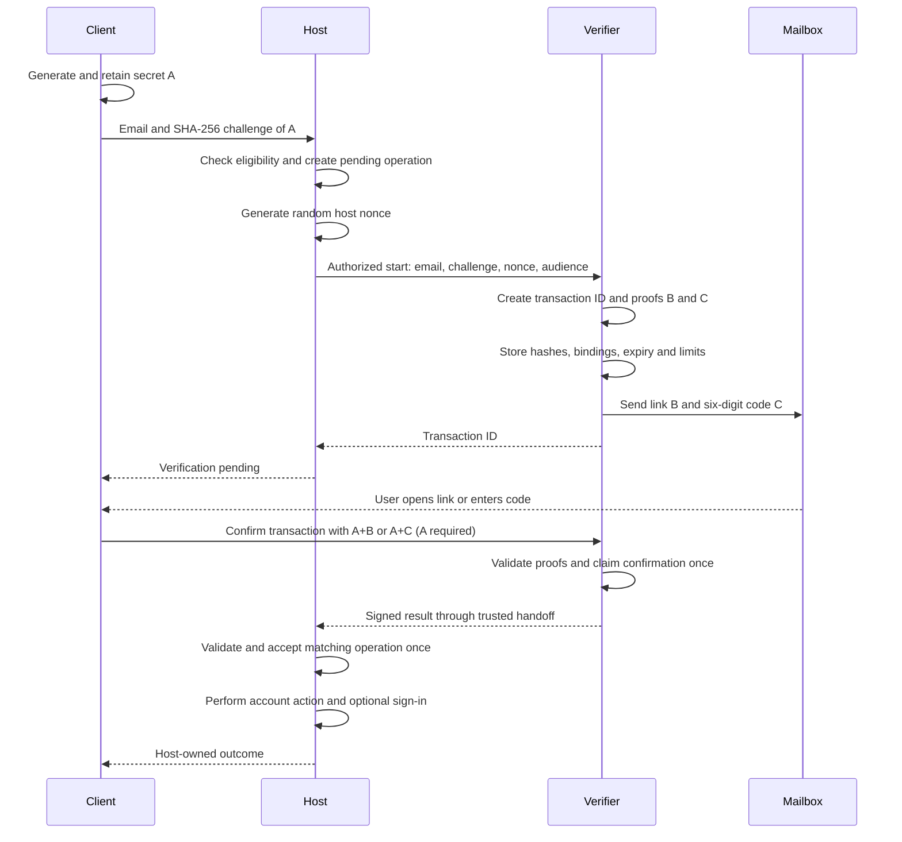
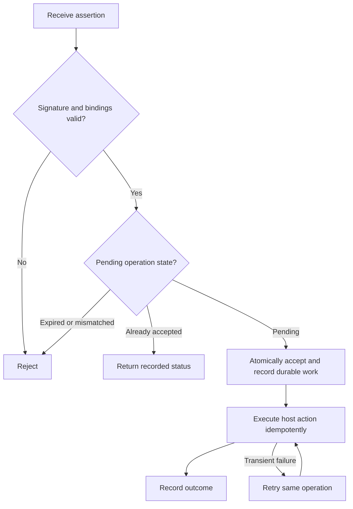
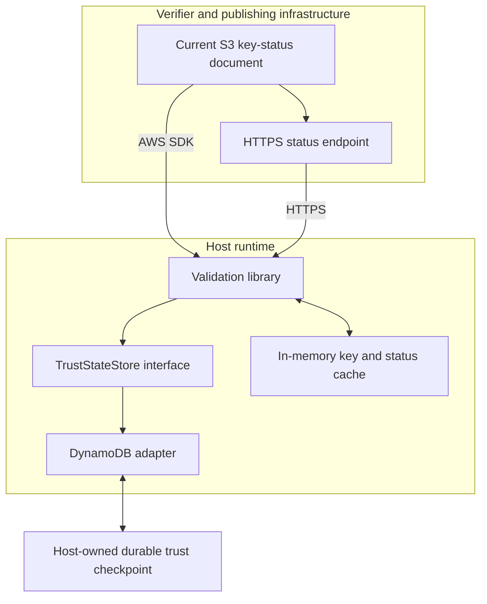

# Architecture and verification flow

[Design overview](../verification-only-plan.md)

## Default: imported library inside the host

Decision: the host imports and runs the verifier library in its own process.
Initiation and result handoff use trusted internal calls. Host code supplies the
trusted caller/audience context; do not derive authorization from arbitrary
client input. No additional service credential is needed for an in-process call.
AWS resource access still requires the host runtime's configured permissions.

Client-facing routes still enforce proof validation and operation authorization.
For progress, use the host session where available; a short-lived, unguessable
operation-scoped credential is the agreed direction for pre-account flows.
Its exact issuance, storage, lifetime and revocation rules remain to be specified.

Library and host may live in different repositories while sharing this runtime.
Independent services or Lambdas introduce a transport boundary even within one
project. Elaborate that future variant in [Separate deployment](separate-deployment.md).

## Responsibility boundary

The host imports and deploys the module. These boxes are responsibility boundaries,
not a requirement for separate services. A composed handler can call the library
directly; separate Lambdas require authenticated, encrypted communication.
A signature does not make evidence independent of the host that controls the
verifier code and signing permissions.

| Responsibility | Existing verifyemail implementation | Planned owner |
| --- | --- | --- |
| Account eligibility lookup | Verifier's Cognito adapter | Host |
| A/B/C verification, expiry, limits and resend | Verifier | Verifier |
| Account creation and session issuance | Verifier's Cognito adapter | Host |
| Signed verification result | Not implemented | Verifier |
| Operation binding and single-use acceptance | New host contract needed | Host |

## Proposed verification flow

The sequence is logical: exact public routes and result delivery remain to be
specified. The verifier must accept host bindings only through an authorized
start path, not trust arbitrary client-supplied audience or nonce values.

A stays on the initiating client until confirmation; the backend stores its
challenge. The verifier generates B and C. Preserve the existing ten-minute
proof lifetime, hashed B, keyed digest of C, retry budgets, cooldowns, conditional
claims, and resend invalidation. A is mandatory: B+C must never complete verification.
The email may be opened elsewhere, but completion requires the initiating app's A.
If A is lost, restart verification rather than falling back to email-only completion.

## Signed result and request binding

The host generates a cryptographically random nonce (32 bytes) and
stores its association with the expected email, intended operation, account or
signup context, initiating session, and expiry. The verifier creates its own
transaction ID. Keep the two identifiers separate; neither is an authorization
credential by itself.

| Signed field | Purpose |
| --- | --- |
| Issuer and audience | Identify the trusted verifier and intended host |
| Email and successful verification result | State what was verified |
| Host nonce | Bind evidence to the host's pending operation |
| Verifier transaction ID | Identify this verification transaction |
| Verification time, issuance time and expiration | Bound freshness and acceptance |
| Assertion ID | Identify the result for deduplication |

This is evidence of mailbox access, not an access token or proof of legal identity.
Operation names can remain private to the host through the nonce mapping.

## Replay prevention and crash recovery

A signature prevents tampering; it does not prevent replay or a thief submitting
first. Host acceptance must check the trusted key and allowed algorithm, issuer,
audience, time bounds, email, nonce, transaction, and original operation context.
Concurrent acceptance must have one winner. Atomically record acceptance and
durable follow-up work, then make external actions retry-safe. Do not claim a
distributed exactly-once guarantee.

The verifier also needs recoverable result issuance/delivery after successful
confirmation: retrying delivery must preserve the same verification identity,
never perform a new verification or authorize another operation. See [confirmation](confirmation.md) and [result delivery](result-delivery.md)
for the agreed durability and retry semantics; concrete mechanisms remain open.

## Host validation and storage boundary

The store interface and adapter run inside the host. The verifier service has no access to the host database. The checkpoint is not a copy of the public-key archive.
