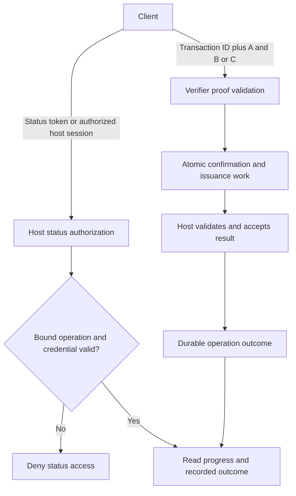
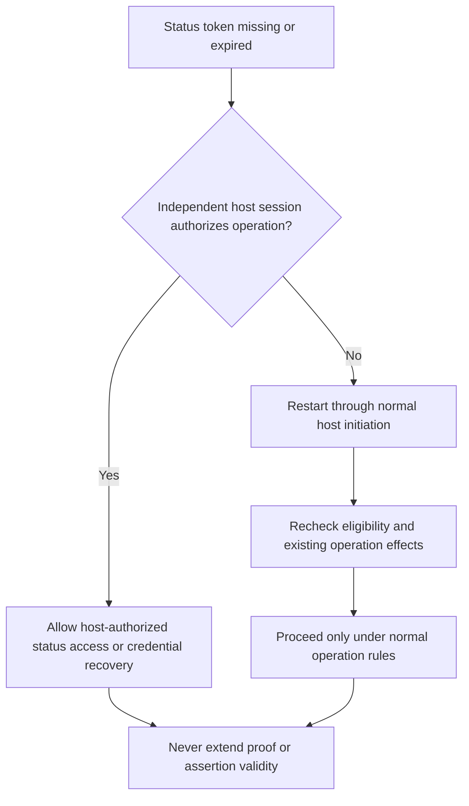

# Client status authorization

[Design overview](../verification-only-plan.md) · [Result delivery](result-delivery.md)

Status: agreed design; not implemented. The host owns this credential and its
authorization checks. The imported verifier continues to validate email proofs.

## Scope

Use an existing host session when it independently authorizes access to the
specific operation. For pre-account signup, the host issues a cryptographically
random, unguessable opaque status token bound to exactly one pending operation.
Persist only its hash, binding and lifecycle metadata on the host, not the raw token.
Keep it independent from secret A, email proofs B/C, and public transaction IDs.

| Action | Status-token permission |
| --- | --- |
| Read the bound operation's progress and recorded outcome | Allowed |
| Read another operation | Denied |
| Confirm email or replace A/B/C | Denied |
| Change the email or operation bindings | Denied |
| Retrieve the signed assertion or login/session credentials | Denied |
| Create a login session or perform the host action | Denied |

Return only the status information needed by the initiating client. Reporting
operation completion must not return authentication credentials through this
read-only capability. Checking status never executes or retries a business action.

## Lifetime and handling

Default to thirty minutes from credential creation, deployment-configurable.
Usage does not extend expiration. Enforce expiry on the server; browser cookie
expiry or database cleanup is not the authorization check.

Status-token lifetime is independent from proof expiration, assertion expiration
and host operation deadlines. An unexpired token cannot extend any of them.
It may report an expired or completed operation within its own lifetime.
Its expiration does not cancel already accepted durable host work.

For browsers, carry the token in a Secure, HttpOnly cookie over HTTPS.
For native clients, use protected app storage and an authorization header.
Never place the token in URLs, logs, analytics or error reports.
Concrete cookie scoping, SameSite policy, token encoding and hash algorithm remain
implementation details; they must preserve operation isolation and read-only scope.

## Status checks and confirmation are separate

A status token alone cannot enter the confirmation path. A transaction ID alone
cannot enter either authorized path.

## Lost responses and lost credentials

After a lost confirmation response, the client reads recorded progress through
the host status endpoint. This is a read, not another confirmation. Preserve the
distinction between email verified, host accepted and operation completed.

If the token is lost, do not recover or replace it using only an email address
or transaction ID. An independently authorized host session may authorize recovery
for that operation. Otherwise restart the pending flow through normal initiation
and eligibility controls. Restart must neither undo completed work nor bypass
host deduplication or create duplicate account effects.

Because only a hash is retained, the host cannot return the original raw token.
Any authorized replacement requires new credential issuance. Exact replacement
and invalidation mechanics remain to be specified.

## Acceptance scenarios

Verify operation isolation; wrong, expired and missing tokens; no sliding expiry;
status access after proof expiry; recovery after a lost confirmation response;
no assertion or session-credential exposure; rejection of token-only confirmation;
and restart after an action already completed without duplicating its effects.

## Remaining implementation details

Specify token entropy/encoding and hashing, cookie scoping and SameSite behavior,
rate limits, exact status fields, issuance-response loss handling, replacement
and revocation semantics, and cleanup/retention. These details must not broaden
the approved read-only permissions or renew verification evidence.
