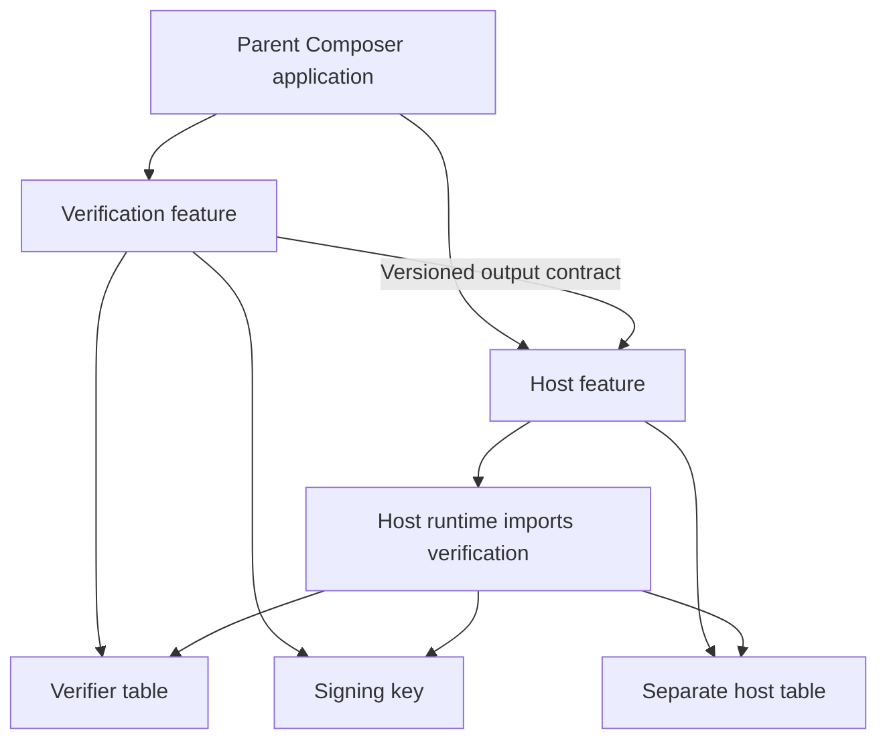
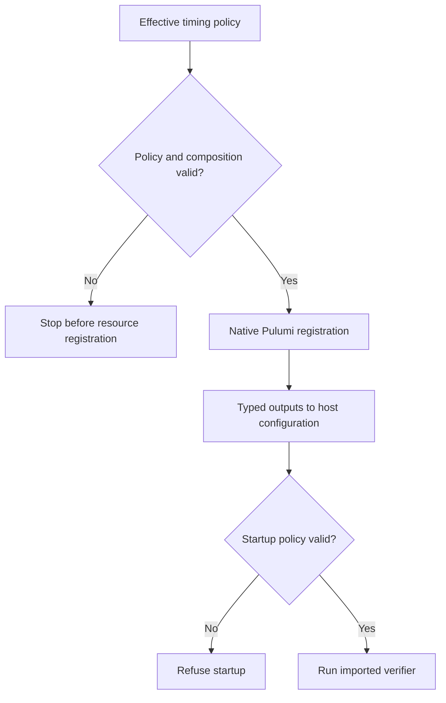

# Composer integration

The runtime remains an imported Go library. The `feature` package uses
`go.infra.composer` for deployment contracts; the separate `infrastructure` Go
module uses Composer's Pulumi adapter and native AWS constructors. Importing the
runtime does not import Pulumi. This is a foundation, not a complete AWS service.

The isolated test-host Pulumi entry point also uses `composer.Application`.
It registers the verifier and the test host as features, binds their
verification contract with `Application.Inject`, and deploys the plan through
the Composer Pulumi adapter. The test-host repository owns the Pulumi component
factory that builds the host-specific resources, including the Lambda and mobile
API. The shared deployment wizard is provided by Composer's `deploycli` module.

## Ownership and contract

| Artifact | Owner | Purpose |
| --- | --- | --- |
| Verifier DynamoDB table | Verification feature | On-demand storage with string `pk`, encryption and point-in-time recovery for versioned transactions and durable work. TTL is deliberately absent until safe cleanup is implemented. |
| ES256 KMS key | Verification feature | P-256 asymmetric signing key. Outputs include its immutable ARN and key ID; rotation/publication remain separate implementation work. |
| Host table | Parent application | Separate storage for dispatch, acceptance, status credentials, trust checkpoints and business work. This feature never creates or deletes the host's table. |
| Runtime and permissions | Parent application | Imports the library, supplies AWS clients, configures its own compute, and grants table-scoped reads/writes and key-scoped signing. No new Lambda, API or Cognito pool is implied. |
| Effective timing policy | Parent application | Validated at declaration, before Pulumi registration and by runtime constructors. The configuration inventory can describe delivery through `EMAIL_VERIFICATION_POLICY`. |

`feature.Declare(instanceID, policy)` offers
`email.verification.infrastructure`, major **1**, under offering `infrastructure`.
Fields: `table_name`, `table_arn`, `key_id`, `key_arn`, `policy_json` (all public
strings). A consuming feature declares a requirement using `feature.Contract()`
and binds it with `Application.Inject`. Native references preserve dependencies;
no resource names or ARN strings need to be guessed. Multiple instances need
explicit binding when their offerings would otherwise be ambiguous.

## Parent integration

1. Build the effective policy with `config.Load`, then `feature.Declare`.
2. Register host and verifier features in the same Composer application. Use the
   host requirement and explicit injection shown in `examples/composed`.
3. Add `feature.Configuration` to the parent configuration inventory (merge its
   properties, consumers and bindings with other features, then validate the
   complete inventory). The helper validates its own inventory as well.
4. Plan the application. Call `infrastructure.Deploy` with the plan, matching
   application/environment ownership metadata, and factories for other kinds.
   This installs an ownership scope; pass a context without a preinstalled scope.
   The verifier kind cannot be overridden. Extra factories remain trusted host code.
5. Configure the actual host artifact with the resolved `policy_json`, table and
   key outputs. The static configuration inventory does not set environment
   variables or grant IAM access. The host loads that exact JSON with `config.Load`
   at startup and supplies it to constructors; it must not silently use defaults
   when configured policy is missing or unavailable.
6. Construct DynamoDB stores with distinct verifier/host table names and the KMS
   signer with the returned key ARN. Supply authorized trust data, separate HMAC
   and encryption secrets, a mailer, and the scheduler described in the design.

The parent supplies AWS provider options to `Deploy` when using an explicit
provider; they are inherited by the component's children. Canonical `ic:` tags
and ownership inventory come from Composer. Resource names are scoped by feature
instance. Both native resources are protected against accidental Pulumi deletion.
Removing protection is an explicit administrative lifecycle action, not the
three-month key retirement implementation.

## Validation and limits

Run `go run ./examples/composed` for an offline plan. Run root tests and, from
`infrastructure`, `go test -race ./...` and `go vet ./...`. CI covers both modules.
The nested module uses a local replace for development; downstream Go consumers
ignore that replace and use the pinned published root commit.

The native mock test composes a host consuming actual verifier resource outputs,
checks table/key schemas and ownership tags, and proves unsafe policies register
no cloud resources. This is not a live AWS deployment or an IAM authorization test.

`infrastructure/examples/embedded` is an optional Pulumi entry point requiring
`domain` and `policyJSON` configuration, plus the parent AWS provider settings.
It provisions only verifier storage/signing, not a usable email service. No cloud
update was executed to validate this change. SES, archive/legal-hold publication,
rotation, IAM attachments, monitoring, scheduler and host business integration
remain explicit production work in the implementation status.
