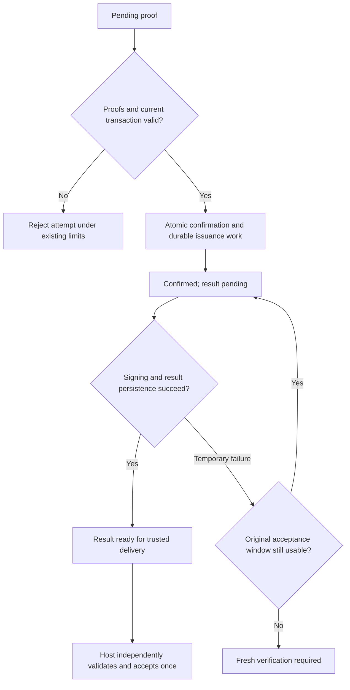

# Confirmation and recoverable assertion issuance

[Design overview](../verification-only-plan.md) · [Initiation](initiation.md)

Status: agreed confirmation and durability design; not implemented. Operation and
state names below describe the logical contract. Exact wire names, retry credentials
and concrete transport remain to be finalized. See the agreed
[result-delivery semantics](result-delivery.md).

## Confirmation inputs and validation

The client supplies the transaction ID, secret A, and either link proof B or
code C. A is mandatory; B alone, C alone, and B+C cannot confirm. Validate A against
the stored challenge and validate the chosen email proof against the current
transaction and proof generation. Preserve expiry, attempt budgets, resend
invalidation and request bindings from the existing design. Do not accept new
email, audience or nonce bindings supplied during confirmation.

Use protected transport; do not log proof secrets. Opening an email link alone
must not consume verification. The transaction ID identifies a record and is
never sufficient authorization to confirm or retrieve its status.

## Atomic confirmation boundary

A single atomic conditional transition must:

1. Confirm the transaction only while its current proofs are valid and usable.
2. Consume its email proofs, preventing either proof from producing another success.
3. Persist the original successful verification time and immutable request bindings.
4. Create durable pending work to issue the assertion.

The condition must protect against concurrent confirmation, expiry, exhausted
attempt limits and resend changes occurring after an initial read. Only one
confirmation wins. Storage failure must not leave consumed proofs without
recoverable issuance work, or report successful confirmation before commit.

```mermaid
sequenceDiagram
    participant C as Client
    participant V as Verifier
    participant D as Verifier durable storage
    participant W as Issuance worker
    participant K as KMS
    C->>V: Transaction ID, A, and B or C
    V->>V: Validate proofs, bindings, expiry and limits
    V->>D: Atomically confirm, consume proofs and record issuance work
    D-->>V: Commit succeeds
    V-->>C: Proof confirmed; result may still be pending
    W->>D: Resume durable issuance work
    W->>K: Sign assertion with authorized key
    alt Signing succeeds
        K-->>W: Signature
        W->>D: Persist selected signed result before release
    else Temporary signing failure
        K-->>W: Failure
        W->>D: Preserve work for bounded retry
    end
```

The worker is a logical responsibility; this does not require a new Lambda.
Proof confirmation, result readiness, and host acceptance are distinct milestones.
A confirmation response is not itself the signed evidence authorizing host action.

## Recovery and retries

- Before confirmation commit: no successful confirmation exists; a retry must
  satisfy the current proof checks.
- After commit but before the response: an authorized retry returns the recorded
  status without consuming proofs again or scheduling another verification.
- After commit but before signing: resume durable issuance work after a crash
  or temporary KMS outage. Do not ask the user to repeat proof validation while
  the original evidence remains usable.
- After a result is durably selected: reuse that result for delivery retries.
  Never release an unpersisted candidate that could be replaced after a crash.
- Concurrent issuance workers must select one durable result. Signing may be
  retried; this is not a guarantee of exactly one KMS invocation.

Preserve the original verification time throughout recovery. Preserve the
assertion identity, bindings and original expiration once assigned; retries must
not renew an acceptance window. Issuance time and expiration must be fixed
durably for the issuance attempt before retryable signing, rather than recalculated
after each failure. The exact claim-reservation and worker-fencing mechanism
remains an implementation detail.



The maximum verification age and all assertion, key and host deadlines still
apply. Recovery cannot guarantee eventual acceptance after an unlimited outage.
The verifier need not know a private host-operation deadline: the host enforces
that deadline independently and may reject a result the verifier has produced.
Never restore consumed proofs or rewrite verification time to bypass expiration.

## Authorization of repeated requests

Every repeated confirmation or status request must establish authorization for
the original transaction. Transaction ID alone is insufficient. Do not interpret
consumed email proofs as a new confirmation. The exact credential/session contract
for retrieving recorded status, its lifetime and retention remain open; this
document does not authorize anonymous status or assertion retrieval.

## Acceptance scenarios

- Valid A+B or A+C confirms only its bound transaction.
- Missing or incorrect A fails, including valid B+C without A.
- Expired, superseded or exhausted proofs cannot win a confirmation race.
- Concurrent confirmations produce one successful durable transition.
- A lost response after commit returns recorded status to an authorized retry.
- Crash or storage failure cannot strand consumed proofs without issuance work.
- KMS recovery preserves the original verification time and fixed issuance claims.
- Concurrent signing and crashes around result persistence expose one selected result.
- Long outages do not extend acceptance; the host still checks every deadline.
- Confirmation status never substitutes for signed evidence or host acceptance.

## Remaining decisions

Define retry/status authorization, exact errors and wire fields, durable claim
reservation and worker fencing, recovery scheduling and retention.
[Result delivery, host acknowledgment and client completion ownership](result-delivery.md)
are decided; concrete transport and authorization details remain open.
See [assertion timing](assertions.md) and [host acceptance](architecture.md#replay-prevention-and-crash-recovery).
