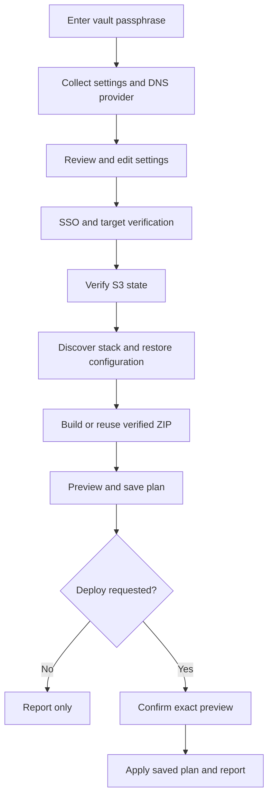

# Test-host deployment wizard

The root `deploy.sh` and `deploy.bat` run the shared [Infra Composer CLI](https://github.com/lambdawalker/go.infra.composer/tree/d96e727bdb02c684d60993a9825998b7440b56a2/deploycli), pinned in `tools/deploy/go.mod`. The target and feature inputs are declared in `deploy.json`. Both scripts keep the existing flags. The CLI deploys only the isolated
email-verification test host. The library and Composer integration remain usable
without this wizard. No admin/index component or public API is involved.

## First run and reruns

Install Go 1.25+ (infrastructure automatically selects Go 1.27.3+), AWS CLI v2,
Pulumi CLI v3 and an AWS IAM Identity Center profile. Start the terminal wizard
from the repository:

```sh
./deploy.sh
# Windows:
# deploy.bat
```

The wizard asks for the local vault passphrase first. It then collects settings
and displays them for review before AWS or GitHub sign-in. In terminal mode,
use Tab and Enter to edit a field, or the numbered menu in a smaller terminal.
Ctrl+Q exits a prompt or review. At a text prompt with a default, typing stops
the five-second countdown and Enter submits the current answer.

Project and environment select the saved deployment scope. Use dev, qa, or a
custom test environment. The Pulumi project is `email-verification-testhost`,
with stacks named `test-<environment>`. For first setup, enter an S3 state URL
or select `new` to create an encrypted, versioned bucket. Existing targets
are checked against the signed-in account and verified S3 state.

Nonsecret records live under `~/.infra-composer/<project>/environments/<environment>/`.
Repository `.deploy/` holds identity/flag snapshots and an encrypted local vault.
The vault uses PBKDF2 and AES-GCM with random salt/nonce; its unlock password is
never saved. The Pulumi passphrase is passed through the process environment.
Keep backups of the vault, unlock password, state URL and Pulumi passphrase.
S3 encryption, Pulumi secret encryption and the local vault are distinct protections.

The wizard remembers these required inputs per environment.

| Prompt | Example | What to do |
| --- | --- | --- |
| SES From address (`--sender`) | `verify-demo@example.com` | Use a full address whose inbox you can access. After deployment creates the SES email identity, open the verification link sent to that address. |
| Test recipient (`--recipient`) | `tester@example.com` | Use the full address that will receive the code. In the SES sandbox, verify it in the deployment's AWS region before testing. |
| Ownership domain (`--domain`) | `example.com` | Use a domain value for resource tags and reports. The wizard does not host a URL on this domain. |
| Sender domain's public DNS provider (`--dnsprovider`) | `route53` or `cloudflare` | Pick the provider that serves the public DNS for the domain in the From address. The registrar may be different. |

This test stack uses an SES email-address identity. **No new DNS records are
required.** The DNS provider choice is saved for domain setup. If you separately
set up an SES domain identity with Easy DKIM, add the CNAME records SES provides
in the delegated Route 53 public hosted zone or in Cloudflare DNS with proxying
disabled. The wizard displays provider guidance and saves the selection.
See [SES identity verification](https://docs.aws.amazon.com/ses/latest/dg/creating-identities.html)
and the [test client instructions](test-host.md#run-an-email-verification).

## Browser mode

```sh
./deploy.sh --server
# Windows:
# deploy.bat --server
```

The launcher starts a local website. The page lets you choose an action,
review or edit settings, follow sign-in instructions, and see the Pulumi plan
and deployment progress. Preview is preselected when you start without
`--action`. Applying the saved plan requires an explicit click. Add
`--no-open` to print the URL without opening the browser.

Use **Stop wizard** to cancel the run and **Close wizard** to end the local
session after reviewing the result. Terminal and noninteractive runs remain
available through the same launcher.

## Actions

```sh
./deploy.sh --action build
./deploy.sh --action setup
./deploy.sh --action preview
./deploy.sh --action deploy
./deploy.sh --action status
./deploy.sh --action report
./deploy.sh --action report --refresh-report
./deploy.sh --reconfigure --action setup
```

A plain terminal invocation defaults to deploy: build, successful preview, then
“Deploy the previewed changes? [Y/n]”. Enter/yes applies immediately; five seconds
without input applies that saved plan. No/Escape/Ctrl+C/EOF cancels. Required text,
secret entry and destructive confirmations never receive timeout approval.
Deletion/replacement additionally requires typing the exact stack name. Explicit
setup/build/status/preview/report never become deploy. Build needs no AWS session.

Builds create a Linux ARM64 Lambda ZIP and cache input/artifact hashes under
`dist/testhost/`. Unchanged verified artifacts are reused; `--force-rebuild`
invalidates reuse. Every preview/apply still queries Pulumi. Encrypted stack config
is refreshed before updates, preserving generated secret values and keys.

Operation locks prevent concurrent same-environment runs. Interrupted bootstrap
and stack discovery retain receipts. A missing previously initialized stack or a
failed remote lookup stops for recovery. Do not remove a lock until you have
verified that its owner is no longer running. Restore state/vault backups rather
than deleting settings to bypass recovery checks. Rerun the same command after
resolving the cause. To adopt a stack created with the older helper, use its exact
S3 backend and environment; do not initialize a new backend over existing resources.

Preview/deployment attempts produce safe JSON, Markdown and HTML reports under
`.deploy/reports/`, including partial results. State inventory means recorded;
read-only refresh evidence has its own timestamp. Reports omit raw policies,
environment maps, state payloads and credentials.



## GitHub Actions

The manual `testhost-deploy.yml` workflow calls the same executable with explicit
inputs, OIDC and a concurrency group. It does not run on pushes. Create a protected
GitHub environment and an AWS OIDC deployment role scoped to that repository and
environment first. The wizard deliberately does not automatically create roles
or overwrite protection settings. The role needs the reviewed provisioning rights
for this test stack and its S3 state; the runtime role is separately least-privilege.

```sh
./deploy.sh --action github-setup --github-repository lambdawalker/go.apexfission.aws.email-verification --github-environment testhost-dev --github-role arn:aws:iam::ACCOUNT:role/ROLE
```

Authenticate `gh` with environment administration rights. Setup verifies the
repository/session, checks the existing environment, reconciles managed variables
and transfers `PULUMI_CONFIG_PASSPHRASE` via stdin. It preserves protections and
unrelated settings. Permission failures report incomplete setup. Secret delivery
cannot be read back. Change `--github-secret-version` or use `--force-reconcile`
to redeliver the existing passphrase. Nothing dispatches a deployment automatically.

Managed variables: `BENCH_PROJECT`, `BENCH_ACCOUNT`, `BENCH_REGION`, `BENCH_BACKEND`,
`BENCH_ENVIRONMENT`, `BENCH_ROLE_ARN`, `BENCH_SENDER`, `BENCH_RECIPIENT`, `BENCH_DOMAIN`,
and `BENCH_DNS_PROVIDER`. For an existing GitHub environment, rerun GitHub setup
once to set the DNS provider before preview or deploy. Select the matching
protected environment and target in Actions. Inputs must match its saved scope.
Select the approval checkbox when choosing the deploy action.
Noninteractive deploy requires explicit `--action deploy --approve`; omitted action
is preview. CI requires complete settings and never starts SSO or bootstraps state.

## Validation and remaining boundaries

Tests use fake commands for cached builds, artifact tampering, bootstrap recovery,
stack discovery, saved settings, scope mismatches, approval responses and safe
reports. Windows is cross-compiled; actual Windows console/ACL behavior still
needs an operator test. No real AWS/GitHub environment setup or deployment is run
merely to verify this tooling. The existing test-host limitations around scan-based
scheduling, pinned-key trust and safe cleanup still apply.
