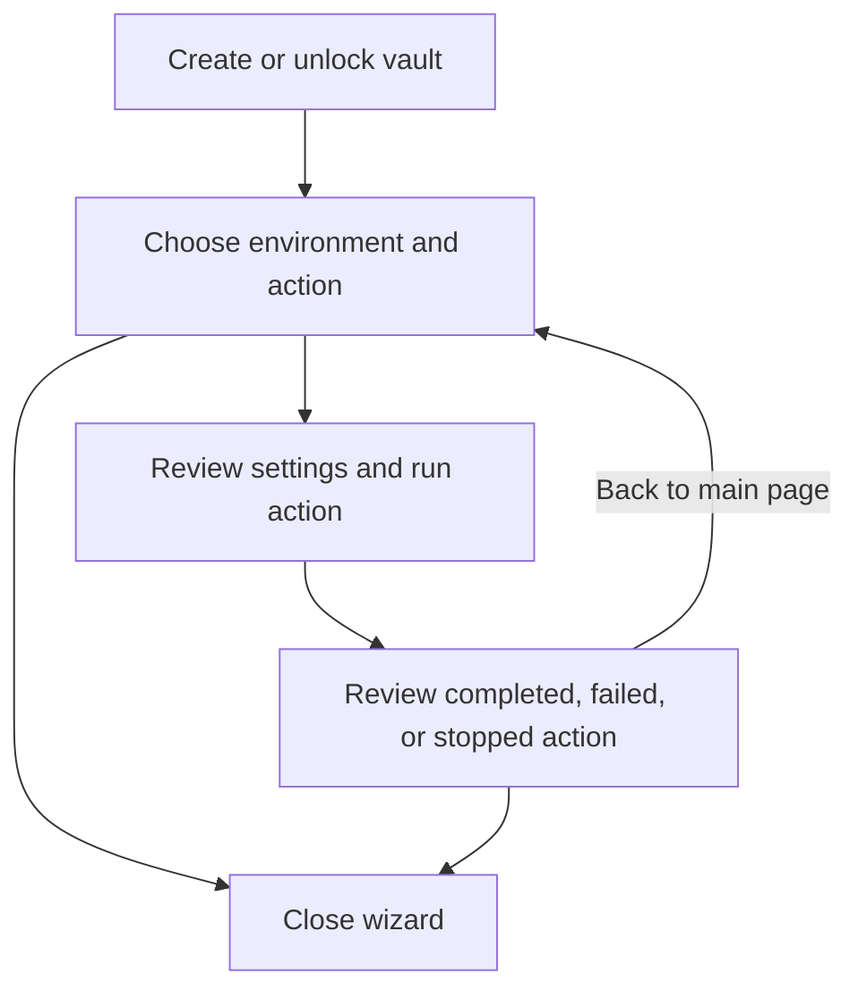
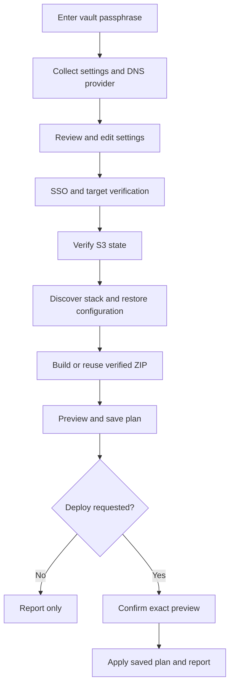

# Test-host deployment wizard

The root `deploy.sh` and `deploy.bat` run the shared [Infra Composer CLI](https://github.com/lambdawalker/go.infra.composer/tree/a84cb12f9bb17713b1e695c65088b0746125ca9a/deploycli), pinned in `tools/deploy/go.mod`. The target and feature inputs are declared in `deploy.json`. The CLI deploys only the isolated
email-verification test host. The library and Composer integration remain usable
without this wizard. The test host has its own authenticated Android demo API.

## First run and reruns

Install Go 1.25+ (infrastructure automatically selects Go 1.27.3+), AWS CLI v2,
Pulumi CLI v3 and an AWS IAM Identity Center profile. Start the terminal wizard
from the repository:

```sh
./deploy.sh
# Windows:
# deploy.bat
```

When started from a desktop terminal, the wizard first asks whether to stay
in the terminal or launch the web interface. Press Enter or wait 15 seconds
to stay in the terminal. Headless and SSH sessions go straight to the terminal
wizard. To open the web interface directly, run `./deploy.sh --server` or
`.\deploy.bat --server` on Windows. Select a target with a saved deployment
and open **Topology** to see its AWS resources as 3D models. The ACM certificate
for the Android demo endpoint appears as an engraved glass plaque with a sapphire-blue frame, TLS letters and ribbon.
Choose **TLS shield** in the Topology toolbar to switch to the ruby shield.
The API Gateway uses a violet aperture. Its `start`, `confirm`, and `status` routes each use a violet glass sextant with a cyan packet on the scale. Their shared Lambda integration, `testhost.app-demo-invoke`, uses a rounded violet glass clevis and orange glass tongue joined by a silver pin.
Secrets Manager resources appear as a ruby glass vault with an open door and a cyan cartridge. The SES sender identity appears as an engraved glass certificate with a plum frame, envelope and ribbon. Each Lambda invocation permission uses the same engraved plaque with a mandarin-orange frame, λ and ribbon. The function itself uses the standalone orange λ.

The IAM execution role has a ruby person silhouette, ACM certificate validation has emerald ACM lettering, and the API Gateway JWT authorizer has teal JWT lettering. All three share the engraved certificate shape and matching frame and ribbon.

The glass bodies use the tinted finish of the certificate plaques. You can see other icons through overlapping glass. Details such as hinges and envelope folds stay opaque.

In the topology viewport, drag to orbit, drag with the middle mouse button to pan, and scroll to zoom. Press **Ctrl+B** and drag a rectangle to frame that area, or press **Esc** to cancel. The upper-right controls include six axis views, pan, zoom, and box zoom. Click the **Home** icon or press **Home** in the viewport to restore the opening angle, center, and zoom. **Fit view** frames the visible artifacts at the current angle.

After choosing an interface, enter the local vault passphrase. The wizard
collects settings and displays them for review before AWS or GitHub sign-in.
In terminal mode,
use Tab and Enter to edit a field, or the numbered menu in a smaller terminal.
Ctrl+Q exits a prompt or review. At a text prompt with a default, typing stops
the 15-second countdown and Enter submits the current answer.

Project and environment select the saved deployment scope. The wizard suggests
`test-host` for a new setup and reuses the saved project name on later runs.
Use dev, qa, or a custom test environment. The Pulumi project is `email-verification-testhost`,
with stacks named `test-<environment>`. For first setup, enter an S3 state URL
or select `new` to create an encrypted, versioned bucket. Existing targets
are checked against the signed-in account and verified S3 state.

Nonsecret records live under `~/.infra-composer/<project>/environments/<environment>/`.
Repository `.deploy/` holds identity/flag snapshots and an encrypted local vault.
The vault uses PBKDF2 and AES-GCM with random salt/nonce; its unlock password is
never saved. The Pulumi passphrase is passed through the process environment.
Keep backups of the vault, unlock password, state URL and Pulumi passphrase.
S3 encryption, Pulumi secret encryption and the local vault are distinct protections.

The wizard remembers these project inputs per environment.

| Prompt | Example | What to do |
| --- | --- | --- |
| SES From address (`--sender`) | `verify` or `verify-demo@example.com` | A local part uses `<environment>.components.email-verification.<base-domain>`. The interactive default is `verify`. An explicit full address can use a different domain. Use an inbox you can access to confirm the SES email identity. |
| Test recipient (`--recipient`) | `tester@example.com` | Use the full address that will receive the code. In the SES sandbox, verify it in the deployment's AWS region before testing. |
| Ownership domain (`--domain`) | `apexfission.com` | Enter the base domain. It also supplies tags, reports, and the default Android API hostname. |
| Public DNS provider (`--dnsprovider`) | `route53` or `cloudflare` | Select the provider serving the sender domain. The mobile API uses it by default. |

The test stack creates an SES email-address identity. The chosen address must
be able to receive the SES verification email. Provision a mailbox or forwarding
for the suggested address, or enter an existing full address you can verify.
The DNS provider choice is saved for domain setup. If you separately
set up an SES domain identity with Easy DKIM, add the CNAME records SES provides
in the delegated Route 53 public hosted zone or in Cloudflare DNS with proxying
disabled. The wizard displays provider guidance and saves the selection.
See [SES identity verification](https://docs.aws.amazon.com/ses/latest/dg/creating-identities.html)
and the [test client instructions](test-host.md#run-an-email-verification).

## Browser mode

```sh
./deploy.sh --server
# Windows:
# deploy.bat --server
```

Use `--server` to open the browser directly or `--terminal` to go straight
to the terminal wizard. The same flags work on both launchers.

The browser opens a local website. Use **Theme** in the header to choose
**System**, **Light**, or **Dark**. New wizard sessions follow your system
appearance. Your selection survives reloads in the current browser tab.

On a fresh checkout, create and confirm the local vault password in the browser.
If a vault already exists, unlock it with its existing password.

When you start without `--action`, each available action has a card that
explains what it does. Preview is selected by default.

Use the **Main menu** in the header to choose the environment.
**New Environment** starts a draft, while **Open Environment** lists the
project's recorded deployments and saved setups. Open environments appear
as tabs in the header. Switch tabs between operations to load the selected
environment's settings and artifacts. The cards in **Actions** apply to
that environment. The project-wide **Remove All Environments and Index**
command is in the main menu.

In the artifact tree and details, `email-verification` identifies the
importable verifier's transaction table and signing key. `host-app` identifies
the demo's infrastructure, including its API, Lambda, and deployment state bucket.
Click an owner badge to filter both the artifact tree and proposed changes.
The owner filters show artifact totals and the number of proposed operations.

**Overview** shows the most recent successful deployment and failed attempt for
the selected environment and target. Download a report from either entry.
Use **Check drift** on a saved deployment to verify its managed resources.
The check records when it ran and lists external changes, missing resources,
and resources it could not verify. It previews a refresh without updating the
Pulumi stack.

In **Proposed changes**, deletion and replacement steps appear first. Selecting
a change shows before-and-after values for supported settings and replacement
fields when Pulumi reports them. **Depends on** and **Used by** in Artifact
details let you navigate between resources linked in recorded state or the
current preview.

Both browser removal actions ask you to confirm your intent, acknowledge what
will be removed, and type the exact name shown. Enter the stack name for one
environment or the project name for all environments and the shared index.
Close the dialog or press Esc to cancel before the final confirmation.
See [discovery and teardown](test-host-discovery.md#publish-test-hosts).

In **Settings**, enter or review the SES From address,
test recipient, ownership domain, DNS provider, and AWS settings in a single
form. Editing the ownership domain updates the suggested From address, and the
form shows the full address before you continue. Previously saved full sender
addresses are carried forward. The wizard highlights invalid fields as you edit.
Continue validates the complete form and checks the AWS profile, account, and
any existing S3 state location. If a check fails, the wizard returns to the
form with your entries intact and shows the issue next to the relevant field.
The wizard saves the project defaults after you confirm the verified account.
It displays sign-in instructions when needed and then shows deployment
progress. Applying a saved Pulumi plan requires an explicit click. Add
`--no-open` to print the URL without opening the browser.

The bottom action bar stays visible as you scroll the form or Pulumi plan.
The plan groups artifacts by service and shows a type, logical name, operation,
and purpose where known. Expand a name to see the full Pulumi URN.

Routine browser defaults have a 15-second countdown. A form with valid,
resolved defaults has 30 seconds. Interacting with the page pauses the
countdown, and applying the saved plan requires an explicit click.

Use **Credentials** to enter the Cloudflare API token or GitHub token when
needed. The wizard encrypts entered tokens with the local vault passphrase
after AWS account confirmation. A later run shows `*****` for a configured
token. Leave its field blank to keep it. The GitHub token is used by the
local GitHub CLI during setup.

Choose **Add AWS SSO profile** in the settings form to start AWS CLI setup in
the launching terminal. The wizard reloads the list and keeps your form edits
when you finish. Without an attached terminal, run `aws configure sso`
separately and choose **Refresh AWS profiles**.

After an action completes, fails, or stops, choose **Back to main page** to
open the action cards in the same tab. The wizard releases the action's local
locks before showing its result. Choose **Copy diagnostics** on a failed or
stopped result to copy the action, stage, reported error, and recent failed
command output. The wizard redacts known secrets and common credential
formats. The active vault unlock is reused across actions.



After 20 minutes of inactivity, the browser wizard locks and asks for the vault
password again. Choose **Close wizard** from Actions or a result, or press
Ctrl+C in the terminal to end it. The running browser session records its
loopback port under `~/.infra-composer/_wizards/`. Use the private URL printed
in the terminal to reopen the session while the launcher is running.

## AWS artifact names

Infra Composer checks the names supplied by the verifier, demo stack, and
discovery index. This covers Lambda functions and permissions, DynamoDB
tables, IAM roles and policies, logs, secrets, EventBridge, API Gateway,
Cognito, DNS, and SES identities. The wizard also checks the generated
state bucket name before trying to create it.

The checks cover configured names and the bases used for default auto-naming.
AWS and Pulumi still validate generated suffixes, provider-assigned IDs,
custom auto-naming rules, and name availability.

## Android demo endpoint

Each wizard-managed stack derives its HTTPS hostname from the selected
environment and the base domain. For `dev` and `apexfission.com`, the
default API is `https://dev.components.email-verification.apexfission.com`
and the default From address is
`verify@dev.components.email-verification.apexfission.com`. Preview and Deploy
include the certificate, DNS records, and authenticated API. See the [mobile demo contract and DNS settings](test-host.md#connect-an-android-demo).

## Actions

```sh
./deploy.sh --action build
./deploy.sh --action setup
./deploy.sh --action preview
./deploy.sh --action deploy
./deploy.sh --action status
./deploy.sh --action report
./deploy.sh --action report --refresh-report
./deploy.sh --reconfigure --action setup
```

A plain terminal invocation defaults to deploy: build, successful preview, then
“Deploy the previewed changes? [Y/n]”. Enter/yes applies immediately; 15 seconds
without input applies that saved plan. No/Escape/Ctrl+C/EOF cancels. Required text,
secret entry and destructive confirmations never receive timeout approval.
Deletion/replacement additionally requires typing the exact stack name. Explicit
setup/build/status/preview/report never become deploy. Build needs no AWS session.

Builds create a Linux ARM64 Lambda ZIP and cache input/artifact hashes under
`dist/testhost/`. Unchanged verified artifacts are reused; `--force-rebuild`
invalidates reuse. Every preview/apply still queries Pulumi. Encrypted stack config
is refreshed before updates, preserving generated secret values and keys.

Operation locks prevent concurrent same-environment runs. Interrupted bootstrap
and stack discovery retain receipts. A missing previously initialized stack or a
failed remote lookup stops for recovery. Do not remove a lock until you have
verified that its owner is no longer running. Restore state/vault backups rather
than deleting settings to bypass recovery checks. Rerun the same command after
resolving the cause. To adopt a stack created with the older helper, use its exact
S3 backend and environment; do not initialize a new backend over existing resources.

Preview/deployment attempts produce safe JSON, Markdown and HTML reports under
`.deploy/reports/`, including partial results. State inventory means recorded;
read-only refresh evidence has its own timestamp. Reports omit raw policies,
environment maps, state payloads and credentials.



## GitHub Actions

The manual `testhost-deploy.yml` workflow calls the same executable with explicit
inputs, OIDC and a concurrency group. It does not run on pushes. Create a protected
GitHub environment and an AWS OIDC deployment role scoped to that repository and
environment first. The wizard deliberately does not automatically create roles
or overwrite protection settings. The role needs the reviewed provisioning rights
for this test stack and its S3 state; the runtime role is separately least-privilege.

```sh
./deploy.sh --action github-setup --github-repository lambdawalker/go.apexfission.aws.email-verification --github-environment testhost-dev --github-role arn:aws:iam::ACCOUNT:role/ROLE
```

Authenticate `gh` with environment administration rights. Setup verifies the
repository/session, checks the existing environment, reconciles managed variables
and transfers `PULUMI_CONFIG_PASSPHRASE` via stdin. It preserves protections and
unrelated settings. Permission failures report incomplete setup. Secret delivery
cannot be read back. Change `--github-secret-version` or use `--force-reconcile`
to redeliver the existing passphrase. Nothing dispatches a deployment automatically.

Managed variables: `BENCH_PROJECT`, `BENCH_ACCOUNT`, `BENCH_REGION`, `BENCH_BACKEND`,
`BENCH_ENVIRONMENT`, `BENCH_ROLE_ARN`, `BENCH_SENDER`, `BENCH_RECIPIENT`, `BENCH_DOMAIN`,
and `BENCH_DNS_PROVIDER`. For an existing GitHub environment, rerun GitHub setup
once to set the DNS provider before preview or deploy. Select the matching
protected environment and target in Actions. Inputs must match its saved scope.
Select the approval checkbox when choosing the deploy action.
Noninteractive deploy requires explicit `--action deploy --approve`; omitted action
is preview. CI requires complete settings and never starts SSO or bootstraps state.

## Validation and remaining boundaries

Tests use fake commands for cached builds, artifact tampering, bootstrap recovery,
stack discovery, saved settings, scope mismatches, approval responses and safe
reports. Windows is cross-compiled; actual Windows console/ACL behavior still
needs an operator test. No real AWS/GitHub environment setup or deployment is run
merely to verify this tooling. The existing test-host limitations around scan-based
scheduling, pinned-key trust and safe cleanup still apply.
