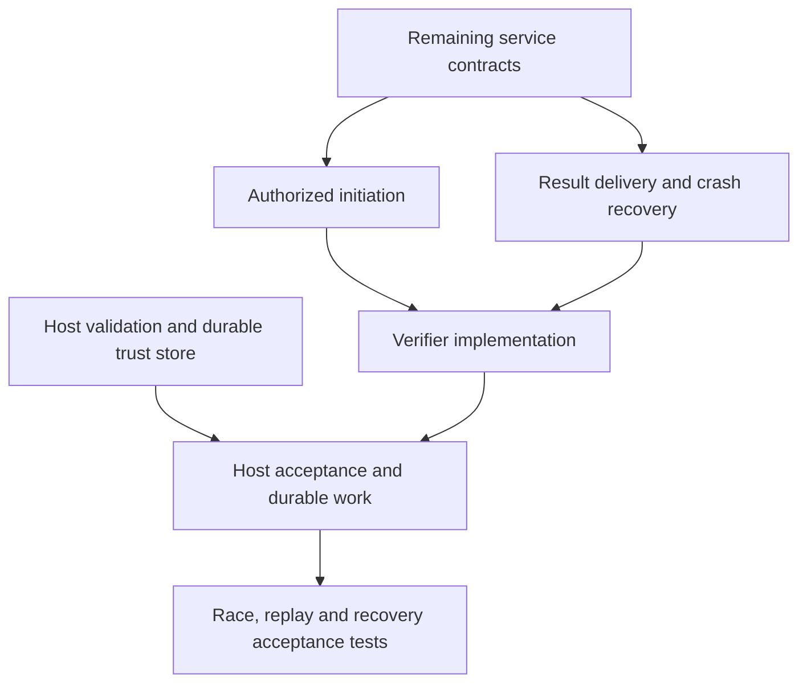

# Implementation decisions

[Design overview](../verification-only-plan.md)

## Default implementation scope

Build the verifier as an imported library inside the host process, using trusted
internal initiation and acceptance calls. Separate-service transport and its
authentication are deferred to [Separate deployment](separate-deployment.md).
This does not remove client authorization or AWS resource permissions.

## Next implementation decisions

- Finalize the remaining choices in [Assertion schema, signing, and trusted keys](../design/assertions.md#assertion-schema-signing-and-trusted-keys).
  The initial fields, signed JWT/JWS format, AWS KMS approach, and proposed JWKS
  route, ES256 selection, and operational timing defaults are recorded there.
- Implement the agreed [initiation contract](initiation.md), including authorized
  start and idempotency. Finalize its transport, retention and delivery details.
- Implement [confirmation and recoverable issuance](confirmation.md); finalize
  retry authorization, claim reservation and worker fencing.
- Implement [result delivery and acknowledgment](result-delivery.md) through the
  default internal call. Finalize retry/reconciliation settings and retention;
  defer separate-service transport details.
- Implement [client status authorization](client-status.md): host-owned read-only
  operation token, hash-only storage and thirty-minute default. Finalize issuance,
  replacement, revocation and client transport details.
- Move eligibility, Cognito enrollment and grants/session code to the host side;
  remove their permissions and integration requirements from the verifier.
- Add shared assertion validation and host acceptance contracts; keep signing
  keys separate from the existing proof HMAC key.
- Test replay races, wrong audience/email/nonce, expired results, stolen B without
  A, resend invalidation, and crashes before and after acceptance.
- Review applicable standards before claiming conformance. PKCE-style binding,
  signed assertions and webhook-style deduplication are design inspirations;
  no NIST compliance or EVP interoperability is claimed.

Keep proofs and signed assertions out of logs and result URLs. Deliver results
through a direct trusted return when composed, or an authenticated backend
handoff when separated. No AWS deployment, proof-key rotation or data migration
is part of this documentation change.

## Design diagram

