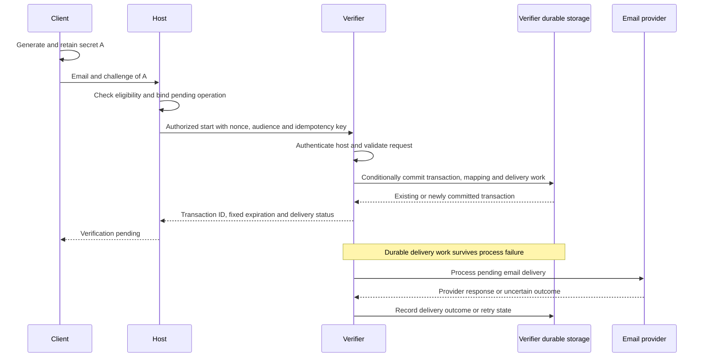
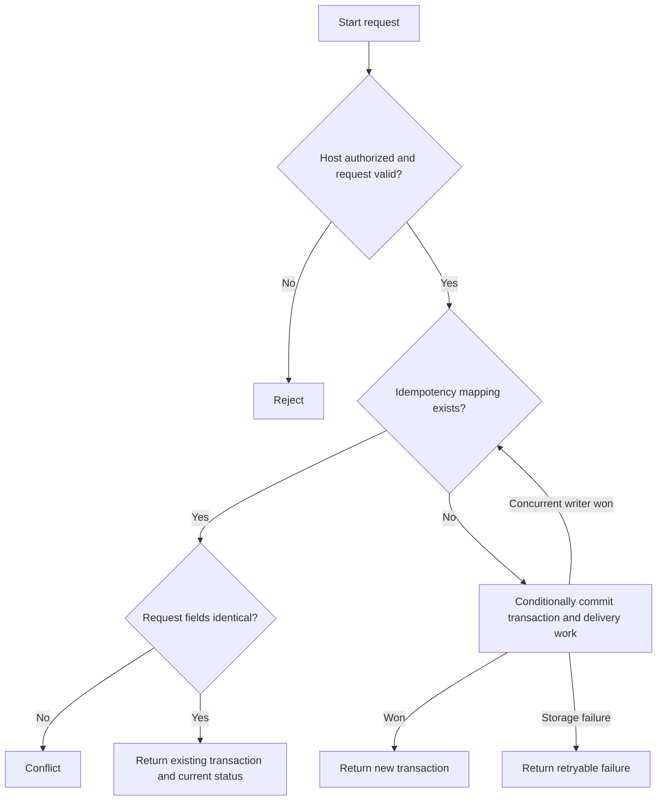

# Verification initiation contract

[Design overview](../verification-only-plan.md)

Status: agreed initiation design; not implemented. Field names below are proposed
wire names. Confirmation and recoverable result delivery remain to be finalized.

## Authorized start

Only an authorized host may call `StartVerification`. Authenticate the host and
verify its permission to use the requested audience before looking up or returning
a transaction. For composed calls, trusted host code establishes the caller context;
for separate services, require authenticated, encrypted communication. The exact
transport and authentication mechanism remain implementation decisions.

| Request field | Meaning |
| --- | --- |
| `email` | Exact address bound by the host after its input validation. |
| `client_challenge` | SHA-256 challenge of client secret A; never A itself at initiation. |
| `nonce` | Host-generated binding to its pending operation. |
| `audience` | Intended host audience, authorized for the authenticated caller. |
| `idempotency_key` | Host-supplied identifier scoped to that authenticated host. |

The host owns eligibility and pending-operation context. The client retains A
until confirmation. Verifier-generated email proofs B and C remain subject to the
existing expiry, hashing, attempt limits and resend rules.

Before requesting email delivery, durably record the transaction, its request
bindings, the idempotency mapping and pending delivery work without a gap that
could lose the job or create a second transaction after a crash. Return the
transaction ID, fixed proof expiration and current delivery status. These fields
are not proof of completed email verification.

## Initiation and delivery sequence

Email processing may finish before or after the start response. The sequence
shows responsibility and durability, not a required worker topology.
Distinguish queued work from provider-accepted sending. Neither means the recipient
received or read the message. Exact delivery-state names remain to be specified.

## Retry and concurrency rules

Scope lookup by authenticated host and idempotency key. Compare all accepted
request fields, including email, client challenge, nonce and audience.

- Same key and identical fields: return the same transaction with its current
  status and original expiration; create no additional email job.
- Same key and different fields: return a conflict without modifying the original.
- Concurrent starts: conditional persistence must select one transaction.
- Expired transaction: return its expired state; never extend or restart it.
  A new verification requires a new idempotency key and authorized initiation.
- Resend: a separate operation with cooldowns, limits and invalidation of
  superseded email proofs. A start retry is not a resend request.

Identical retries can return updated delivery or transaction status, but preserve
transaction identity and expiry. An idempotency key is not an authorization
credential; every retry must authenticate the caller.

## Crash recovery and email limitation

A crash after durable creation but before returning must recover the same
transaction on retry. A crash before creation must leave no partial transaction
that a retry mistakes for completion. Pending delivery must be recoverable.

The contract prevents duplicate verification transactions and duplicate email
jobs caused by start retries. It does not promise exactly-once email delivery:
a crash or timeout after the email provider accepted a send can leave an uncertain
outcome, and retrying can deliver another email. Do not create a new transaction
or extend proof expiry to handle that uncertainty.

## Remaining decisions

- Exact request encodings, size limits, error codes and authentication transports.
- Idempotency retention and cleanup rules, including how to prevent old retries
  from creating new transactions after a mapping is removed.
- Durable email-job payload protection and retry behavior: proof hashes alone
  cannot reconstruct the original email secrets for a later send.
- Exact delivery-state model and handling of provider uncertainty.
- Confirmation contract and recovery around proof consumption and signing.
- Result delivery and authorized result retrieval, preserving the original
  assertion identity, bindings, verification time and expiration.

## Acceptance checks

Verify identical retries after response loss; conflicting field reuse; concurrent
starts; cross-host isolation; unauthorized audience selection; expired retries;
storage failure before and after commit; recovery of pending email work; and
provider acceptance followed by a lost response. No secrets or assertions belong
in logs or result URLs.
