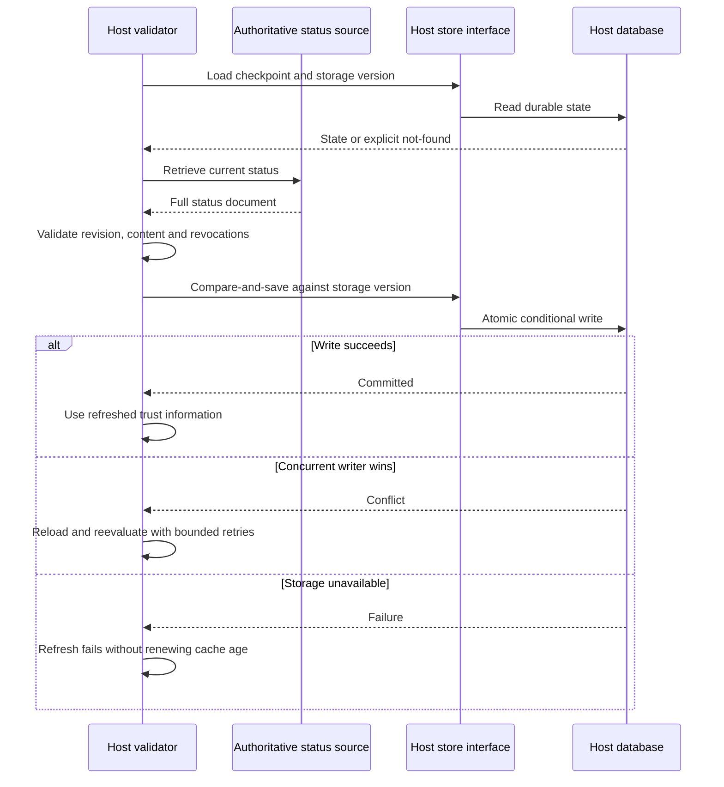

# Key lifecycle, revocation and retention

[Design overview](../../verification-only-plan.md)

### Rotation lifecycle

KMS automatic rotation does not cover asymmetric signing keys. Our deployment or
rotation workflow will orchestrate replacement keys:

1. Create a new asymmetric KMS key with a new key identifier.
2. Publish its public JWK alongside the existing public key.
3. Publish seven days before cutover and confirm publication readiness; consumers
   own refresh and no consumer acknowledgment is required.
4. Stop signing with the old key, retaining its public key until all assertions
   signed with it expire, including allowed clock tolerance.
5. Retire the old key under a defined retention policy.

Account for consumer/CDN cache lifetimes when scheduling the overlap. Each
assertion's `kid` must identify the actual signing key, not a mutable alias.
Compromise response is separate from routine rotation: consumers must be able to
reject a revoked key even before its assertions expire. Disabling a KMS key alone
does not revoke signatures validated with a downloaded public key.

### Emergency revocation distribution and recovery

Decision: maintain one authoritative key-status document in S3, separate from
the immutable public-key archive. It lists allowed keys and permanent revoked
key IDs scoped to the issuer, including revocation time, reason and a monotonically
increasing status revision. Keep version history for audit. Never reuse a revoked
key ID. Historical signed archive records cannot override current status.

Direct AWS consumers read the status document through the AWS SDK from a
deployment-configured trusted location; HTTPS consumers read the same status via
a companion endpoint alongside JWKS. A standard JWKS alone does not convey
revocation history. Both adapters apply the selected 300-second refresh age,
30-second refresh cooldown and 900-second maximum age. A known revocation
overrides cached authorization immediately; unknown status is not authorization.
Validate status and key-set consistency before acceptance, rejecting ambiguous
or inconsistent views. Source authentication, freshness and rollback protection
must not depend solely on the possibly compromised assertion signing key.
Use the schema and retrieval contract below; finalize durable revision enforcement
during implementation and preserve previously learned revocations.

A separate administrative role controls trust-status publication and emergency
replacement. The verifier runtime cannot modify the allowed/revoked list.
Authenticate recovery through independently trusted AWS administrative access.
A compromised key's signature cannot by itself approve its replacement, even
though ordinary archived key records are signed with the current assertion key.

Emergency procedure:
1. Stop use of the affected signing key, contain compromised credentials and
   permissions, and raise the operational alert.
2. Publish permanent revocation through the authoritative status source and both
   supported retrieval routes. Do not wait for outstanding assertions to expire.
3. Establish and administratively authorize a clean replacement key after
   containing the compromise; verify publication and resume signing. Emergency
   replacement bypasses the routine seven-day publication lead time.
4. Preserve audit history and assess affected assertions, key records and host
   actions. If no trustworthy replacement is ready, signing remains unavailable.

Consumers reject every newly presented assertion from a known revoked key,
including unexpired assertions claiming an issuance time before revocation.
An attacker with signing access can forge issuance timestamps. Distribution is
not instantaneous: the cache policy permits stale trust information until its
maximum age during outages. Failed refresh never renews that age, and a revoked
key never receives a stale-cache allowance.

#### Host-owned review of previously accepted proofs

At atomic acceptance, the host durably records issuer, signing key ID, assertion
ID, transaction/operation linkage, host acceptance time, and the rights or other
effects derived from that proof. Index or otherwise support lookup by issuer and
key ID. Do not rely solely on a token's claimed issuance time to bound exposure.

When the host learns of revocation, it rejects new assertions from that key and
starts a durable, idempotent, retryable review of affected accepted proofs and
their derived grants. The host determines which rights or sessions to suspend or
revoke, and which actions require investigation or compensating work. Revocation
does not automatically reverse irreversible actions or revoke unrelated rights
supported by independent evidence. Preserve progress, audit outcomes and alert
on remediation failures. Account for acceptance/revocation races so affected
records are eventually included.

This review belongs to the host, which owns the accounts, permissions and
acceptance records. No new remediation Lambda is required in the verifier; the
host may use its existing background-work mechanism. Previously accepted work
is subject to this incident policy, rather than blindly continuing a grant after
the host knows its supporting key was revoked.

### Retired KMS-key retention

Decision: retain a retired signing key in KMS for three calendar months after
the end of its authorized signing period (or earlier emergency retirement).
This is a deployment-controlled retention setting, distinct from the one-year
signing period, assertion acceptance overlap and indefinite public-key archive.
Use UTC calendar-month arithmetic, clamping to the last day of the destination
month when needed.

Stop new signing at retirement. For routine rotation, preserve public-key
retrieval through the required assertion overlap, with signing permission removed;
then disable the KMS key. Confirm the public key and signed historical record
have been archived before disabling/deleting the resource. On compromise, disable
affected signing immediately; the ordinary overlap does not justify continued
acceptance of revoked keys.

After the three-month retention period, schedule KMS deletion. AWS requires an
additional 7–30-day deletion waiting period (default 30 days), so this policy
means three months before scheduling, not guaranteed physical deletion exactly
at three months. Configure that waiting period within AWS's allowed range and
record the actual scheduled deletion time. Retention never permits automatic
reactivation of a retired or revoked signing key.

Retain the immutable S3 public-key record, signature and lifecycle/revocation
metadata indefinitely after KMS deletion. No private key is exported to S3.
Historical storage never restores active trust.

Reference: [AWS KMS key deletion](https://docs.aws.amazon.com/kms/latest/developerguide/deleting-keys.html).

### Key-status document and lifecycle states

Decision: publish one authoritative JSON key-status document, with the same
content available through direct AWS access and HTTPS. This is planned behavior,
not an implemented endpoint. Current status remains separate from immutable
historical public-key records.

| Field | Purpose |
| --- | --- |
| `schema_version` | Document format version. |
| `issuer` | Verifier whose keys are described. |
| `revision` | Monotonically increasing revision on every status change. |
| `updated_at` | Time of the last status change, not the last retrieval. |
| `keys` | Key IDs, lifecycle states, authorized signing windows, and exact archived-record references. |
| `revocations` | Permanent revoked key IDs with revocation times and reasons. |

| State | Host behavior |
| --- | --- |
| `published` | Cache the upcoming key; do not accept assertions from it yet. |
| `active` | Accept otherwise-valid assertions within the authorized signing window. |
| `retiring` | Accept outstanding assertions issued before signing stopped, only within the remaining acceptance window. |
| `retired` | Reject new acceptance; retain historical records. |
| `revoked` | Reject immediately upon learning revocation, regardless of assertion timestamps. |

Every acceptance still requires signature, issuer, audience, timing and operation
binding checks. Retiring does not authorize new signing. Revocation is permanent
and overrides any conflicting lifecycle state; never reuse a revoked key ID.

Selected default locations are `trust/key-status.json` in a configured S3 bucket
and `/verification/key-status.json` alongside the HTTPS JWKS endpoint. Locations
are configured trusted sources, not selected by an incoming assertion. Only the
separate administrative/publishing role can update status; the verifier runtime
cannot do so. The retrieval and freshness contract is defined below.

Rollback protection must preserve the highest revision seen and learned
revocations across Lambda restarts. Reject lower revisions, conflicting content
at the same revision, and attempts to restore a revoked key. Durable storage,
and concurrent updates follow the host durable trust contract below. The exact
content-digest representation remains to be specified; an in-memory cache alone is insufficient.

An unchanged document can remain authoritative. A successful check against the
authoritative source refreshes cache age; `updated_at` remains the last change
time. An old intermediary response must not reset freshness. Both routes follow the
retrieval contract below and the existing refresh, cooldown and maximum-age limits.

### Per-key entries and permanent revocations

Decision: each entry in `keys` has the following required fields. Key identity is
scoped to the document's issuer; never reuse a `kid`.

| Field | Purpose |
| --- | --- |
| `kid` | Unique key identifier within the issuer. |
| `state` | `published`, `active`, `retiring`, `retired`, or `revoked`. |
| `alg` | `ES256` for the first version. |
| `signing_not_before` | Earliest permitted assertion issuance time. |
| `signing_not_after` | Exclusive deadline for signing new assertions. |
| `accept_until` | Exclusive key-level deadline for accepting outstanding assertions. |
| `archive_ref` | Object containing `bucket`, `key`, and `version_id` identifying the exact signed public-key record in S3. |

Each permanent `revocations` entry contains:

| Field | Purpose |
| --- | --- |
| `kid` | Revoked key identifier, scoped to the document's issuer. |
| `revoked_at` | Administrative revocation time for audit. |
| `reason_code` | Bounded reason value: `compromise` or `administrative` in the initial schema. |
| `revision` | Document revision that first introduced this revocation. |

Use UTC RFC 3339 timestamps for these time fields. Convert them to instants when
comparing with JWT timestamps. Require unique key IDs within each collection,
recognized states and algorithms, complete version-specific archive references,
and valid ordering: `signing_not_before < signing_not_after <= accept_until`.
Revocation-entry revisions cannot exceed the enclosing document revision.
The same key may occur in both collections; its revocation always takes precedence.

Signing and acceptance deadlines serve different purposes. Signing may stop at
noon while previously issued assertions remain acceptable within their individual
deadlines, bounded by `accept_until`. A key deadline never extends the assertion's
own expiration, maximum verification age or host-operation deadline. Apply the
configured clock tolerance once to each relevant time comparison, never repeatedly
through nested checks. Clock tolerance does not authorize continued signing after
retirement or give a known revocation a grace period.

A revoked key is rejected even if another field says active or its acceptance
window remains open. `revoked_at` is audit information, not a cutoff allowing
tokens with earlier claimed issuance times. Malformed or inconsistent status
must not authorize acceptance; preserve learned revocations independently of
whether the rest of an update is usable.

The archive provides public-key material and immutable KMS identity; the status
entry determines current authorization. Require matching issuer, key ID and
algorithm between the status entry and referenced record. Archive references are
locators within configured trusted storage, not permission to follow arbitrary
token-supplied resources.

### Retrieval and freshness contract

Decision: keep caching in the host validator. Every refresh must reach the current
authoritative S3 key-status object. Both routes return the complete document in
the first version; conditional requests and 304 handling are deferred.

| Route | Required behavior |
| --- | --- |
| Direct AWS | Read current `trust/key-status.json` from the configured source bucket using the AWS SDK. Do not pin this updateable status object to an old S3 version. |
| HTTPS | Serve `/verification/key-status.json` by reading that same source object for every refresh request. Disable CDN/API response caching and endpoint-local status caching. Return `Cache-Control: no-store`; do not serve stale origin responses on failure. |
| Host validator | Cache validated trust information under the existing 300-second refresh, 30-second cooldown and 900-second maximum-age policy. |

The configured source and issuer establish trust; do not use token-provided
locations or silently fall back to an older replica. Authenticate AWS access and
validate HTTPS server identity. These checks rely on the trusted publishing
infrastructure, not a cryptographic proof that the source has never been compromised.

A refresh succeeds only after the host:
1. Obtains a complete response through its configured authoritative route.
2. Validates schema, issuer and key/status consistency.
3. Compares the revision and content with durable host trust state.
4. Rejects lower revisions, conflicting content at the same revision, or attempts
   to restore known revoked keys.
5. Durably saves the accepted revision and learned revocations before using the
   updated trust information.

Concurrent refreshes must not roll durable state backward. A validation or
persistence failure is not a successful refresh and must not reset cache age.
Known revocations never receive an outage allowance.

An unchanged revision with identical content is a valid refresh when the
authoritative source was just checked. `updated_at` remains the last status-change
time; it is not the cache freshness timestamp. Cache hits and old intermediary
responses cannot renew freshness. Keep network operations bounded and account
for retrieval elapsed time conservatively.

On refresh failure, already-known trusted keys may remain usable only within the
existing maximum age and all assertion checks. Unknown or known-revoked keys
remain rejected. At the maximum age, block new acceptance with a distinct retryable
availability error and emit the configured operational alert. No cache means
immediate blocking when retrieval fails.

A new host has no prior revision for comparison. Initial trust comes from its
configured AWS/HTTPS source; durable revision and revocation tracking protects
subsequent refreshes across restarts. Resetting that durable state loses this
history and must not be a routine error-recovery mechanism. Durable storage and concurrency follow the contract below; exact content-digest
representation remains to be specified.

References: [S3 consistency](https://aws.amazon.com/s3/consistency/)
and [HTTP caching](https://www.rfc-editor.org/rfc/rfc9111.html).

### Decisions still open for this item

- Initial trust provisioning and detailed publication/recovery contracts; the signed-record format and S3 legal-hold protection are decided.
- Exact content-digest representation and bounded retry settings. Host-owned durable storage and atomic concurrency behavior are decided below.

References: [JWT (RFC 7519)](https://www.rfc-editor.org/rfc/rfc7519.html),
[JWT validation guidance (RFC 8725)](https://www.rfc-editor.org/rfc/rfc8725.html),
[KMS public keys](https://docs.aws.amazon.com/kms/latest/APIReference/API_GetPublicKey.html),
and [KMS rotation](https://docs.aws.amazon.com/kms/latest/developerguide/rotate-keys.html).

## Host durable trust history

Decision: production validators require host-owned durable trust storage. Provide a `TrustState` model, a `TrustStateStore` interface with load and atomic compare-and-save operations, and a default DynamoDB adapter. Other databases may implement the same contract. The host supplies configuration and permissions; the verifier service cannot access this store.

Scope each checkpoint by issuer and configured trust-source identity. Store the highest accepted status revision, its content digest, permanently revoked key IDs, and a storage concurrency version. Public keys and complete signed archive records need not be duplicated here. The in-memory cache holds retrieved keys and status; the checkpoint alone cannot validate assertions.

Require durable reads and atomic conditional writes. First initialization must also be conditional on absence. A higher revision must preserve known revocations; an equal revision must have matching content; lower or conflicting revisions fail and alert. On a write conflict, reload and reevaluate, with bounded retries. Never overwrite newer state or interpret an unavailable database as an empty store.

After restart, load durable history before accepting refreshed status. Persistence failure makes the refresh unsuccessful and does not reset cache age. An already-running instance may use its previously validated cache only within the existing maximum age and all validation rules; a cold instance without a usable cache blocks acceptance. Known revocations always override cached authorization.

This is rollback protection during refresh, not fleet-wide instantaneous revocation notification. Existing refresh and outage limits still bound when another running instance learns a change. The precise digest representation and retry bound remain implementation details to specify consistently across adapters.
