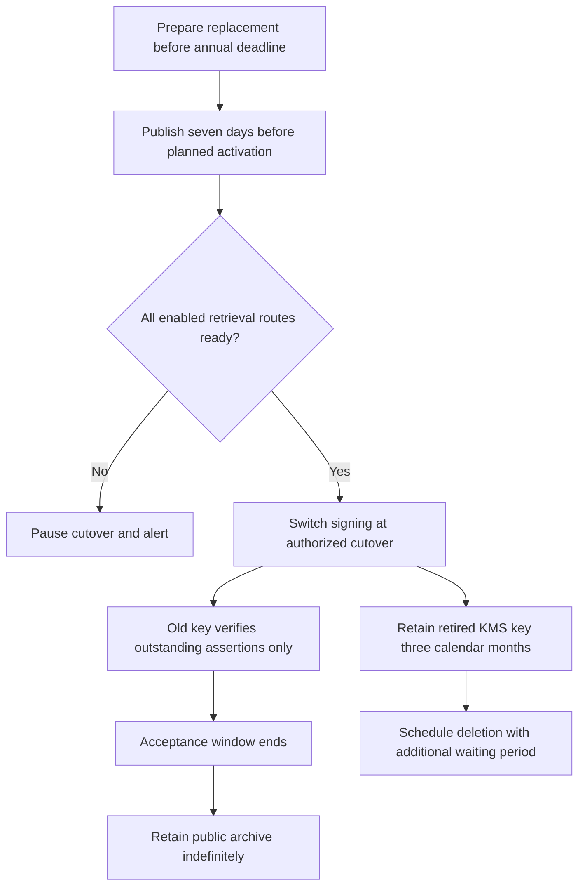

# Rotation and publication

[Design overview](../../verification-only-plan.md)

### Rotation cadence

Decision: configure `signing_key_rotation_interval_days` with a default of 365 days
(one year), measured from activation for signing. Prepare and publish replacement
keys before that deadline so signing can switch on time. This is our operational
policy, not an automatic expiration property of the key or KMS automatic rotation.
Suspected compromise triggers emergency replacement and revocation without waiting
for the scheduled interval. Short assertion lifetimes do not prevent a compromised
signing key from creating fresh assertions. Public-key acceptance overlap and
retired KMS-key deletion are separate policies.

### Publication readiness and consumer responsibility

Decision: publish the replacement public key seven days before its planned
activation; make this lead time deployment-configurable. Continue signing with
the current authorized key until cutover. Confirm publication and retrieval
through each enabled supported route. These checks cover our publication, not
propagation into consumer caches. No consumer acknowledgment is required.

Consumers own cache refresh and assertion validation. An unfamiliar `kid`
triggers a bounded refresh from the preconfigured trusted source, subject to the
cooldown and outage policy. Never accept an unresolved or unauthorized key.
The imported validator module implements these responsibilities on the host's
behalf. Waiting a week does not establish that every consumer has refreshed.
Publication failure pauses cutover and raises an alert; it does not silently
extend the old key's authorized signing period.

## Design diagram

