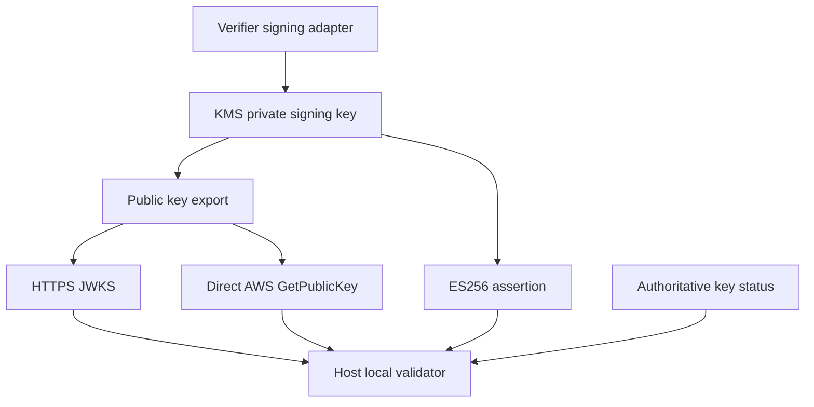

# Signing and key distribution

[Design overview](../../verification-only-plan.md)

### Selected signing algorithm: ES256

Decision: use ES256 (ECDSA with NIST P-256 and SHA-256) for the first version.

| Setting | Value |
| --- | --- |
| JWT protected header `alg` | `ES256` |
| AWS KMS key specification | `ECC_NIST_P256` |
| AWS KMS key usage | `SIGN_VERIFY` |
| AWS KMS signing algorithm | `ECDSA_SHA_256` |
| Public JWK | `kty: EC`, `crv: P-256`, `alg: ES256`, `use: sig`, unique `kid`, public `x` and `y` |

The rationale is compact signatures and compatibility with our KMS/JWT design.
NIST FIPS 186-5 specifies ECDSA, and SP 800-57 Part 1 Rev. 5 places
256-bit elliptic-curve keys at approximately 128-bit classical security strength,
comparable to 3072-bit RSA. This is our engineering selection, not a NIST mandate
for email verification or a claim of whole-system NIST/FIPS compliance.

The signing adapter must sign the exact JWS signing input. If it sends a SHA-256
digest to KMS, use `MessageType: DIGEST` to avoid hashing twice. Convert the KMS
DER-encoded ECDSA signature to the JWS fixed-width 64-byte `R || S` representation
(two unsigned 32-byte integers) before base64url encoding. Test interoperability
with an independent JWT verifier and rejection of malformed signatures and
unexpected algorithms. Deduplicate by the bound request and assertion ID, not by
signature bytes.

### Future TODO: quantum-resistant signatures

- [ ] Evaluate a migration to NIST-standardized post-quantum digital signatures.
  ES256/P-256 is not quantum-resistant; short assertion lifetimes do not make the
  signing algorithm quantum-resistant.
- [ ] Review applicable NIST transition guidance, AWS KMS support, JOSE/JWT
  interoperability, library support, and signature-size/latency costs when planning
  that migration. No post-quantum algorithm or migration date is selected yet.
- [ ] Design a controlled rollout with new key IDs, explicit algorithm/key bindings,
  compatible consumers deployed before signer cutover, and a bounded transition
  policy. Never broaden accepted algorithms based solely on an incoming token.
- [ ] Test downgrade rejection and retirement of the old algorithm. Ordinary
  rotation to another P-256 key does not provide quantum resistance.

References: [NIST FIPS 186-5](https://csrc.nist.gov/pubs/fips/186-5/final),
[NIST SP 800-57 Part 1 Rev. 5](https://nvlpubs.nist.gov/nistpubs/SpecialPublications/NIST.SP.800-57pt1r5.pdf),
[JWA ES256 (RFC 7518)](https://www.rfc-editor.org/rfc/rfc7518.html),
and [AWS KMS Sign](https://docs.aws.amazon.com/kms/latest/APIReference/API_Sign.html).

### AWS signing and public-key distribution

Use an asymmetric AWS KMS signing key. The verifier calls KMS to sign, and the
application does not receive the private key. Restrict signing permissions to the
verifier role and keep signing keys separate from proof HMAC keys.

#### Public-key retrieval: direct AWS access or HTTPS JWKS

Both routes supply the same trusted public signing keys for local assertion
validation. Direct KMS access is the preferred route for the composed host inside
the AWS environment; the HTTPS endpoint is optional for other consumers.

| Route | Intended consumer | Access and trust configuration |
| --- | --- | --- |
| Direct AWS KMS `GetPublicKey` | Host running inside the AWS environment | Deployment-configured trusted key ARNs and a runtime IAM role authorized by the applicable IAM/key policies to call `kms:GetPublicKey` on those keys. |
| HTTPS JWKS | Consumers using a published key set | Preconfigured trusted issuer and HTTPS JWKS URL; no AWS credentials required to read the public endpoint. |

For direct AWS access, deployment supplies a trusted mapping from assertion
`kid` values to immutable KMS key ARNs, covering the current key and previous
keys still accepted during rotation. The host retrieves and caches their public
keys through the AWS SDK, then verifies ES256 locally. Importing the Go module
does not grant AWS permissions or automatically discover trusted keys. Retrieving
a public key requires no signing permission. Never use an untrusted token's
`kid` as an arbitrary KMS key ARN to fetch and trust.

KMS returns a DER-encoded SPKI public key, which can be parsed directly for local
verification; converting it to JWK is needed only when publishing the JWKS.
Direct access avoids calling the host's public JWKS URL, but still makes an
authenticated AWS API request on cache misses or refresh.

Both routes must receive rotation updates before signer cutover and retain
previous public keys for the acceptance overlap. Cache refresh and revocation
rules must apply to both routes; a cached key must not remain trusted indefinitely
after removal or revocation. Use the configurable cache policy below. A mutable signing alias alone is insufficient to identify previous
verification keys.

#### Optional HTTPS publication

Proposed stable public-key URL on the host API domain:

```text
https://api.example.com/email-verification/jwks.json
```

This is a deployment-selected route, not a required standards path. Export public
keys through KMS GetPublicKey and convert its SPKI representation to public JWKs.
The JWKS contains public key material and identifiers only. The host can also use
the same trusted set through deployment-managed configuration when composed.

Consumers must configure the trusted issuer and key source independently.
An incoming assertion may select a known key with `kid`; it must not introduce
a trusted key or arbitrary key-fetch URL. Protect publication permissions and use
HTTPS for the endpoint. Apply the cache policy below.


## Design diagram


