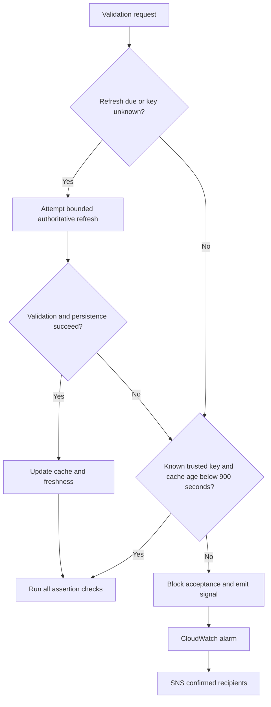

# Cache policy and operational alerts

[Design overview](../../verification-only-plan.md)

### Cache refresh and outage policy

Decision: apply the same deployment-configurable trust-information policy to
direct AWS and HTTPS JWKS consumers.

| Configuration | Default | Meaning |
| --- | --- | --- |
| `trusted_keys_refresh_after_seconds` | 300 | Refresh on the next validation request once information is five minutes old. |
| `trusted_keys_max_age_seconds` | 900 | Hard maximum age since the last successful authoritative refresh, including outages; not an additional grace period. |
| `trusted_keys_refresh_cooldown_seconds` | 30 | Minimum interval between request-triggered refresh attempts per cache instance, including unknown-key attempts. |

Coalesce concurrent lookups and bound retries with backoff; concurrent Lambda
environments have separate caches, so this is not a fleet-wide rate limit.
Require positive settings with refresh age below maximum age. Cache hits do not
reset freshness. Failed refreshes do not reset freshness or restore removed keys.
Use elapsed time for cache age; JWT clock tolerance does not extend cache limits.

Before the hard maximum age, a failed refresh may leave already-known trusted
keys usable, subject to every assertion check. At or beyond the maximum age,
block new acceptance until an authoritative refresh succeeds. No cached trust
information means immediate blocking if retrieval fails. Unknown or explicitly
revoked keys are never accepted through the stale-cache allowance.

Refreshing KMS public-key bytes alone is not an authoritative refresh of the
application's allowed-key set. The direct AWS adapter needs a trusted, refreshable
source for allowed kid-to-immutable-ARN mappings and retirement/revocation state.
Use the [authoritative S3 key-status retrieval contract](../keys/lifecycle-and-revocation.md#retrieval-and-freshness-contract)
and the emergency procedure in that document. The
HTTPS route must likewise refresh the authoritative published trust set, accounting
for upstream caches rather than treating an old response as new trust information.

Email sending and proof validation may remain available independently, but the
host must return a distinct retryable availability error when trust refresh
prevents acceptance, not an invalid-code error. Already accepted durable work
continues. After recovery, retry only original assertions still meeting all signed
expiration, verification-age, and host deadlines; otherwise require new verification.
The outage policy can delay learning of revocation up to the configured maximum
trust-information age; it does not extend assertion validity.

### Infrastructure plan: monitoring and alert delivery

Decision: use AWS CloudWatch Logs, metrics, dashboards and alarms, with SNS email
notifications initially. Package these resources in the infrastructure module;
this is planned work, not a deployed monitoring system.

- The host validator emits structured refresh-failure, acceptance-blocked and
  refresh-recovery signals for either retrieval route, including when imported
  into a composed Lambda. Verifier-only telemetry is insufficient.
- Include service, environment, key-source route, cache age and a bounded failure
  reason. Exclude email addresses, JWTs, proof secrets and verification codes.
  Use bounded metric dimensions; do not dimension metrics by transaction IDs.
- Show refresh failures, trust-information age and blocked acceptance on a
  CloudWatch dashboard. Alert when unavailable or over-age trust information
  blocks acceptance; group repeated failures instead of emailing per request.
- Recovery requires successful authoritative refresh evidence. Missing traffic
  or missing metrics must not alone clear an incident. Define aggregation and
  health-check behavior before implementation, including multiple host instances.
- Configure `alert_email_recipients` separately for each environment at deployment.
  Development and production use separate SNS topics and recipient lists.
  An address may be explicitly included in both.
- Recipients must confirm their SNS email subscriptions. Deployment status must
  expose pending confirmations per environment and must not claim delivery is
  ready merely because a subscription was requested. Provide a delivery-check
  procedure before relying on the alerts.

#### Future TODO: dedicated operational signal and incident system

- [ ] Build a separate system to receive and manage operational signals across
  modules and environments, including incident grouping, routing, acknowledgment,
  escalation and recovery tracking.
- [ ] Define a reusable event contract and integration boundary so this module
  can connect to that future system without changing assertion validation rules.
- [ ] Keep CloudWatch/SNS as the initial solution; the future system is not a
  prerequisite for shipping observable verification and is not implemented here.

Monitoring references:
[CloudWatch embedded metrics](https://docs.aws.amazon.com/AmazonCloudWatch/latest/monitoring/CloudWatch_Embedded_Metric_Format.html),
[CloudWatch alarms](https://docs.aws.amazon.com/AmazonCloudWatch/latest/monitoring/CloudWatch_Alarms.html),
[alarm notifications](https://docs.aws.amazon.com/AmazonCloudWatch/latest/monitoring/Notify_Users_Alarm_Changes.html).

## Design diagram

