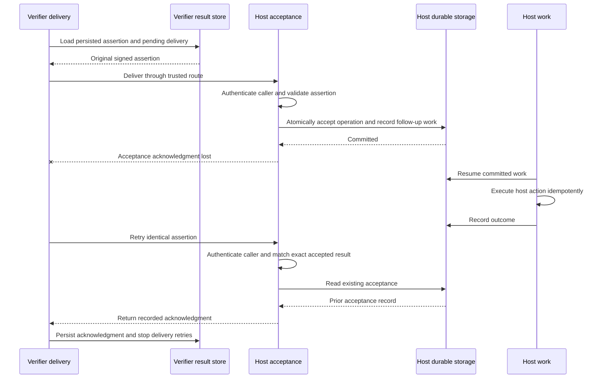
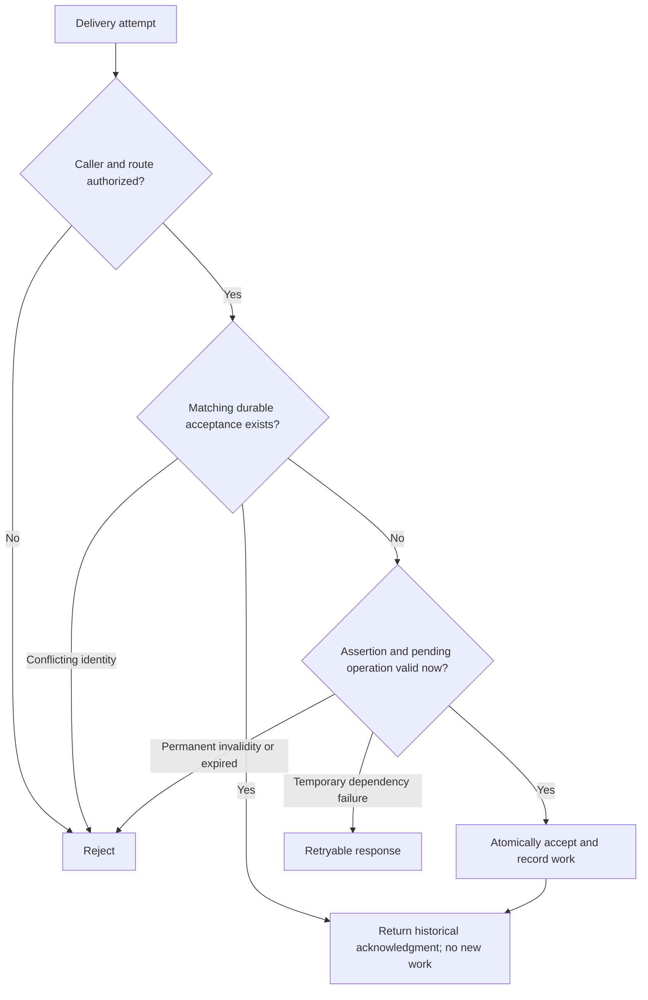

# Result delivery and host acknowledgment

[Design overview](../verification-only-plan.md) · [Confirmation](confirmation.md)

Status: agreed delivery semantics; not implemented. Exact transports, wire fields,
authentication mechanisms and retry settings remain implementation decisions.

## Durable result and delivery routes

Persist the selected signed assertion and recoverable pending delivery work before
any delivery attempt. Every retry uses the same assertion bytes, assertion ID,
bindings, verification time and original expiration. A crash must not lose an
undelivered result or cause a new assertion to be issued for the same delivery.

| Deployment | Delivery |
| --- | --- |
| Composed host and verifier | Invoke the host acceptance handler directly through trusted code. |
| Separate services or Lambdas | Use an authenticated, encrypted backend call to the destination configured for that host. |

Both routes use the same host acceptance rules. Never accept a client-supplied
callback URL as the delivery destination. Authenticate and authorize the sender
for the intended host and issuer; authenticate the recipient and acknowledgment.
Transport authentication does not replace assertion validation.

## Acceptance and acknowledgment

For a first acceptance, the host checks the signature, current key trust,
schema, issuer, audience, email, transaction, nonce, original operation context
and all applicable deadlines. Atomically consume the matching pending operation
and persist acceptance plus durable follow-up work. Acknowledge only after that
commit succeeds. Receipt of a message alone is not acceptance.

The acknowledgment identifies the accepted assertion and transaction in the
correct issuer/host scope. Exact response fields remain to be specified.
It confirms durable acceptance, not successful completion of account creation,
session issuance or any other host action. Follow-up work executes idempotently
and records its outcome separately.

## Normal delivery and lost acknowledgment

Work may execute before or after the acknowledgment; the ordering requirement
is that acceptance and durable work are committed before either acknowledgment
or external effects. This is not a distributed exactly-once execution guarantee.

## Duplicate delivery and expiration

An authenticated duplicate must match the durable record of the original
accepted assertion and its operation bindings, not merely present a reused
assertion ID. Retain sufficient immutable evidence or a digest of the exact
accepted assertion to detect conflicting content. Reject conflicting reuse.

A matching duplicate returns recorded acceptance without accepting again or
creating new work. This remains valid when the assertion has since expired:
it reports an earlier committed event and does not bypass deadlines for a first
acceptance. Historical acknowledgment also does not restore rights withdrawn
after revocation; host remediation and current operation outcome remain separate.

Concurrent first deliveries must have one acceptance winner. On a conflict,
reread the durable record and apply duplicate/conflict rules. Storage failure
must never be reported as successful acceptance.

## Failure handling and reconciliation

Temporary transport, trust-source or storage failures use bounded retries with
backoff. Retry scheduling survives process restarts. Invalid assertions and
mismatched bindings are permanent rejections for that result; unavailable trust
information is a retryable availability failure, not an invalid assertion.

If no acceptance occurred within the effective acceptance window, require fresh
verification. A timeout or lost acknowledgment does not prove that acceptance
failed. Once first acceptance is no longer possible, an authenticated retry or
status reconciliation may still obtain historical acknowledgment; it must never
create a new acceptance from expired evidence. While the host is unreachable,
retain an unresolved delivery outcome rather than claim either success or
definitive non-acceptance.

Never extend expiration or re-sign with fresh timestamps to resolve delivery
uncertainty. The host enforces its private operation deadline even when the
verifier does not know that deadline. Persist acknowledgment before retiring
pending delivery work.

## Client completion

The client obtains progress and completion from the host under authorization
bound to its original operation/session. A transaction identifier alone is
insufficient. Use the agreed [client status authorization](client-status.md)
contract: an authorized host session or a read-only operation-scoped token.
Keep these milestones distinct:

| Milestone | Meaning |
| --- | --- |
| Email verified | Required proofs were confirmed. |
| Host accepted | Evidence was durably accepted for the bound operation. |
| Operation complete | The host action finished and its outcome was recorded. |

The host reports action failure or pending work accurately even after accepting
verification. Do not expose assertions in result URLs or logs. Polling versus
push updates and exact client response fields remain open.

## Acceptance scenarios

Test crash before delivery, host crash before/after acceptance commit, lost
acknowledgment, concurrent deliveries, identical retries after expiration,
conflicting assertion-ID reuse, unavailable dependencies, permanent rejection,
revocation after prior acceptance, and host-action failure after acknowledgment.
Verify retries neither renew evidence nor duplicate durable host work.

## Remaining decisions

Specify service authentication, exact delivery/acknowledgment fields and errors,
retry/backoff limits, reconciliation routes, remaining client status credential
and transport details from [Client status authorization](client-status.md), and retention of results, acceptance records and deduplication evidence.
These details must preserve the agreed semantics above.
