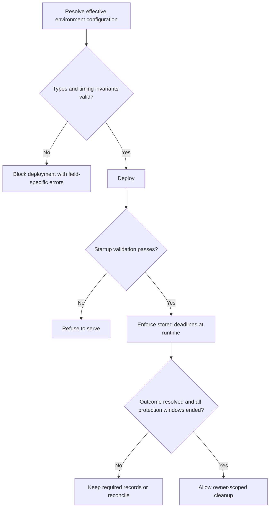

# Retry, retention and timing validation

[Design overview](../verification-only-plan.md) · [Storage ownership](storage-ownership.md)

Status: agreed requirements; validation code and deployment integration are not yet
implemented. Exact start-validity duration and recovery protocol remain open.

## Selected defaults

- Five total automatic attempts, including the first, per logical signing or
  result-delivery work item. Persist the count across restarts and worker changes.
  Retries use backoff for temporary failures; permanent rejection is not retried.
  User proof-entry attempts and resends have separate budgets.
- Forty-eight hours after a resolved terminal outcome for eligible verifier
  operational and minimal duplicate-prevention records, subject to the safety
  conditions below. This does not apply to host evidence, permanent revocations
  or the indefinite public-key archive.
- Neither retry nor retention extends proof validity, assertion expiration,
  maximum verification age, signing authorization or host-operation deadlines.
- Exhausting attempts does not prove non-acceptance. Uncertain delivery enters
  reconciliation/review and is excluded from automatic resolved-record cleanup.

Exact backoff, reconciliation budgets and review policy remain to be specified.
The earlier twenty-attempt, seven-day and twenty-four-hour proposals are not
selected defaults.

## Missing records must not authorize new work

Separate temporary workflow data from minimal request/completion records that
retain request identity, bindings and terminal outcome for duplicate prevention.
Completion records can represent success, definitive failure, rejection or expiry.

Only an explicitly authorized start can create a transaction. Confirmation,
retry and delivery paths must not recreate a missing workflow transaction.
A host may return an independently retained matching acceptance acknowledgment;
missing verifier state must never authorize another host action.

Each start authorization must have a fixed, host-authorized validity deadline
bound to that request. Retries cannot refresh it. Reject stale start requests
after the deadline even if their idempotency records have been removed.

Within the validity window, an absent record does not establish that this is the
first attempt. Use independently durable host operation state and a defined
creation/recovery protocol to distinguish authorized first creation from missing
previous state. If the distinction cannot be established, fail closed and raise
a recovery error. Neither a client-supplied fresh timestamp nor another arbitrary
idempotency key may silently reset the same operation.

The exact host/verifier creation handshake and start-validity duration must be
specified and tested before enabling destructive cleanup. Loss of all relevant
durable history cannot be solved by a database lookup alone. Recovery must retain
or reestablish a trusted authorization boundary; do not claim protection against
arbitrary simultaneous loss or rollback of all records.

These rules apply to the particular request, not a permanent ban on verifying
the same email through a genuinely new authorized operation.

## Safe cleanup

Forty-eight hours is the baseline after recorded resolution, not an unconditional
delete timer. Keep minimum duplicate-prevention state through every window in
which the original request or a supported retry could cause work.

Conceptually, the earliest safe deletion time is the latest of:
- resolved time plus configured operational retention;
- the original start-authorization deadline, including any permitted tolerance;
- the end of supported retry/reconciliation and deduplication obligations.

No automatic deletion eligibility exists for an unresolved outcome. Once host
acceptance and its acknowledgment are durably recorded, the full signed result
may be removed earlier if all remaining duties can be served by minimal state.
Do not retain recoverable email secrets merely because metadata remains useful.
Their cleanup follows proof/delivery need, not the forty-eight-hour metadata rule.

Runtime authorization checks enforce deadlines independently of physical deletion.
Host evidence retention and backups require their own policies. Configuration
changes must not shorten protection for existing records created under earlier
settings; preserve per-record deadlines or an equivalent versioned policy.

## Required executable configuration validator

Implement a shared typed validation function used by deployment preflight and
runtime initialization. It must validate the effective environment configuration
after defaults and overrides are resolved, before deployment mutations occur.
On failure, exit nonzero, stop deployment, and name the conflicting fields,
values and violated invariant. Do not silently clamp or replace unsafe values.

Run the same validation in CI and on service startup to catch deployments or
configuration changes that bypass the standard command. Reject invalid dynamic
configuration before activating it. Return actionable errors without secrets.

| Check | Required behavior |
| --- | --- |
| Types and units | Reject missing required settings, invalid units, nonpositive lifetimes, negative tolerance, invalid attempt counts and arithmetic overflow. |
| Retry configuration | Require at least one total attempt, coherent backoff bounds and bounded timeouts; stop runtime attempts at their actual evidence deadline. |
| Start and deduplication | Reject any configuration that permits deletion before a still-valid start/retry can be replayed; include allowed tolerance. |
| Resolution and cleanup | Exclude unresolved work; enforce the derived safe-deletion deadline rather than a blind creation-time TTL. |
| Assertion timing | Enforce the established lifetime, maximum verification age and single-application tolerance rules; the earliest applicable deadline wins. |
| Trust cache | Require positive refresh/cooldown/max-age settings and refresh age strictly below maximum age; no failed refresh renews freshness. |
| Key lifecycle | Validate publication lead time against rotation scheduling, signing/acceptance date ordering and configured acceptance overlap. |
| Retired-key cleanup | Validate the established calendar-month retention and permitted deletion-wait settings; public archives remain separate. |
| Status credential | Require a positive fixed lifetime; use never renews it or extends verification deadlines. |
| Configuration updates | Reject cleanup plans that undercut previously issued records' stored validity/deduplication obligations. |

Do not invent unnecessary inequalities: a status token may outlive a proof to
report its expiration; assertion lifetime and maximum verification age run in
parallel. Backoff is truncated by runtime deadlines, not justification to extend
them. Deployment validation cannot prove future clock accuracy or prevent
arbitrary data deletion; runtime checks and recovery handling remain mandatory.

## Deployment and cleanup gates

## Required verification

Test valid defaults, every cross-field failure, exact boundary instants, tolerance
application, overflow and mixed units. Test shortened retention after issuance,
lost records within the start window, stale starts after cleanup, concurrent starts,
crashes around creation/confirmation/acceptance, retry-count persistence, and
uncertain acknowledgment at the attempt limit. CI must demonstrate that invalid
effective configuration blocks deployment before mutations, and startup rejects it.

## Remaining decisions

Finalize start-authorization duration and binding, safe first-creation/recovery
handshake, backoff parameters, reconciliation limits, proof-secret cleanup and
backup retention. Deployment validation is a required implementation deliverable,
not functionality delivered by this documentation update.
