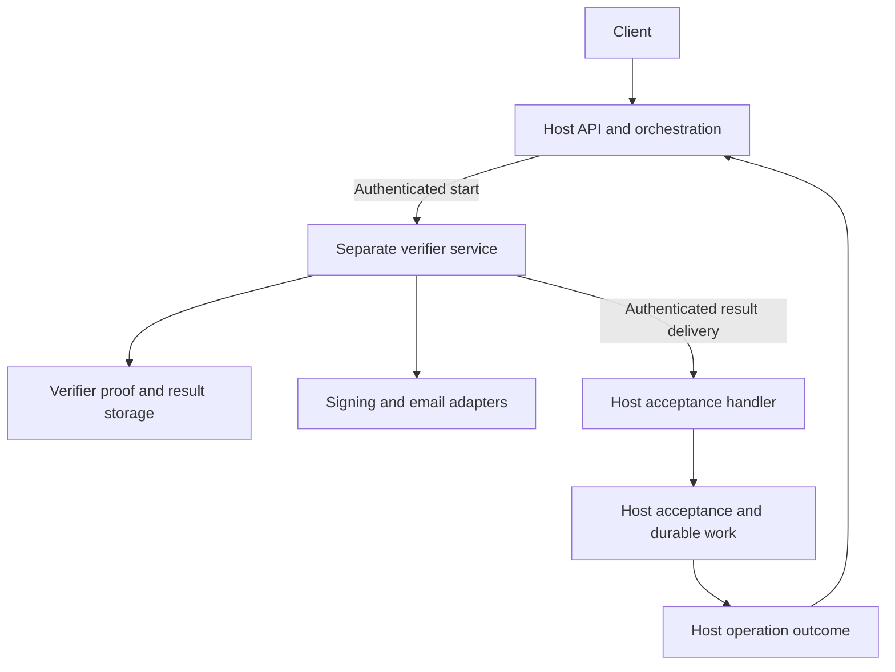

# Separate host and verifier deployment — deferred design

[Design overview](../verification-only-plan.md) · [Default architecture](architecture.md)

Status: future elaboration; not required for the default imported-library deployment.
The host imports the verifier and calls it in-process by default. This document
reserves the design space for independently running host and verifier services.

## Scope and boundary

Repository ownership alone does not create a network boundary. A verifier library
maintained in another repository can still execute inside the host process.
This variant applies when calls cross process/service boundaries, including
separate Lambdas even if their code is maintained in one project.

The previously agreed initiation, confirmation, signed-assertion validation,
durable delivery and host acceptance semantics remain constraints. The transport
and deployment details below are deferred, not an implemented integration.

## Future deployment sketch

Confirmation routing and concrete endpoints remain to be designed. Diagram
arrows represent required authenticated communication, not selected protocols.

## Topics to elaborate later

- Service identities and permission mapping for initiation, delivery and status.
- IAM roles and authenticated AWS requests as the preferred candidate when both
  services run on AWS; exact invocation mechanism and policies remain undecided.
- Cross-account or non-AWS deployments and alternative authentication.
- Configured destinations, recipient authentication and network exposure.
- Wire schemas, errors, timeouts, bounded retries and acknowledgment reconciliation.
- Independent deployment/version compatibility and operational ownership.
- Caller isolation, rate limits, monitoring and deployment-specific tests.

Do not use assertion IDs, transaction IDs or caller-supplied audience values as
credentials. Do not accept arbitrary client-provided callback destinations.
A valid signed result still requires all host validation and operation-binding
checks. No permanent shared service password is required by the current design.

## Relationship to the default

Default implementation work should not depend on finishing this variant.
Preserve clean library contracts so a future authenticated transport adapter can
reuse them without changing proof, assertion or acceptance semantics.
Client-to-host authorization remains necessary in both deployments and is
separate from service-to-service authentication.
