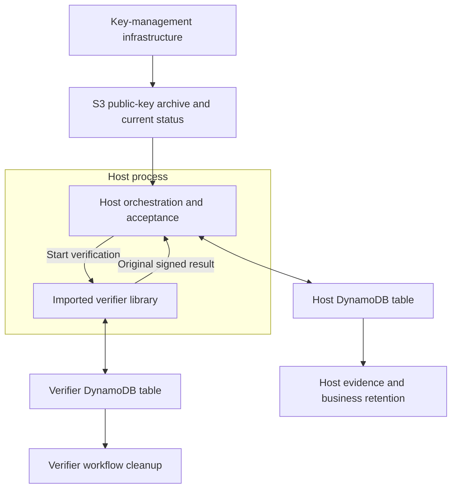

# Storage ownership and default database

[Design overview](../verification-only-plan.md) · [Architecture](architecture.md)

Status: agreed design; not implemented or deployed.

## Selected default

Use DynamoDB on-demand for both verifier operational storage and the host records
in this design, with separate verifier-owned and host-owned tables. Start with
one table per ownership boundary; finalize keys and indexes from access patterns.
Separate tables do not require separate services: the host still imports the
verifier library and runs it in-process.

The host deployment provisions tables, permissions and configuration. The verifier
module manages its own records through storage interfaces and a supplied DynamoDB
adapter. The host manages its records and cleanup independently. Table separation
is an ownership and operational boundary; code sharing one runtime IAM role is
not automatically security-isolated from other tables that role can access.

Other consumers may implement compatible storage adapters or retain an existing
host database. Importing this library does not mandate DynamoDB for every host.

## Record ownership

| Owner | Records | Purpose |
| --- | --- | --- |
| Verifier module | Verification transactions, proof hashes, attempt counters, initiation idempotency | Validate and consume proofs safely |
| Verifier module | Pending email work, issuance work, temporary signed results, retry and delivery acknowledgment state | Resume work and deliver the original result reliably |
| Host | Pending operations, status-token hashes and operation bindings | Authorize client progress and bind verification to intended work |
| Host | Accepted evidence, deduplication records, durable follow-up work and outcomes | Accept once and perform host actions safely |
| Host | Links between accepted proofs and resulting accounts, grants or permissions | Investigate and remediate revoked-key effects |
| Host validator | Highest trust revision, content digest and permanent learned revocations | Prevent trust rollback across restarts |
| Verifier key-management infrastructure | Public-key archive and authoritative key status/revocation history | Publish key material and control current trust |

Key archives remain in S3 under the existing legal-hold policy. This table decision
does not move them into DynamoDB or change key-retention decisions.

## Ownership diagram

Neither component's cleanup may delete the other's records. Separate tables allow
independent backup, restore and lifecycle configuration. Environment isolation and
exact permissions remain deployment concerns.

## Access patterns and atomicity

Design direct lookups for verifier transactions and initiation idempotency, and
host pending operations, status credentials, accepted assertions and trust state.
Provide an index or equivalent queryable mapping for accepted proofs by issuer
and signing key ID, with pagination and eventual inclusion of acceptance/revocation
races. Do not rely on a full-table scan as the normal incident lookup mechanism.

Within each owner's store, preserve the existing atomic contracts: proof
consumption plus durable issuance work on the verifier side; acceptance plus
durable follow-up work on the host side. Handoff remains retryable and acknowledged.
Do not assume one transaction spanning the verifier and every possible host
database. Interfaces must express the required atomic behavior rather than expose
only unrelated individual writes.

## Signed-result retention boundary

The verifier retains the signed result while it is needed for issuance recovery,
delivery retries or unresolved acknowledgment reconciliation. Generating a
signature alone is not completion of reliable delivery.

Once the host has durably accepted the result and the verifier has durably
recorded acknowledgment, verifier cleanup may remove the full result according
to the cleanup policy, preserving minimal duplicate/idempotency information for
the applicable retry window. The verifier is not the permanent archive of the
host's accepted evidence.

The host owns long-term retention of evidence and links to effects it authorized.
A verifier cleanup deadline must not delete host acceptance or remediation records.
Keep unresolved outcomes distinguishable from confirmed failure or acceptance.

## Retention and retry decisions still pending

The previously discussed twenty-attempt retry limit, one-to-thirty-second backoff,
twenty-four-hour reconciliation window, and seven-day operational retention are
proposals, not finalized defaults in this document. Any short verifier operational
retention must be scoped to eligible records, not applied to host evidence or
permanent revocation history.

Before deleting idempotency records, define how requests outside their retry
window are rejected instead of becoming new transactions after cleanup. Also
finalize proof-secret cleanup, unresolved-case retention, host evidence policy,
and backup retention. No cleanup or database migration is performed by this
documentation change.

## Rationale and alternatives

The known access patterns are keyed lookups and conditional state transitions.
DynamoDB is the selected default for these records. A host with extensive joins,
ad hoc reporting or existing relational business storage may use a relational
adapter instead while preserving the same durability and atomicity contracts.

For on-demand billing, splitting the same request units and stored bytes between
tables is expected to leave base usage cost approximately unchanged, assuming the
same region, table class and enabled features. This is not a workload estimate or
a promise of identical bills: indexes, backup settings, monitoring and encryption
configuration can change costs. Provisioned capacity needs a separate comparison.

References: [DynamoDB pricing](https://aws.amazon.com/dynamodb/pricing/),
[data modeling](https://docs.aws.amazon.com/amazondynamodb/latest/developerguide/bp-modeling-nosql.html),
[transactions](https://docs.aws.amazon.com/amazondynamodb/latest/developerguide/transaction-apis.html).
