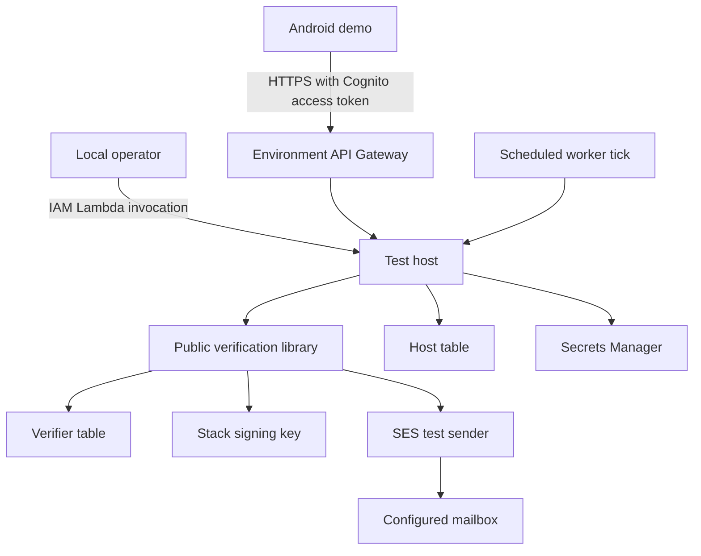
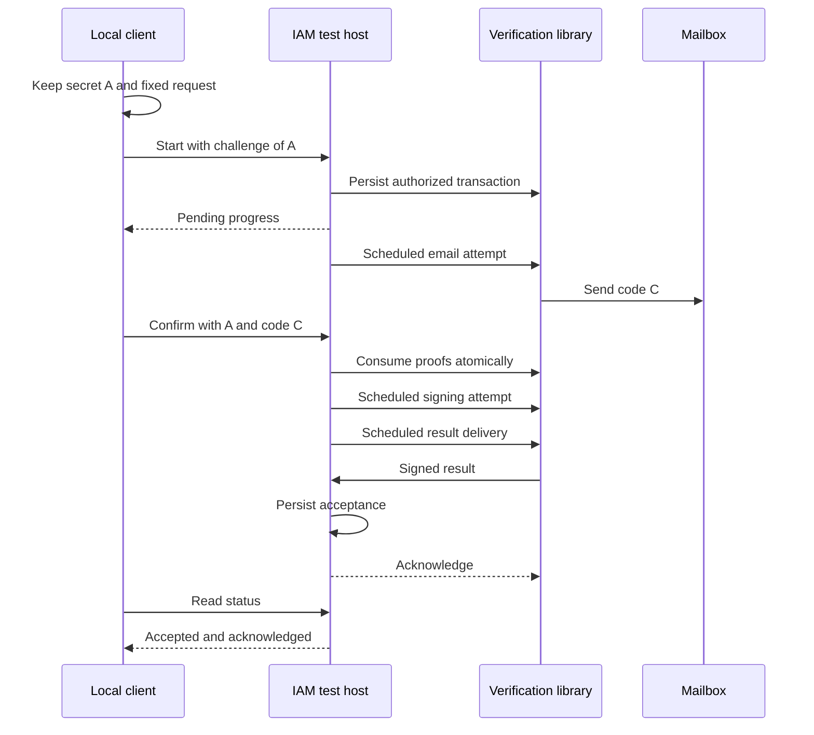

# Isolated test host

The repository now contains an executable host for testing the same public Go
library and Composer feature in a dedicated AWS stack. It is an operator tool,
not a public signup application. Other applications import the public library;
Go prevents unrelated modules from importing `internal/testhost` or
`infrastructure/internal/teststack`. The `cmd/testhost` packages are executables.
The source remains visible in the repository.

## Stack boundary

| Artifact | Purpose |
| --- | --- |
| Verifier DynamoDB table and ES256 KMS key | Created through the existing Composer verification feature. Stores transactions and signs assertions. |
| Separate host DynamoDB table | Stores fixed requests, preparation markers, dispatch, acceptance and the worker scan cursor. Never shares the real application's records. |
| Test host Lambda | Imports the verification library. Accepts operator commands through IAM, signed-in mobile requests through API Gateway, and worker ticks from EventBridge. |
| Mobile demo API | The deployment wizard configures a Regional API Gateway, validated ACM certificate, and public DNS for the selected environment. A dedicated Cognito user pool authenticates invited testers. |
| SES sender identity | Dedicated test sender. Sends only the six-digit code to the configured recipient. Both code and IAM policy restrict the recipient. |
| Secrets Manager secret | Two independently generated 32-byte keys for proof HMAC and recoverable email encryption. Pulumi protects secret state; Lambda gets only the secret ARN in its environment. |
| EventBridge rule | Runs a worker every minute. Scans pages of five verifier records, up to 100 per invocation within the time budget, persists the pagination cursor and attempts one phase per record. |
| IAM role and CloudWatch logs | Grants exact table/key/secret/sender access. The application returns sanitized errors and never logs proofs, assertions, secret A or request bodies. |



The test host fixes its host ID and audience from the project and stack. It permits
only its configured test recipient. Grant `lambda:InvokeFunction` only to test
operators. Mobile operations are scoped to the authenticated Cognito user.
The supplied client never returns an assertion or uses verification to log in.
Host acceptance is the final tested result; `WorkPending` remains the library's
business-work marker, and this host creates no account.

## Build and deploy

Prefer the root `deploy.sh` / `deploy.bat` [guided wizard](deployment-wizard.md).
The explicit commands below remain the low-level helper for an already selected
Pulumi backend; do not switch backends when moving an existing stack to the wizard.


Prerequisites: Go 1.25+ for the Lambda build, Go 1.27.3+ for the infrastructure
module, Python 3, AWS CLI, Pulumi CLI, a Pulumi backend and an AWS deployment
profile. Go can download the newer infrastructure toolchain automatically.
Use a dedicated AWS test account/profile where available. No AWS deployment has
been performed by this implementation change.

From the repository root:

```sh
export AWS_PROFILE=my-test-profile
export AWS_REGION=us-east-1
bash scripts/testhost-deploy.sh test-email us-east-1 example.test sender@example.com tester@example.com preview
# Review the preview, then create the same isolated stack:
bash scripts/testhost-deploy.sh test-email us-east-1 example.test sender@example.com tester@example.com up
```

The helper builds a Linux ARM64 bootstrap ZIP, selects/creates a `test-*` stack,
sets the nonsecret configuration and invokes Pulumi. `preview` is the default;
`up` uses Pulumi's normal approval prompt. The program also enforces the `test-*`
prefix when called directly. The domain is ownership metadata, not a hosted URL.
Use a dedicated sender address not already managed by another stack.

SES sends a sender-verification message when the identity is created. Complete
that verification before testing. In an SES sandbox account the recipient must
also be verified in the selected region; use the same verified mailbox or an
already verified test recipient. This code does not request production SES access.

The helper seeds `policyJSON` only if absent. To customize timings, edit that
stack property. The actual effective policy is validated inside the Pulumi entry
point before resource registration and inside Lambda initialization. Invalid
combinations stop deployment/startup. The test host additionally caps each external
call timeout at 30 seconds to fit its 120-second Lambda budget. Do not edit keys in Secrets Manager during
a pending verification: those keys are needed to recover queued mail/proofs.

Get the function name:

```sh
cd infrastructure/cmd/testhost
pulumi stack output testHostFunction
cd ../../..
```

The operator needs `lambda:InvokeFunction` for the exported
`testHostFunctionArn`; the deployment does not modify your human IAM principal.
AWS credentials and region come from the normal AWS CLI profile/environment.

## Connect an Android demo

The wizard enables mobile DNS. The stack defaults the mobile base domain to
`components.email-verification.<ownership-domain>`. The stack name supplies
the leading environment label. With `apexfission.com` as the ownership domain:

| Stack | Android API base URL |
| --- | --- |
| `test-dev` | `https://dev.components.email-verification.apexfission.com` |
| `test-qa` | `https://qa.components.email-verification.apexfission.com` |

Preview and Deploy include the endpoint resources. The default DNS zone is
the public Route 53 zone for the ownership domain. Existing Pulumi values for
`mobileBaseDomain` and `mobileDNSZone` take precedence. In the test host
Pulumi directory, use `pulumi config set` to select a different base domain
or delegated zone. When using Cloudflare, set `mobileDNSProvider` to
`cloudflare`, set `mobileDNSZoneID`, and provide `CLOUDFLARE_API_TOKEN`
with DNS write access to that zone. For GitHub deployment, supply it as a
protected environment secret. The SES sender and ownership metadata remain
separate settings.

The deployment role needs access to manage the demo's API Gateway, certificate,
Cognito resources, and selected Route 53 zone if applicable. Inviting users to
the demo pool is a separate operator action.

The test host exports per-environment connection details through Pulumi.
It has no shared environment discovery index. After apply, use
`testHostMobileURL`, `testHostMobileUserPoolID`, `testHostMobileClientID`, and
`testHostMobileIssuer` to configure the Android demo for the chosen environment. Invite demo users in that environment’s
Cognito pool. The Android client signs in via SRP and uses the **access token**
in the authorization header. An invitation and the existing SES sender and
test-recipient verification are required for an end-to-end email demo.

Send JSON with `Content-Type: application/json` and
`Authorization: Bearer <access_token>`.

| Endpoint | JSON fields |
| --- | --- |
| `POST /v1/verification/start` | `operation`, `email`, `challenge`, `authorized_at` |
| `POST /v1/verification/confirm` | `operation`, `secret`, `code` |
| `POST /v1/verification/status` | `operation` |

Generate a random 32-byte operation ID and secret A on the client. Encode both
as unpadded base64url. Hash the UTF-8 bytes of the encoded secret with SHA-256
and encode the digest as unpadded base64url for `challenge`. Use an RFC 3339 timestamp for `authorized_at` and keep all
start fields identical when retrying. Retain the operation ID and secret A
until the session finishes. A successful confirmation can precede final host
acceptance. Poll status for `accepted: true`, or stop on a terminal state
such as `expired` or `attempts_exhausted`.

## Run an email verification

Replace `FUNCTION` with that output:

```sh
python3 scripts/testhost-client.py start --function FUNCTION --email tester@example.com
python3 scripts/testhost-client.py tick --function FUNCTION
# Read the email. The code is prompted without echoing it:
python3 scripts/testhost-client.py confirm --function FUNCTION
python3 scripts/testhost-client.py tick --function FUNCTION
python3 scripts/testhost-client.py tick --function FUNCTION
python3 scripts/testhost-client.py status --function FUNCTION
```

Manual ticks accelerate the test; the minute schedule also advances these phases.
The expected final response has `accepted: true` and `state: acknowledged`.
An exhausted retry budget, expiry or unresolved operation is reported separately.
A lost confirmation response should be followed by `status`, not a new request.

The private `.testhost/session.json` file retains A, the operation ID and its fixed
start timestamp. Repeating `start` with that file retries the original request
without extending deadlines. Use `--session .testhost/another.json` to authorize a
new test. The client rejects mismatched function/recipient reuse and permissive
POSIX file permissions. Payloads go through private temporary files, not command
line arguments. On Windows, restrict the session directory ACL to your user.
Delete the session file after the test when you no longer need retry/recovery.



## Recovery and deliberate limits

- Request and preparation markers are durable before dispatch. A lost verifier
  record after dispatch is unresolved. A missing host operation after preparation
  is never recreated by retry. A crash between preparation and its marker can
  also be unresolved; use a new explicitly authorized test rather than guessing.
- Library CAS writes and stored attempt/deadline values arbitrate concurrent
  workers. A crash around SES delivery can still produce duplicate emails.
- The cursor survives restarts and revisits transient failures. This scanner is
  intentionally for low-volume testing. It is not a production queue/index
  implementation; accumulated terminal rows or high active volume increase the
  scan cycle and can delay work past expiry. Each invocation checkpoints completed
  pages and stops before its remaining time cannot cover another external phase.
- Every delivery refreshes the exact stack key from KMS and requires an enabled
  P-256 signing key. This test trust adapter does not implement the production
  signed key archive, permanent revocation history, publication or rotation. It
  cannot establish production trust-protocol readiness.
- No TTL or automatic record deletion is enabled. Expired email secrets are
  purged by the worker; operational tombstone cleanup and uncertain-outcome
  investigation are still separate production work. Host acceptance remains stored.
- Tables, signing key and secret are protected against accidental Pulumi deletion.
  To stop recurring work, disable the stack's EventBridge rule or destroy the
  disposable compute after review. A full teardown requires explicit removal of
  resource protection, then `pulumi destroy`; Secrets Manager and KMS retain their
  configured recovery/deletion delays. Do not weaken the production key-retention
  rules merely to clean up a test stack.

## Evidence

Root tests exercise start/retry, changed bindings, missing records, proof A,
recipient restrictions, email, signing and acceptance across host recreation.
AWS adapter tests use SDK fakes. Native Pulumi mocks check separate tables, native
key bindings, secret marking, scoped IAM, scheduled work, per-environment DNS,
and JWT authorization on the mobile routes. `scripts/testhost-import-test.sh` compiles an external module and verifies
that Go refuses its import of the internal host. CI also builds the deployable ZIP.
These checks are local/mocked; actual SES delivery and AWS permissions require a
live run in your selected test account.
