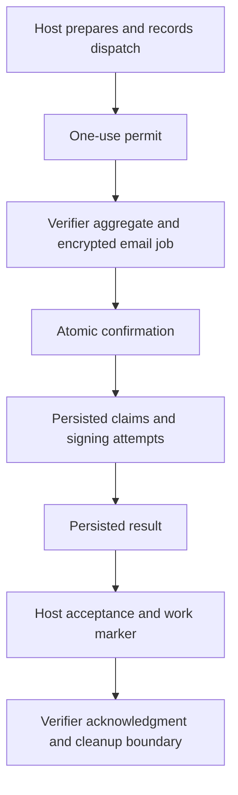

# First executable implementation

This branch implements an initial in-process core, not the whole production
system. No AWS deployment or migration has been performed.

## Implemented

- Go module, strict effective-configuration loader, field validation and timing
  relationships; constructor validation, preflight wrapper and CI checks.
- Separate host/verifier atomic storage interfaces, memory test store and AWS SDK
  DynamoDB adapter with consistent reads and version-conditional writes.
- Durable host dispatch plus an unexported one-use in-memory permit. Ambiguous
  restart cannot recreate an absent verifier transaction. Explicit host blocking
  prevents a replaced operation from accepting a late result.
- Transaction creation with A challenge, hashed B, transaction-bound HMAC of C,
  and an AES-GCM encrypted pending email payload committed in one aggregate.
- B or C confirmation requiring A, fixed expiry, proof-attempt budget and atomic
  transition to recoverable signing work. No B+C fallback.
- Fixed assertion identity/timestamps across signing retries, persisted attempt
  counts and next-attempt scheduling, original-result delivery and durable ack.
- ES256 signing, KMS DER-to-JOSE adapter, strict assertion type/algorithm/binding
  checks, duplicate JSON rejection and host atomic acceptance plus work marker.
- Historical duplicate acknowledgment after expiration, without new acceptance.
- Monotonic durable trust checkpoint updates preserving learned revocations.
- Host-owned hashed status credentials and read-only operation-scoped status.
- Safe cleanup deadline calculation; unresolved work has no cleanup deadline.
  There is deliberately no destructive record-deletion API in this first slice.
- Local end-to-end demo and concurrency/crash/expiry/replay-oriented tests.

## Concrete choices to review

A transaction is one versioned aggregate. Updating it atomically records its
pending work, avoiding a separate outbox write that could be lost. AWS adapters
store JSON bytes under `data` plus a numeric `version`; tables use string `pk`.
Host operation keys are SHA-256 of host and operation ID, scoped by table.

A successful conditional host dispatch grants one unexported process-local permit.
The permit is consumed before randomness, encryption or persistence. A failure
may sacrifice availability: retry uses Lookup, and absence requires reconciliation.
This intentionally avoids promising exactly-once delivery across separate stores.
Host callers must preserve their original operation identity across retries.

Five total signing/delivery attempts are persisted. Additional implementation
choices (not new product guarantees): backoff starts at one second, caps at thirty,
uses full jitter, and reserves a ten-second external-call timeout. Next-attempt
time includes timeout plus jitter. The host scheduler must honor these stored
values. Durable email retry currently uses timeout plus maximum backoff.

Each transaction snapshots configuration at creation so later defaults cannot
shorten its retention or change its proof/retry policy. Host acceptance can enforce
stricter current policy. Start deadlines have no extra tolerance. Status tokens
are 32 random bytes encoded as canonical base64url and hashed with SHA-256.

The initial client proof-attempt budget is five; resend is not exposed until its
own cooldown/generation contract is implemented. The retry-window value of one
day is a conservative retention obligation, not an implemented automatic
reconciliation service. Key/rotation settings are validated but rotation is not
implemented. These choices are explicit and configurable for review.

## Required before production

- Durable scheduler/discovery indexes, lease/fencing behavior under real AWS
  latency, reconciliation and recovery tooling, and production deletion/TTL jobs.
- SES adapter/template integration, resend invalidation/cooldowns, ingress rate
  limiting, and securely provisioned encryption/HMAC keys with rotation policy.
- Authoritative S3/HTTPS trust retrieval, cache refresh/cooldown behavior and
  publication validation. The Trust interface must not be backed by untrusted
  token keys or a stale static key map. CommitTrust alone is not a full validator.
- Public-key archive publication/legal holds, bootstrap, rotation/revocation
  workflows, and host revocation-review indexing and remediation worker.
- Host business-work execution and outcomes, status-cookie/HTTP authorization,
  credential recovery and revocation. WorkPending is a durable marker, not an
  account provisioning implementation.
- Remaining infrastructure provisioning, IAM least privilege, monitoring/alerts
  and live AWS tests. Composer integration now provisions verifier storage/signing,
  but does not provision the complete production service. Preflight provides a gate but
  does not automatically instrument deployment commands outside this repository.
- Additional independent cryptographic interoperability and adversarial review.

## Validation map

The tests cover one confirmation winner under concurrency, one-use dispatch,
missing-state fail-closed behavior, proof/start/status expiration, stable issuance
claims across retries, attempt counters across service recreation, encrypted email
recovery, exact-result historical acknowledgments, late-result blocking, trust
rollback/revocation preservation, strict JSON, and DynamoDB/KMS request semantics.
AWS adapter tests use controlled SDK fakes; they are not live service tests.

## Composer integration

[Composer integration](design/composer-integration.md) adds a versioned feature
contract, validated configuration inventory, isolated Pulumi module, ownership
labels and native composition tests. Host storage and runtime remain parent-owned.

## Isolated test host

[Test-host implementation](design/test-host.md) now wires SES, a resumable scan
worker, pinned KMS trust and durable acceptance into a separate deployable test
stack. This is a low-volume operator harness, not the production scheduler,
archive/revocation protocol or user-facing application. No live AWS run was
performed. Host progress has a read-only backend API for IAM-authenticated callers.
