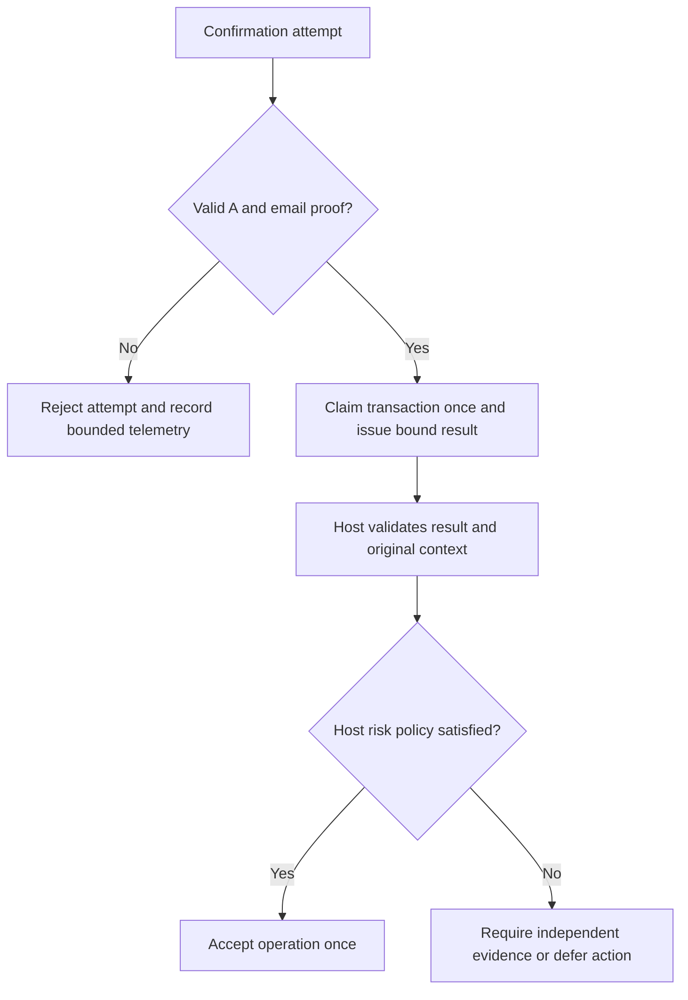

# Draft: IP and location signals

**Status: draft for discussion; not approved for implementation and not part of the core verification plan.**

This optional extension to the [verification-only plan](verification-only-plan.md)
explores transaction risk signals. Collection, thresholds, retention, and host
responses remain undecided. Proof A remains mandatory in the core flow.

## Proposed signals and host policy

Record initiation and confirmation-attempt source IPs only through trusted ingress
metadata; do not trust arbitrary forwarded headers. Compare within the transaction
and expose useful risk signals to the host. Define limited retention, restricted
access, and masking/pseudonymization where appropriate; never log proof secrets or
full verification URLs.

Different countries or unfamiliar networks are signals, not authentication factors.
Mobile networks, VPNs, travel, and cross-border use can cause legitimate changes;
attackers can use nearby proxies. The backend cannot observe an email being read
unless that activity contacts it. A mail scanner opening a link is not successful
verification. Do not automatically cancel a valid request solely because another
IP submits an invalid proof; preserve bounded attempt limits while considering
denial-of-service abuse. Exact thresholds and host responses remain to be specified.

## Proposed acceptance scenario

- Legitimate IP changes do not bypass A or automatically fail verification;
  attacker-origin invalid attempts do not alone cancel the legitimate request.

## Open decisions

- Which trusted ingress metadata to collect and expose to the host.
- Retention periods, access controls, and masking or pseudonymization.
- Whether and how the host uses network changes to request independent evidence.
- Thresholds that account for legitimate network changes and denial-of-service abuse.
