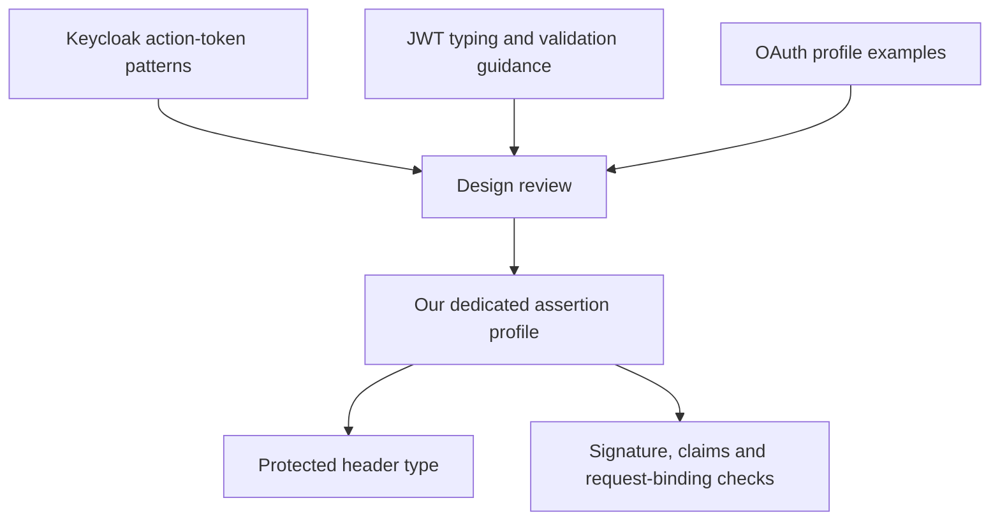

# Related efforts and reading list

Companion to the [verification-only design plan](verification-only-plan.md).
These are references for later study, not dependencies or claims of interoperability.
Keycloak is an open-source project; the OAuth entries below are published standards.

| Effort | Read first | Relevance to our design | Important difference |
| --- | --- | --- | --- |
| Keycloak action tokens | [Server Developer Guide: Action Token Handler SPI](https://www.keycloak.org/docs/26.6.4/server_development/#_action_token_handler_spi) | Signed JWTs for actions such as email verification, with purpose-specific handlers, expiration checks, and optional single-use handling. | Its documented action identifier, such as `verify-email`, is a `typ` field in the **payload**. Our `typ` is in the **protected header**. Its action token enables an action; our assertion reports verification already completed. |
| OAuth JWT access-token profile | [RFC 9068](https://www.rfc-editor.org/rfc/rfc9068.html) | Uses explicit header typing, normally `at+jwt`, to identify a particular JWT profile and its validation rules. | This is an access-token profile, not email-verification evidence. Our assertions must not be accepted as access tokens. |
| OAuth Demonstrating Proof of Possession (DPoP) | [RFC 9449](https://www.rfc-editor.org/rfc/rfc9449.html) | Uses the protected header type `dpop+jwt` for a distinct proof JWT with dedicated validation rules. | Proves possession of a client key and binds proofs to HTTP requests. Our client-secret A flow is not DPoP. |
| JWT security best practices | [RFC 8725, sections 3.11 and 3.12](https://www.rfc-editor.org/rfc/rfc8725.html#section-3.11) | Explains explicit typing and mutually exclusive validation rules for different JWT uses. | Guidance to apply alongside signature, issuer, audience, time, and request-binding checks; a type label alone is insufficient. |

## Suggested reading order

1. Keycloak for a concrete implementation and its action-token lifecycle.
2. RFC 8725 for why different token purposes need distinct validation rules.
3. RFC 9068 and RFC 9449 for examples of protected-header type conventions.

## Our decision

Use `typ: email-verification+jwt` in the protected JWT/JWS header.
This is our custom profile label, not a claim of a registered media type.
It identifies a signed result issued after mailbox-access verification.
Require that exact header value and all of our assertion validation rules.
A payload field named `typ` cannot substitute for the header check.

The analogous type-label pattern does not make our protocol compatible with
Keycloak, OAuth access tokens, or DPoP.

## Design diagram

These arrows show design inspiration only, not dependencies or interoperability.
