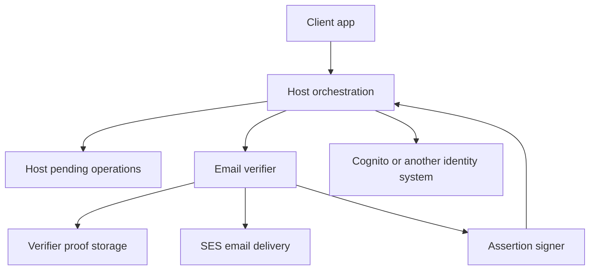
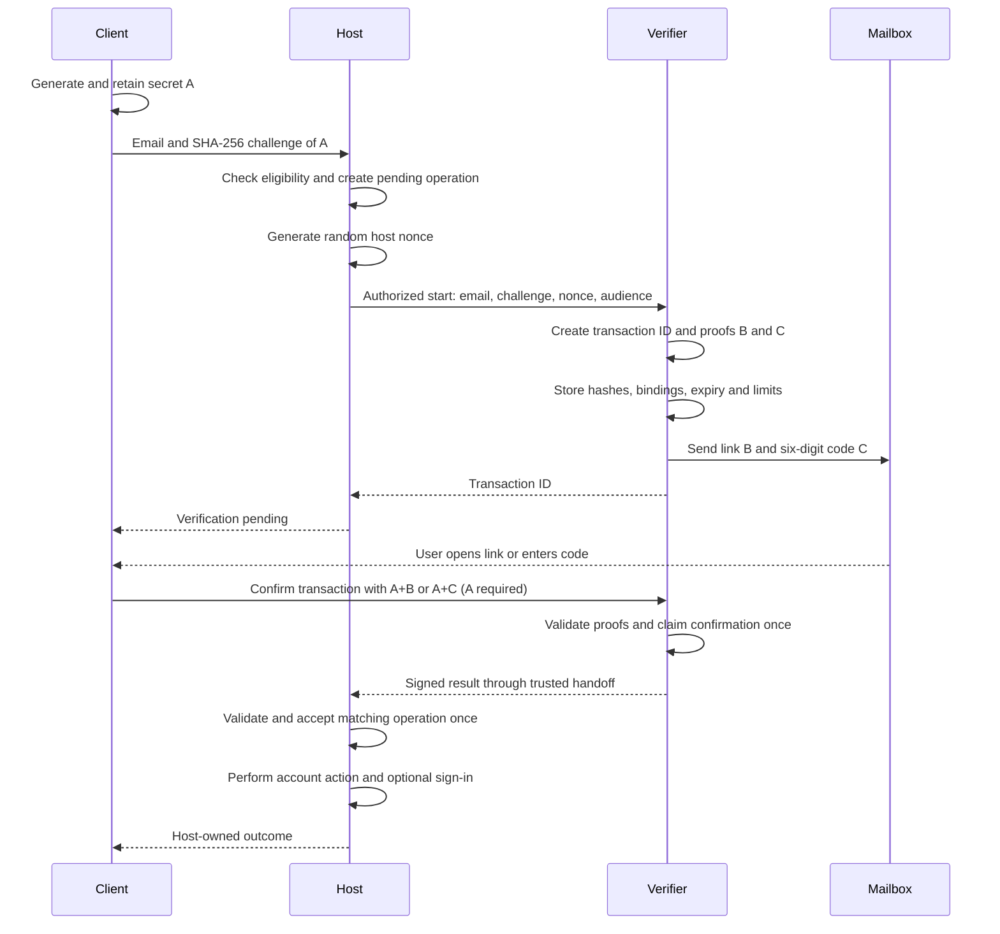
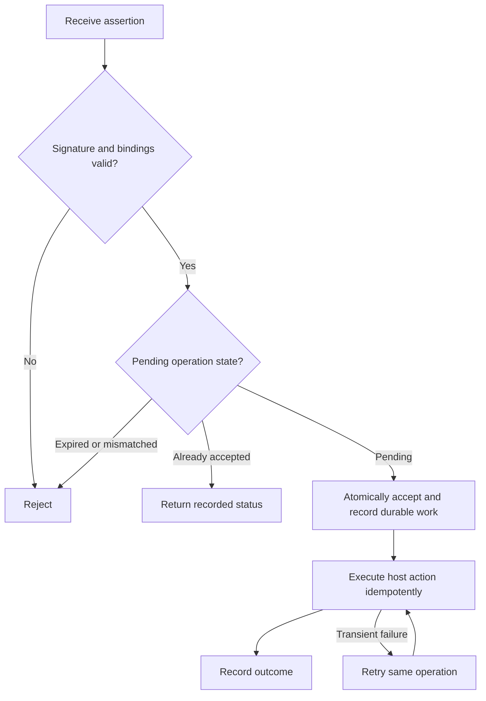

# Plan: verification-only email module

Status: planned architecture from our design discussion; not implemented.
The existing implementation in [go.apexfission.aws.verifyemail](https://github.com/lambdawalker/go.apexfission.aws.verifyemail) still checks Cognito eligibility, creates users,
and requests sessions. This new repository will implement the verification-only boundary.

The verifier will answer one question: **did someone demonstrate access to this
email address for this particular request?** It will return a signed verification
assertion. The host owns eligibility, accounts, Cognito, sessions, and the action
authorized by that evidence. Cognito integration belongs outside this repository;
its final repository location is still to be decided.

## Responsibility boundary



The host imports and deploys the module. These boxes are responsibility boundaries,
not a requirement for separate services. A composed handler can call the library
directly; separate Lambdas require authenticated, encrypted communication.
A signature does not make evidence independent of the host that controls the
verifier code and signing permissions.

| Responsibility | Existing verifyemail implementation | Planned owner |
| --- | --- | --- |
| Account eligibility lookup | Verifier's Cognito adapter | Host |
| A/B/C verification, expiry, limits and resend | Verifier | Verifier |
| Account creation and session issuance | Verifier's Cognito adapter | Host |
| Signed verification result | Not implemented | Verifier |
| Operation binding and single-use acceptance | New host contract needed | Host |

## Proposed verification flow



The sequence is logical: exact public routes and result delivery remain to be
specified. The verifier must accept host bindings only through an authorized
start path, not trust arbitrary client-supplied audience or nonce values.

A stays on the initiating client until confirmation; the backend stores its
challenge. The verifier generates B and C. Preserve the existing ten-minute
proof lifetime, hashed B, keyed digest of C, retry budgets, cooldowns, conditional
claims, and resend invalidation. A is mandatory: B+C must never complete verification.
The email may be opened elsewhere, but completion requires the initiating app's A.
If A is lost, restart verification rather than falling back to email-only completion.

## Signed result and request binding

The host generates a cryptographically random nonce (proposed: 32 bytes) and
stores its association with the expected email, intended operation, account or
signup context, initiating session, and expiry. The verifier creates its own
transaction ID. Keep the two identifiers separate; neither is an authorization
credential by itself.

| Signed field | Purpose |
| --- | --- |
| Issuer and audience | Identify the trusted verifier and intended host |
| Email and successful verification result | State what was verified |
| Host nonce | Bind evidence to the host's pending operation |
| Verifier transaction ID | Identify this verification transaction |
| Verification time, issuance time and expiration | Bound freshness and acceptance |
| Assertion ID | Identify the result for deduplication |

This is evidence of mailbox access, not an access token or proof of legal identity.
Operation names can remain private to the host through the nonce mapping.

## Replay prevention and crash recovery



A signature prevents tampering; it does not prevent replay or a thief submitting
first. Host acceptance must check the trusted key and allowed algorithm, issuer,
audience, time bounds, email, nonce, transaction, and original operation context.
Concurrent acceptance must have one winner. Atomically record acceptance and
durable follow-up work, then make external actions retry-safe. Do not claim a
distributed exactly-once guarantee.

The verifier also needs recoverable result issuance/delivery after successful
confirmation: retrying delivery must preserve the same verification identity,
never perform a new verification or authorize another operation. The persistence
and retry mechanism is still to be designed.

## Assertion schema, signing, and trusted keys

Status: initial design baseline from our discussion; not implemented. Exact field
names below are proposed contract names. ES256 is selected for the first version; operational timing
values remain open.

### Format and initial schema

Use a digitally signed JWT in JWS compact serialization. JWT defines the claims;
JWS protects the header and payload with a signature. This is a verification
assertion, not a session/access token, OAuth flow, or OIDC ID token.

All payload fields below are required in the initial profile.

| Payload field | JSON type | Meaning and validation |
| --- | --- | --- |
| `iss` | string | Configured verifier issuer; must exactly match the trusted issuer. |
| `aud` | string | Intended host identifier; require one exact configured audience in this profile. |
| `email` | string | Address verified for this transaction; must match the address bound at initiation. |
| `email_verified` | boolean | Must be `true`; unsuccessful attempts do not produce success assertions. |
| `nonce` | string | Host-generated random request binding, echoed unchanged from authorized initiation. |
| `transaction_id` | string | Verifier transaction identifier, matched against the pending operation. |
| `verified_at` | integer | UTC Unix seconds when the required proofs were successfully validated. |
| `iat` | integer | UTC Unix seconds when this assertion was issued. |
| `exp` | integer | UTC Unix seconds at which acceptance expires. |
| `jti` | string | Unique assertion identifier, retained across delivery retries for deduplication. |

The host nonce remains proposed as 32 cryptographically random bytes encoded as
unpadded base64url. Transaction and assertion ID encodings remain to be finalized.
Operation names, account/session associations, and eligibility stay in host storage.
Do not include A, B, C, their secret values, or session credentials in the assertion.

| Protected header | Initial rule |
| --- | --- |
| `typ` | Require a distinct assertion type; proposed value `email-verification+jwt` is a local profile choice, not a registered type claim. |
| `alg` | Require `ES256` for the first version. Reject `none` and every other algorithm; bind each trusted key to its configured algorithm. |
| `kid` | Stable unique identifier for the specific signing key in the trusted key set; never reuse it for a replacement key. |

Validate types, required fields, signature, issuer, audience, request bindings,
and time bounds. Require `verified_at <= iat < exp`, and enforce a configured
maximum verification age and assertion lifetime, with a bounded clock tolerance.
Those durations are still to be chosen; the ten-minute email-proof lifetime does
not automatically define the assertion lifetime. Reject duplicate JSON members
and unsupported assertion types. Use dedicated validation rules so login tokens
and verification assertions cannot substitute for one another.

Prefer redelivery of the same persisted signed assertion. Retries must preserve
the verification identity, `jti`, bindings, verification time, and original
expiration; retrying must not renew the acceptance window. The host still
atomically consumes its pending operation and records durable follow-up work.
A signature provides integrity, not confidentiality or automatic single use.

### Selected signing algorithm: ES256

Decision: use ES256 (ECDSA with NIST P-256 and SHA-256) for the first version.

| Setting | Value |
| --- | --- |
| JWT protected header `alg` | `ES256` |
| AWS KMS key specification | `ECC_NIST_P256` |
| AWS KMS key usage | `SIGN_VERIFY` |
| AWS KMS signing algorithm | `ECDSA_SHA_256` |
| Public JWK | `kty: EC`, `crv: P-256`, `alg: ES256`, `use: sig`, unique `kid`, public `x` and `y` |

The rationale is compact signatures and compatibility with our KMS/JWT design.
NIST FIPS 186-5 specifies ECDSA, and SP 800-57 Part 1 Rev. 5 places
256-bit elliptic-curve keys at approximately 128-bit classical security strength,
comparable to 3072-bit RSA. This is our engineering selection, not a NIST mandate
for email verification or a claim of whole-system NIST/FIPS compliance.

The signing adapter must sign the exact JWS signing input. If it sends a SHA-256
digest to KMS, use `MessageType: DIGEST` to avoid hashing twice. Convert the KMS
DER-encoded ECDSA signature to the JWS fixed-width 64-byte `R || S` representation
(two unsigned 32-byte integers) before base64url encoding. Test interoperability
with an independent JWT verifier and rejection of malformed signatures and
unexpected algorithms. Deduplicate by the bound request and assertion ID, not by
signature bytes.

### Future TODO: quantum-resistant signatures

- [ ] Evaluate a migration to NIST-standardized post-quantum digital signatures.
  ES256/P-256 is not quantum-resistant; short assertion lifetimes do not make the
  signing algorithm quantum-resistant.
- [ ] Review applicable NIST transition guidance, AWS KMS support, JOSE/JWT
  interoperability, library support, and signature-size/latency costs when planning
  that migration. No post-quantum algorithm or migration date is selected yet.
- [ ] Design a controlled rollout with new key IDs, explicit algorithm/key bindings,
  compatible consumers deployed before signer cutover, and a bounded transition
  policy. Never broaden accepted algorithms based solely on an incoming token.
- [ ] Test downgrade rejection and retirement of the old algorithm. Ordinary
  rotation to another P-256 key does not provide quantum resistance.

References: [NIST FIPS 186-5](https://csrc.nist.gov/pubs/fips/186-5/final),
[NIST SP 800-57 Part 1 Rev. 5](https://nvlpubs.nist.gov/nistpubs/SpecialPublications/NIST.SP.800-57pt1r5.pdf),
[JWA ES256 (RFC 7518)](https://www.rfc-editor.org/rfc/rfc7518.html),
and [AWS KMS Sign](https://docs.aws.amazon.com/kms/latest/APIReference/API_Sign.html).

### AWS signing and public-key distribution

Use an asymmetric AWS KMS signing key. The verifier calls KMS to sign, and the
application does not receive the private key. Restrict signing permissions to the
verifier role and keep signing keys separate from proof HMAC keys.

#### Public-key retrieval: direct AWS access or HTTPS JWKS

Both routes supply the same trusted public signing keys for local assertion
validation. Direct KMS access is the preferred route for the composed host inside
the AWS environment; the HTTPS endpoint is optional for other consumers.

| Route | Intended consumer | Access and trust configuration |
| --- | --- | --- |
| Direct AWS KMS `GetPublicKey` | Host running inside the AWS environment | Deployment-configured trusted key ARNs and a runtime IAM role authorized by the applicable IAM/key policies to call `kms:GetPublicKey` on those keys. |
| HTTPS JWKS | Consumers using a published key set | Preconfigured trusted issuer and HTTPS JWKS URL; no AWS credentials required to read the public endpoint. |

For direct AWS access, deployment supplies a trusted mapping from assertion
`kid` values to immutable KMS key ARNs, covering the current key and previous
keys still accepted during rotation. The host retrieves and caches their public
keys through the AWS SDK, then verifies ES256 locally. Importing the Go module
does not grant AWS permissions or automatically discover trusted keys. Retrieving
a public key requires no signing permission. Never use an untrusted token's
`kid` as an arbitrary KMS key ARN to fetch and trust.

KMS returns a DER-encoded SPKI public key, which can be parsed directly for local
verification; converting it to JWK is needed only when publishing the JWKS.
Direct access avoids calling the host's public JWKS URL, but still makes an
authenticated AWS API request on cache misses or refresh.

Both routes must receive rotation updates before signer cutover and retain
previous public keys for the acceptance overlap. Cache refresh and revocation
rules must apply to both routes; a cached key must not remain trusted indefinitely
after removal or revocation. Exact cache durations remain an implementation
decision. A mutable signing alias alone is insufficient to identify previous
verification keys.

#### Optional HTTPS publication

Proposed stable public-key URL on the host API domain:

```text
https://api.example.com/email-verification/jwks.json
```

This is a deployment-selected route, not a required standards path. Export public
keys through KMS GetPublicKey and convert its SPKI representation to public JWKs.
The JWKS contains public key material and identifiers only. The host can also use
the same trusted set through deployment-managed configuration when composed.

Consumers must configure the trusted issuer and key source independently.
An incoming assertion may select a known key with `kid`; it must not introduce
a trusted key or arbitrary key-fetch URL. Protect publication permissions and use
HTTPS for the endpoint. Cache policy and bounded refresh behavior remain to be
defined.

### Rotation lifecycle

KMS automatic rotation does not cover asymmetric signing keys. Our deployment or
rotation workflow will orchestrate replacement keys:

1. Create a new asymmetric KMS key with a new key identifier.
2. Publish its public JWK alongside the existing public key.
3. Allow consumers to receive the new key before switching signing to it.
4. Stop signing with the old key, retaining its public key until all assertions
   signed with it expire, including allowed clock tolerance.
5. Retire the old key under a defined retention policy.

Account for consumer/CDN cache lifetimes when scheduling the overlap. Each
assertion's `kid` must identify the actual signing key, not a mutable alias.
Compromise response is separate from routine rotation: consumers must be able to
reject a revoked key even before its assertions expire. Disabling a KMS key alone
does not revoke signatures validated with a downloaded public key.

### Decisions still open for this item

- Final assertion type, ID encoding, email comparison rules, and schema evolution.
- Assertion lifetime, maximum verification age, and clock tolerance.
- Rotation cadence, cache/refresh limits, propagation checks, and old-key retention.
- Emergency revocation distribution and recovery behavior.

References: [JWT (RFC 7519)](https://www.rfc-editor.org/rfc/rfc7519.html),
[JWT validation guidance (RFC 8725)](https://www.rfc-editor.org/rfc/rfc8725.html),
[KMS public keys](https://docs.aws.amazon.com/kms/latest/APIReference/API_GetPublicKey.html),
and [KMS rotation](https://docs.aws.amazon.com/kms/latest/developerguide/rotate-keys.html).

## Next implementation decisions

- Finalize the remaining choices in [Assertion schema, signing, and trusted keys](#assertion-schema-signing-and-trusted-keys).
  The initial fields, signed JWT/JWS format, AWS KMS approach, and proposed JWKS
  route and ES256 selection are recorded there; operational timing values remain open.
- Define direct-call and separate-Lambda contracts, including authorized initiation,
  result delivery, recovery and client completion behavior.
- Move eligibility, Cognito enrollment and grants/session code to the host side;
  remove their permissions and integration requirements from the verifier.
- Add shared assertion validation and host acceptance contracts; keep signing
  keys separate from the existing proof HMAC key.
- Test replay races, wrong audience/email/nonce, expired results, stolen B without
  A, resend invalidation, and crashes before and after acceptance.
- Review applicable standards before claiming conformance. PKCE-style binding,
  signed assertions and webhook-style deduplication are design inspirations;
  no NIST compliance or EVP interoperability is claimed.

Keep proofs and signed assertions out of logs and result URLs. Deliver results
through a direct trusted return when composed, or an authenticated backend
handoff when separated. No AWS deployment, proof-key rotation or data migration
is part of this documentation change.


## Signup security, mailbox compromise, and standards

These are planned requirements and design rationale, not implemented guarantees.
This section supersedes the earlier discussion of an independent B+C fallback.

### Security decisions and limits

- Require A plus B or C for the same transaction. Stealing the email alone must
  not complete an existing request. A proves possession of a client secret, not
  physical-device identity. Keep A out of email, URLs, logs, and backups that
  would undermine that binding.
- A future stronger device-binding option is a non-exportable device key signing
  a fresh, transaction-bound challenge. Key registration and verification need
  their own design; installing the app is not proof of trust and endpoints can
  be called without the app.
- Keep the host nonce and verifier transaction ID separate and signed in the
  result. Hashing them together does not prevent interception or replay.
  Enforce issuer, audience, email, expiry, transaction, nonce, and original
  operation/session binding, with atomic single-use host acceptance.
- A signature authenticates signed data; it neither encrypts it nor proves that
  host-controlled code honestly executed. Use a trusted direct return when
  composed; authenticated encrypted delivery and scoped permissions when split.
- Email confirmation proves access at verification time, not exclusive mailbox
  ownership, legal identity, or MFA. If an attacker already controls the mailbox,
  they can start a new request with their own A. Neither A nor a newly enrolled
  passkey establishes that they are the legitimate mailbox owner.
- For signup, the host chooses whether mailbox access is sufficient or separate
  identity evidence is needed. For existing accounts, sensitive changes and
  recovery should require an appropriate existing trusted factor; email recovery
  must not silently bypass it. Host-owned options include trusted-device alerts,
  independent recovery contacts, and risk-based recovery delays. A notification
  only to the compromised mailbox is insufficient.

### Separate draft

Optional [IP and location signals](ip-location-signals-draft.md), including their
risk-policy diagram and proposed acceptance scenario, are a separate draft and
are not requirements of this core plan.

### Standards and practices we borrow

Normative requirements below apply within the cited standard's scope; design
inspiration does not imply protocol interoperability or whole-system conformance.

| Reference | What it establishes | Application and limits here |
| --- | --- | --- |
| [NIST SP 800-63A-4, section 3.8, Confirmation Codes](https://pages.nist.gov/800-63-4/sp800-63a.html) | In identity proofing/enrollment, confirmation codes establish access to an address for future communications; at least six decimal digits or equivalent from an approved random bit generator, at most 24 hours for email, invalidation upon use. | Preserve the planned ten-minute lifetime and single-use controls. Six digits and a shorter lifetime alone do not establish NIST conformance. This is not a universal mandate for every commercial signup. |
| [NIST SP 800-63B-4, section 3.1.3, Out-of-Band Devices](https://pages.nist.gov/800-63-4/sp800-63b.html) | Email is prohibited for out-of-band authentication; email-address confirmation codes are explicitly outside that prohibition. | Treat the result as mailbox-access evidence, not a NIST out-of-band authenticator or MFA. Host authentication is a separate responsibility. |
| [OWASP Email Validation and Verification](https://cheatsheetseries.owasp.org/cheatsheets/Email_Validation_and_Verification_Cheat_Sheet.html) | Secure random, single-use, time-limited verification tokens; verification before activation; monitoring without token leakage. | Apply token lifecycle controls and safe logging. This is security guidance, not a wire protocol. |
| [OAuth PKCE, RFC 7636](https://www.rfc-editor.org/rfc/rfc7636.html) | Protects authorization-code exchange using a client-held verifier and its challenge. | Borrow the secret/challenge binding principle for A. Our email flow is not OAuth or a claim of PKCE interoperability; mandatory A is an additional design decision. |
| [OpenID Connect Core 1.0, section 5.1](https://openid.net/specs/openid-connect-core-1_0.html#StandardClaims) | Defines the email_verified claim as reporting verification performed by the provider. | Borrow clear claim semantics; OIDC does not prescribe our email challenge procedure. A JWT alone does not make this an OIDC flow. |
| [Email Verification Protocol, draft-hardt-email-verification-02](https://datatracker.ietf.org/doc/html/draft-hardt-email-verification-02) | Proposes browser-mediated, issuer-signed email verification with request binding. | Inspiration for audience/nonce-bound results; an Internet-Draft, not an approved RFC. Our email delivery flow is different; no EVP interoperability is claimed. |
| [Stripe webhook practices](https://docs.stripe.com/webhooks) | Signed delivery timestamps help constrain replay; receivers track processed event IDs to handle duplicates. | Borrow authenticated freshness and durable deduplication. Fresh retry signatures must not turn a consumed verification into a new authorization or extend its acceptance window. This is an operational pattern, not an email-verification standard. |
| [OWASP Authentication](https://cheatsheetseries.owasp.org/cheatsheets/Authentication_Cheat_Sheet.html) and [MFA guidance](https://cheatsheetseries.owasp.org/cheatsheets/Multifactor_Authentication_Cheat_Sheet.html) | Risk-based checks, reauthentication for sensitive actions, and protected recovery/factor changes. | Host handles existing factors and recovery policy. |
| [Google recovery security holds](https://support.google.com/accounts/answer/9412469) | Recovery requests can be delayed for security. | Example for host recovery design, not a requirement to delay ordinary email confirmation. |

### Acceptance scenarios to add before implementation is considered complete

- B alone, C alone, and B+C fail without A, including from a different device.
- Valid A+B and A+C complete only their bound transaction; A from another request fails.
- Lost A requires restart. Resend invalidates superseded email proofs and respects
  rate limits; email opening by a scanner does not consume verification.
- Expired proofs/results, wrong audience/email/nonce/transaction, and attempts to
  substitute the host operation or session are rejected.
- Simultaneous confirmations and result deliveries produce one acceptance; retries
  return recorded status only to authorized callers and never duplicate host work.
- Crashes before/after confirmation, issuance, and acceptance recover without
  losing durable work or granting a new operation.
- A compromised mailbox used to initiate a new signup is documented as a residual
  risk; high-assurance host policies require independent evidence.

References reviewed for this design on 2026-11-16. No NIST assurance level, MFA,
phishing-resistance guarantee, or standards certification is claimed.
