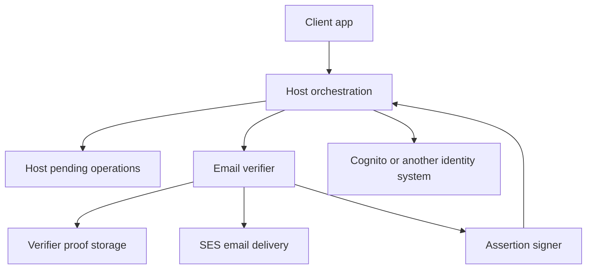
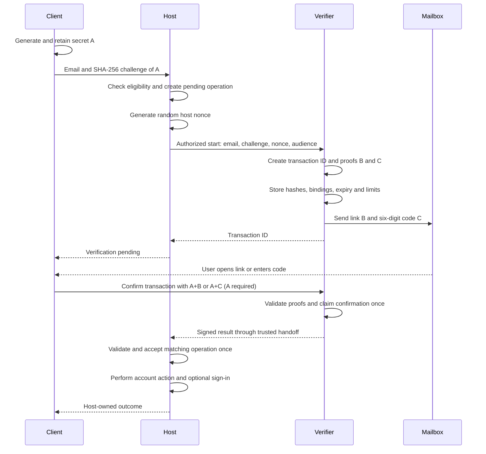
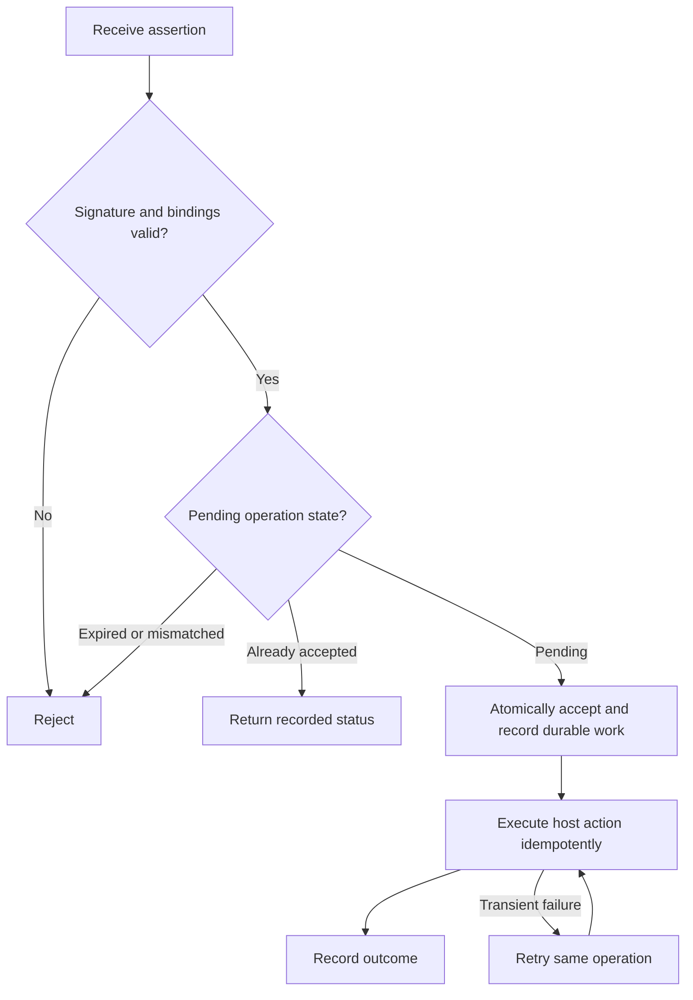

# Plan: verification-only email module

Status: planned architecture from our design discussion; not implemented.
The existing implementation in [go.apexfission.aws.verifyemail](https://github.com/lambdawalker/go.apexfission.aws.verifyemail) still checks Cognito eligibility, creates users,
and requests sessions. This new repository will implement the verification-only boundary.

The verifier will answer one question: **did someone demonstrate access to this
email address for this particular request?** It will return a signed verification
assertion. The host owns eligibility, accounts, Cognito, sessions, and the action
authorized by that evidence. Cognito integration belongs outside this repository;
its final repository location is still to be decided.

## Responsibility boundary



The host imports and deploys the module. These boxes are responsibility boundaries,
not a requirement for separate services. A composed handler can call the library
directly; separate Lambdas require authenticated, encrypted communication.
A signature does not make evidence independent of the host that controls the
verifier code and signing permissions.

| Responsibility | Existing verifyemail implementation | Planned owner |
| --- | --- | --- |
| Account eligibility lookup | Verifier's Cognito adapter | Host |
| A/B/C verification, expiry, limits and resend | Verifier | Verifier |
| Account creation and session issuance | Verifier's Cognito adapter | Host |
| Signed verification result | Not implemented | Verifier |
| Operation binding and single-use acceptance | New host contract needed | Host |

## Proposed verification flow



The sequence is logical: exact public routes and result delivery remain to be
specified. The verifier must accept host bindings only through an authorized
start path, not trust arbitrary client-supplied audience or nonce values.

A stays on the initiating client until confirmation; the backend stores its
challenge. The verifier generates B and C. Preserve the existing ten-minute
proof lifetime, hashed B, keyed digest of C, retry budgets, cooldowns, conditional
claims, and resend invalidation. A is mandatory: B+C must never complete verification.
The email may be opened elsewhere, but completion requires the initiating app's A.
If A is lost, restart verification rather than falling back to email-only completion.

## Signed result and request binding

The host generates a cryptographically random nonce (32 bytes) and
stores its association with the expected email, intended operation, account or
signup context, initiating session, and expiry. The verifier creates its own
transaction ID. Keep the two identifiers separate; neither is an authorization
credential by itself.

| Signed field | Purpose |
| --- | --- |
| Issuer and audience | Identify the trusted verifier and intended host |
| Email and successful verification result | State what was verified |
| Host nonce | Bind evidence to the host's pending operation |
| Verifier transaction ID | Identify this verification transaction |
| Verification time, issuance time and expiration | Bound freshness and acceptance |
| Assertion ID | Identify the result for deduplication |

This is evidence of mailbox access, not an access token or proof of legal identity.
Operation names can remain private to the host through the nonce mapping.

## Replay prevention and crash recovery



A signature prevents tampering; it does not prevent replay or a thief submitting
first. Host acceptance must check the trusted key and allowed algorithm, issuer,
audience, time bounds, email, nonce, transaction, and original operation context.
Concurrent acceptance must have one winner. Atomically record acceptance and
durable follow-up work, then make external actions retry-safe. Do not claim a
distributed exactly-once guarantee.

The verifier also needs recoverable result issuance/delivery after successful
confirmation: retrying delivery must preserve the same verification identity,
never perform a new verification or authorize another operation. The persistence
and retry mechanism is still to be designed.

## Assertion schema, signing, and trusted keys

Status: initial design baseline from our discussion; not implemented. Exact field
names below are proposed contract names. ES256 is selected for the first version; operational timing
values remain open.

### Format and initial schema

Use a digitally signed JWT in JWS compact serialization. JWT defines the claims;
JWS protects the header and payload with a signature. This is a verification
assertion, not a session/access token, OAuth flow, or OIDC ID token.

All payload fields below are required in the initial profile.

| Payload field | JSON type | Meaning and validation |
| --- | --- | --- |
| `schema_version` | integer | Required value `1` for this profile; reject missing or unsupported versions. |
| `iss` | string | Configured verifier issuer; must exactly match the trusted issuer. |
| `aud` | string | Intended host identifier; require one exact configured audience in this profile. |
| `email` | string | Address verified for this transaction; must match the address bound at initiation. |
| `email_verified` | boolean | Must be `true`; unsuccessful attempts do not produce success assertions. |
| `nonce` | string | Host-generated random request binding, echoed unchanged from authorized initiation. |
| `transaction_id` | string | Verifier transaction identifier, matched against the pending operation. |
| `verified_at` | integer | UTC Unix seconds when the required proofs were successfully validated. |
| `iat` | integer | UTC Unix seconds when this assertion was issued. |
| `exp` | integer | UTC Unix seconds at which acceptance expires. |
| `jti` | string | Unique assertion identifier, retained across delivery retries for deduplication. |

The host nonce, transaction ID, and assertion ID each use independently generated
32-byte cryptographically random values encoded as canonical unpadded base64url
(43 characters). See the encoding and evolution rules below.
Operation names, account/session associations, and eligibility stay in host storage.
Do not include A, B, C, their secret values, or session credentials in the assertion.

| Protected header | Initial rule |
| --- | --- |
| `typ` | Require the exact value `email-verification+jwt` in the protected header. This is our selected local profile type, not a claim of a registered media type. |
| `alg` | Require `ES256` for the first version. Reject `none` and every other algorithm; bind each trusted key to its configured algorithm. |
| `kid` | Stable unique identifier for the specific signing key in the trusted key set; never reuse it for a replacement key. |

The assertion type is finalized as `email-verification+jwt` in the protected
JWT/JWS header's `typ` field, not in the payload. Reject a missing or different
header type even if the signature is valid; a payload `typ` cannot substitute
for it. This identifies evidence of completed verification, not an action token
used to initiate verification. Dedicated validators must also reject this
assertion wherever a login or access token is required. The type check supplements,
and never replaces, signature and claim validation. This follows the explicit
typing pattern in RFC 8725 without claiming interoperability with other profiles.

Validate types, required fields, signature, issuer, audience, request bindings,
and time bounds. Require `verified_at <= iat < exp`, and enforce a configured
maximum verification age and assertion lifetime, with a bounded clock tolerance.
The configured defaults are a ten-minute assertion lifetime, fifteen-minute
maximum verification age, and three-second clock tolerance, as specified below.
The email-proof lifetime is a separate ten-minute window. Reject duplicate JSON members
and unsupported assertion types. Use dedicated validation rules so login tokens
and verification assertions cannot substitute for one another.

Prefer redelivery of the same persisted signed assertion. Retries must preserve
the verification identity, `jti`, bindings, verification time, and original
expiration; retrying must not renew the acceptance window. The host still
atomically consumes its pending operation and records durable follow-up work.
A signature provides integrity, not confidentiality or automatic single use.

### Configurable timing and host acceptance

These are selected system configuration defaults, not hard-coded constants or
durations mandated by a standard. Configuration is deployment-controlled, never
chosen by an untrusted client or by a token's claims.

| Configuration | Default | Clock starts at | Purpose |
| --- | --- | --- | --- |
| `assertion_lifetime_seconds` | 600 (10 minutes) | `iat`, original assertion issuance | Limits how long an issued assertion can be accepted. |
| `max_verification_age_seconds` | 900 (15 minutes) | `verified_at`, successful proof validation | Prevents delayed issuance from making old verification evidence fresh. |
| `clock_tolerance_seconds` | 3 seconds | Applied during timestamp validation | Allows small differences between verifier and host clocks. |

The separate email-proof lifetime remains ten minutes from proof creation. It
limits when the user can complete verification, not when the host accepts the
subsequently issued assertion.

The verifier sets `exp = iat + assertion_lifetime_seconds` at original issuance.
The host enforces its trusted configured maximum assertion lifetime as well as
the signed expiration and maximum verification age. Configuration must specify
positive integer lifetimes and a nonnegative integer clock tolerance, with
checked timestamp arithmetic. Deploy issuer and consumer settings coherently;
a host may enforce stricter policy. Increasing configuration never rewrites or
extends an existing signed expiration.

With `now` sampled at host acceptance and `S` the configured tolerance, require:

```text
verified_at <= iat < exp
exp - iat <= host_config.assertion_lifetime_seconds
iat <= now + S
verified_at <= now + S
now < exp + S
now < verified_at + host_config.max_verification_age_seconds + S
now < host_pending_operation_deadline
```

The host-owned operation deadline receives no additional tolerance in this
profile. Apply tolerance once to each relevant comparison, not cumulatively.
It does not change signed timestamps or excuse invalid bindings, signatures,
revoked keys, or previously consumed operations. Keep clocks synchronized;
tolerance is not an allowance for arbitrary processing delays.

Both post-verification limits run in parallel. The effective acceptance deadline
is the earliest of signed expiration plus tolerance, verification time plus
maximum age plus tolerance, and the host's own operation deadline.

#### Examples with the default configuration

Assume verification succeeds at 12:00:00, all other checks pass, the operation
is still pending, and its host deadline is later than the shown times.

| Scenario | Assertion issuance | Signed expiration | Verification-age deadline before tolerance | Host acceptance |
| --- | --- | --- | --- | --- |
| Immediate issuance | 12:00:00 | 12:10:00 | 12:15:00 | Accept at 12:09:00; time checks permit 12:10:02; reject at 12:10:03. |
| Issuance delayed seven minutes | 12:07:00 | 12:17:00 | 12:15:00 | Accept at 12:14:00; time checks permit 12:15:02; reject at 12:15:03 even though the JWT has not reached `exp`. |

If the host's pending-operation deadline is 12:08:00, both examples must instead
reject at or after 12:08:00. Delivery retries retain the original assertion,
identifiers, timestamps, and expiration. They never restart either clock.
Once the host has atomically accepted and recorded durable work, that work may
finish after expiration; retries of the work do not constitute a fresh acceptance.
If no acceptance occurred before the effective deadline, require new verification.

Test both deadlines independently, future timestamps, exact tolerance boundaries,
shorter host deadlines, configuration changes, and retries without renewal.

### ID encoding and email comparison

Decisions for version 1:

- Generate `nonce` on the host and `transaction_id` and `jti` on the verifier
  independently using a cryptographically secure random generator. Each is
  32 bytes encoded as canonical unpadded base64url (43 characters).
- Validate the alphabet, length, decoded byte length, and canonical encoding
  (decode then re-encode must produce the same string). Reject padding,
  whitespace, and alternative encodings. Compare identifiers exactly and
  case-sensitively; never normalize or derive one identifier from another.
- Preserve the same identifiers on retries of the same operation/result.
  A new verification transaction receives new identifiers. These IDs bind and
  identify records; possession of an ID alone never authorizes an operation.
  The signing key's `kid` is a separate deployment-managed identifier and is
  not subject to this random request-ID encoding.
- Bind the exact email string accepted through authorized initiation, use that
  address for delivery, and return it unchanged in the signed assertion.
  The host compares the decoded JSON string exactly against the stored pending
  operation's email, not against a fresh client-supplied value or raw JSON bytes.
- Do not trim, case-fold, remove dots, remove plus tags, or apply Unicode
  normalization during assertion comparison. Any supported validation or
  normalization policy runs before request binding; the host must store and
  send the same resulting value. Unsupported address inputs are rejected,
  rather than silently rewritten by the verifier.
- This equality rule binds one transaction. It does not define account uniqueness
  or claim that differently written addresses necessarily identify different
  mailboxes; those account policies remain host-owned.

### Schema evolution

Require a signed payload field `schema_version` with integer value `1`.
The protected header type remains `email-verification+jwt`; schema version
identifies the contract revision, while the type identifies the message purpose.

Within version 1, optional informational payload fields may be added only when
ignoring them preserves the existing security meaning. Consumers may ignore
unknown informational payload fields, but must still validate every required
field and reject duplicate JSON members. This does not relax JOSE header
processing or allow unsupported critical header parameters.

Changes to required fields, types, interpretation, or security-relevant rules
require a new schema version. Reject missing, malformed, or unsupported versions;
never silently interpret a newer version as version 1. Deploy explicit support
to consumers before issuing a new version, and bound any period accepting both
versions by policy. Do not turn a security-critical requirement into an optional
field older consumers can ignore.

Acceptance checks must include malformed/noncanonical IDs, mismatched email
strings, missing/unsupported versions, and harmless informational additions that
leave all required checks intact.

### Selected signing algorithm: ES256

Decision: use ES256 (ECDSA with NIST P-256 and SHA-256) for the first version.

| Setting | Value |
| --- | --- |
| JWT protected header `alg` | `ES256` |
| AWS KMS key specification | `ECC_NIST_P256` |
| AWS KMS key usage | `SIGN_VERIFY` |
| AWS KMS signing algorithm | `ECDSA_SHA_256` |
| Public JWK | `kty: EC`, `crv: P-256`, `alg: ES256`, `use: sig`, unique `kid`, public `x` and `y` |

The rationale is compact signatures and compatibility with our KMS/JWT design.
NIST FIPS 186-5 specifies ECDSA, and SP 800-57 Part 1 Rev. 5 places
256-bit elliptic-curve keys at approximately 128-bit classical security strength,
comparable to 3072-bit RSA. This is our engineering selection, not a NIST mandate
for email verification or a claim of whole-system NIST/FIPS compliance.

The signing adapter must sign the exact JWS signing input. If it sends a SHA-256
digest to KMS, use `MessageType: DIGEST` to avoid hashing twice. Convert the KMS
DER-encoded ECDSA signature to the JWS fixed-width 64-byte `R || S` representation
(two unsigned 32-byte integers) before base64url encoding. Test interoperability
with an independent JWT verifier and rejection of malformed signatures and
unexpected algorithms. Deduplicate by the bound request and assertion ID, not by
signature bytes.

### Future TODO: quantum-resistant signatures

- [ ] Evaluate a migration to NIST-standardized post-quantum digital signatures.
  ES256/P-256 is not quantum-resistant; short assertion lifetimes do not make the
  signing algorithm quantum-resistant.
- [ ] Review applicable NIST transition guidance, AWS KMS support, JOSE/JWT
  interoperability, library support, and signature-size/latency costs when planning
  that migration. No post-quantum algorithm or migration date is selected yet.
- [ ] Design a controlled rollout with new key IDs, explicit algorithm/key bindings,
  compatible consumers deployed before signer cutover, and a bounded transition
  policy. Never broaden accepted algorithms based solely on an incoming token.
- [ ] Test downgrade rejection and retirement of the old algorithm. Ordinary
  rotation to another P-256 key does not provide quantum resistance.

References: [NIST FIPS 186-5](https://csrc.nist.gov/pubs/fips/186-5/final),
[NIST SP 800-57 Part 1 Rev. 5](https://nvlpubs.nist.gov/nistpubs/SpecialPublications/NIST.SP.800-57pt1r5.pdf),
[JWA ES256 (RFC 7518)](https://www.rfc-editor.org/rfc/rfc7518.html),
and [AWS KMS Sign](https://docs.aws.amazon.com/kms/latest/APIReference/API_Sign.html).

### AWS signing and public-key distribution

Use an asymmetric AWS KMS signing key. The verifier calls KMS to sign, and the
application does not receive the private key. Restrict signing permissions to the
verifier role and keep signing keys separate from proof HMAC keys.

#### Public-key retrieval: direct AWS access or HTTPS JWKS

Both routes supply the same trusted public signing keys for local assertion
validation. Direct KMS access is the preferred route for the composed host inside
the AWS environment; the HTTPS endpoint is optional for other consumers.

| Route | Intended consumer | Access and trust configuration |
| --- | --- | --- |
| Direct AWS KMS `GetPublicKey` | Host running inside the AWS environment | Deployment-configured trusted key ARNs and a runtime IAM role authorized by the applicable IAM/key policies to call `kms:GetPublicKey` on those keys. |
| HTTPS JWKS | Consumers using a published key set | Preconfigured trusted issuer and HTTPS JWKS URL; no AWS credentials required to read the public endpoint. |

For direct AWS access, deployment supplies a trusted mapping from assertion
`kid` values to immutable KMS key ARNs, covering the current key and previous
keys still accepted during rotation. The host retrieves and caches their public
keys through the AWS SDK, then verifies ES256 locally. Importing the Go module
does not grant AWS permissions or automatically discover trusted keys. Retrieving
a public key requires no signing permission. Never use an untrusted token's
`kid` as an arbitrary KMS key ARN to fetch and trust.

KMS returns a DER-encoded SPKI public key, which can be parsed directly for local
verification; converting it to JWK is needed only when publishing the JWKS.
Direct access avoids calling the host's public JWKS URL, but still makes an
authenticated AWS API request on cache misses or refresh.

Both routes must receive rotation updates before signer cutover and retain
previous public keys for the acceptance overlap. Cache refresh and revocation
rules must apply to both routes; a cached key must not remain trusted indefinitely
after removal or revocation. Use the configurable cache policy below. A mutable signing alias alone is insufficient to identify previous
verification keys.

#### Optional HTTPS publication

Proposed stable public-key URL on the host API domain:

```text
https://api.example.com/email-verification/jwks.json
```

This is a deployment-selected route, not a required standards path. Export public
keys through KMS GetPublicKey and convert its SPKI representation to public JWKs.
The JWKS contains public key material and identifiers only. The host can also use
the same trusted set through deployment-managed configuration when composed.

Consumers must configure the trusted issuer and key source independently.
An incoming assertion may select a known key with `kid`; it must not introduce
a trusted key or arbitrary key-fetch URL. Protect publication permissions and use
HTTPS for the endpoint. Apply the cache policy below.

### Cache refresh and outage policy

Decision: apply the same deployment-configurable trust-information policy to
direct AWS and HTTPS JWKS consumers.

| Configuration | Default | Meaning |
| --- | --- | --- |
| `trusted_keys_refresh_after_seconds` | 300 | Refresh on the next validation request once information is five minutes old. |
| `trusted_keys_max_age_seconds` | 900 | Hard maximum age since the last successful authoritative refresh, including outages; not an additional grace period. |
| `trusted_keys_refresh_cooldown_seconds` | 30 | Minimum interval between request-triggered refresh attempts per cache instance, including unknown-key attempts. |

Coalesce concurrent lookups and bound retries with backoff; concurrent Lambda
environments have separate caches, so this is not a fleet-wide rate limit.
Require positive settings with refresh age below maximum age. Cache hits do not
reset freshness. Failed refreshes do not reset freshness or restore removed keys.
Use elapsed time for cache age; JWT clock tolerance does not extend cache limits.

Before the hard maximum age, a failed refresh may leave already-known trusted
keys usable, subject to every assertion check. At or beyond the maximum age,
block new acceptance until an authoritative refresh succeeds. No cached trust
information means immediate blocking if retrieval fails. Unknown or explicitly
revoked keys are never accepted through the stale-cache allowance.

Refreshing KMS public-key bytes alone is not an authoritative refresh of the
application's allowed-key set. The direct AWS adapter needs a trusted, refreshable
source for allowed kid-to-immutable-ARN mappings and retirement/revocation state.
Use the authoritative S3 key-status document and emergency procedure below. The
HTTPS route must likewise refresh the authoritative published trust set, accounting
for upstream caches rather than treating an old response as new trust information.

Email sending and proof validation may remain available independently, but the
host must return a distinct retryable availability error when trust refresh
prevents acceptance, not an invalid-code error. Already accepted durable work
continues. After recovery, retry only original assertions still meeting all signed
expiration, verification-age, and host deadlines; otherwise require new verification.
The outage policy can delay learning of revocation up to the configured maximum
trust-information age; it does not extend assertion validity.

### Infrastructure plan: monitoring and alert delivery

Decision: use AWS CloudWatch Logs, metrics, dashboards and alarms, with SNS email
notifications initially. Package these resources in the infrastructure module;
this is planned work, not a deployed monitoring system.

- The host validator emits structured refresh-failure, acceptance-blocked and
  refresh-recovery signals for either retrieval route, including when imported
  into a composed Lambda. Verifier-only telemetry is insufficient.
- Include service, environment, key-source route, cache age and a bounded failure
  reason. Exclude email addresses, JWTs, proof secrets and verification codes.
  Use bounded metric dimensions; do not dimension metrics by transaction IDs.
- Show refresh failures, trust-information age and blocked acceptance on a
  CloudWatch dashboard. Alert when unavailable or over-age trust information
  blocks acceptance; group repeated failures instead of emailing per request.
- Recovery requires successful authoritative refresh evidence. Missing traffic
  or missing metrics must not alone clear an incident. Define aggregation and
  health-check behavior before implementation, including multiple host instances.
- Configure `alert_email_recipients` separately for each environment at deployment.
  Development and production use separate SNS topics and recipient lists.
  An address may be explicitly included in both.
- Recipients must confirm their SNS email subscriptions. Deployment status must
  expose pending confirmations per environment and must not claim delivery is
  ready merely because a subscription was requested. Provide a delivery-check
  procedure before relying on the alerts.

#### Future TODO: dedicated operational signal and incident system

- [ ] Build a separate system to receive and manage operational signals across
  modules and environments, including incident grouping, routing, acknowledgment,
  escalation and recovery tracking.
- [ ] Define a reusable event contract and integration boundary so this module
  can connect to that future system without changing assertion validation rules.
- [ ] Keep CloudWatch/SNS as the initial solution; the future system is not a
  prerequisite for shipping observable verification and is not implemented here.

Monitoring references:
[CloudWatch embedded metrics](https://docs.aws.amazon.com/AmazonCloudWatch/latest/monitoring/CloudWatch_Embedded_Metric_Format.html),
[CloudWatch alarms](https://docs.aws.amazon.com/AmazonCloudWatch/latest/monitoring/CloudWatch_Alarms.html),
[alarm notifications](https://docs.aws.amazon.com/AmazonCloudWatch/latest/monitoring/Notify_Users_Alarm_Changes.html).

### Rotation cadence

Decision: configure `signing_key_rotation_interval_days` with a default of 365 days
(one year), measured from activation for signing. Prepare and publish replacement
keys before that deadline so signing can switch on time. This is our operational
policy, not an automatic expiration property of the key or KMS automatic rotation.
Suspected compromise triggers emergency replacement and revocation without waiting
for the scheduled interval. Short assertion lifetimes do not prevent a compromised
signing key from creating fresh assertions. Public-key acceptance overlap and
retired KMS-key deletion are separate policies.

### Publication readiness and consumer responsibility

Decision: publish the replacement public key seven days before its planned
activation; make this lead time deployment-configurable. Continue signing with
the current authorized key until cutover. Confirm publication and retrieval
through each enabled supported route. These checks cover our publication, not
propagation into consumer caches. No consumer acknowledgment is required.

Consumers own cache refresh and assertion validation. An unfamiliar `kid`
triggers a bounded refresh from the preconfigured trusted source, subject to the
cooldown and outage policy. Never accept an unresolved or unauthorized key.
The imported validator module implements these responsibilities on the host's
behalf. Waiting a week does not establish that every consumer has refreshed.
Publication failure pauses cutover and raises an alert; it does not silently
extend the old key's authorized signing period.

### First-draft public-key archive and signed records

Decision: retain historical public keys and their metadata indefinitely in S3.
Use immutable, version-specific records rather than overwriting an existing key
record. The publication implementation must enforce this property with storage
controls and restricted write/delete permissions; a unique object name or S3
Versioning alone is not a guarantee of immutability. Select and document the
precise retention/immutability controls before implementation.

Store each public key as a JWK in a signed record binding its `kid`, issuer,
algorithm, immutable KMS key ARN, creation time, planned activation time, record
schema/version, and the signing key's identifier. Sign the exact serialized record
using the current assertion-signing private key in KMS. For routine replacement,
the currently authorized key signs the new key's record before cutover. Keep the
signature with the record, using an explicitly typed signed-record format distinct
from email-verification assertions; neither validator may accept the other type.
The serialization/profile details remain to be specified.

This first draft deliberately does not introduce a separate key-management signing
key. Consumers must already trust the record signer through trusted configuration
or an authenticated established trust path. A signer public key supplied only
inside the same record cannot establish authenticity. Initial trust provisioning
must be documented; self-signing the initial record alone does not establish trust.

An immutable archive records historical facts, not perpetual authorization.
Maintain current acceptance/retirement/revocation state separately through the
authoritative trust source. Archive records never override that state. A valid
record signature does not prove that a key is currently authorized or that a
downloaded trust view is fresh; enforce the freshness and revocation policies.
For routine retirement, retain active verification access through the last
old-key assertion expiration plus configured clock tolerance, then stop accepting
that key. Retain its archived public record afterward. Revocation due to compromise
takes precedence over ordinary overlap. Retired private KMS-key retention/deletion
remains a separate open policy.

#### Explicitly accepted first-draft risks and limits

- Compromise of the current private signing key, or unauthorized use of its KMS
  signing permission, can produce forged assertions and convincingly signed fake
  replacement-key records. Signing records with that same key does not contain
  this compromise or make recovery through that key trustworthy.
- An attacker who can publish a forged record and influence the trusted key
  mapping may extend the compromise into future keys. Storage access restrictions
  and signer authorization remain essential; the record signature is additional
  evidence, not a replacement for those controls.
- Legitimately signed old records can be replayed. Historical signature validity
  must never re-enable a retired/revoked key or reset trust-information freshness.
- Emergency recovery requires an independently authenticated administrative
  update of trust configuration; do not rely solely on authorization signed by
  the compromised key. Use the administrative recovery and distribution procedure below.
- Immutability preserves what was written, including any malicious record written
  by an authorized attacker. It does not prove the original record was legitimate.
- A separate key-management authority remains a possible future enhancement,
  not a first-draft requirement.

### Rotation lifecycle

KMS automatic rotation does not cover asymmetric signing keys. Our deployment or
rotation workflow will orchestrate replacement keys:

1. Create a new asymmetric KMS key with a new key identifier.
2. Publish its public JWK alongside the existing public key.
3. Publish seven days before cutover and confirm publication readiness; consumers
   own refresh and no consumer acknowledgment is required.
4. Stop signing with the old key, retaining its public key until all assertions
   signed with it expire, including allowed clock tolerance.
5. Retire the old key under a defined retention policy.

Account for consumer/CDN cache lifetimes when scheduling the overlap. Each
assertion's `kid` must identify the actual signing key, not a mutable alias.
Compromise response is separate from routine rotation: consumers must be able to
reject a revoked key even before its assertions expire. Disabling a KMS key alone
does not revoke signatures validated with a downloaded public key.

### Emergency revocation distribution and recovery

Decision: maintain one authoritative key-status document in S3, separate from
the immutable public-key archive. It lists allowed keys and permanent revoked
key IDs scoped to the issuer, including revocation time, reason and a monotonically
increasing status revision. Keep version history for audit. Never reuse a revoked
key ID. Historical signed archive records cannot override current status.

Direct AWS consumers read the status document through the AWS SDK from a
deployment-configured trusted location; HTTPS consumers read the same status via
a companion endpoint alongside JWKS. A standard JWKS alone does not convey
revocation history. Both adapters apply the selected 300-second refresh age,
30-second refresh cooldown and 900-second maximum age. A known revocation
overrides cached authorization immediately; unknown status is not authorization.
Validate status and key-set consistency before acceptance, rejecting ambiguous
or inconsistent views. Source authentication, freshness and rollback protection
must not depend solely on the possibly compromised assertion signing key.
Specify the wire schema, endpoint path and revision/freshness validation details
during implementation; preserve previously learned revocations.

A separate administrative role controls trust-status publication and emergency
replacement. The verifier runtime cannot modify the allowed/revoked list.
Authenticate recovery through independently trusted AWS administrative access.
A compromised key's signature cannot by itself approve its replacement, even
though ordinary archived key records are signed with the current assertion key.

Emergency procedure:
1. Stop use of the affected signing key, contain compromised credentials and
   permissions, and raise the operational alert.
2. Publish permanent revocation through the authoritative status source and both
   supported retrieval routes. Do not wait for outstanding assertions to expire.
3. Establish and administratively authorize a clean replacement key after
   containing the compromise; verify publication and resume signing. Emergency
   replacement bypasses the routine seven-day publication lead time.
4. Preserve audit history and assess affected assertions, key records and host
   actions. If no trustworthy replacement is ready, signing remains unavailable.

Consumers reject every newly presented assertion from a known revoked key,
including unexpired assertions claiming an issuance time before revocation.
An attacker with signing access can forge issuance timestamps. Distribution is
not instantaneous: the cache policy permits stale trust information until its
maximum age during outages. Failed refresh never renews that age, and a revoked
key never receives a stale-cache allowance.

#### Host-owned review of previously accepted proofs

At atomic acceptance, the host durably records issuer, signing key ID, assertion
ID, transaction/operation linkage, host acceptance time, and the rights or other
effects derived from that proof. Index or otherwise support lookup by issuer and
key ID. Do not rely solely on a token's claimed issuance time to bound exposure.

When the host learns of revocation, it rejects new assertions from that key and
starts a durable, idempotent, retryable review of affected accepted proofs and
their derived grants. The host determines which rights or sessions to suspend or
revoke, and which actions require investigation or compensating work. Revocation
does not automatically reverse irreversible actions or revoke unrelated rights
supported by independent evidence. Preserve progress, audit outcomes and alert
on remediation failures. Account for acceptance/revocation races so affected
records are eventually included.

This review belongs to the host, which owns the accounts, permissions and
acceptance records. No new remediation Lambda is required in the verifier; the
host may use its existing background-work mechanism. Previously accepted work
is subject to this incident policy, rather than blindly continuing a grant after
the host knows its supporting key was revoked.

### Decisions still open for this item

- Exact S3 immutability controls and signed-record serialization/profile.
- Retired private KMS-key retention/deletion policy.
- Key-status wire schema, companion endpoint path, and concrete freshness/rollback checks.

References: [JWT (RFC 7519)](https://www.rfc-editor.org/rfc/rfc7519.html),
[JWT validation guidance (RFC 8725)](https://www.rfc-editor.org/rfc/rfc8725.html),
[KMS public keys](https://docs.aws.amazon.com/kms/latest/APIReference/API_GetPublicKey.html),
and [KMS rotation](https://docs.aws.amazon.com/kms/latest/developerguide/rotate-keys.html).

## Next implementation decisions

- Finalize the remaining choices in [Assertion schema, signing, and trusted keys](#assertion-schema-signing-and-trusted-keys).
  The initial fields, signed JWT/JWS format, AWS KMS approach, and proposed JWKS
  route and ES256 selection are recorded there; operational timing values remain open.
- Define direct-call and separate-Lambda contracts, including authorized initiation,
  result delivery, recovery and client completion behavior.
- Move eligibility, Cognito enrollment and grants/session code to the host side;
  remove their permissions and integration requirements from the verifier.
- Add shared assertion validation and host acceptance contracts; keep signing
  keys separate from the existing proof HMAC key.
- Test replay races, wrong audience/email/nonce, expired results, stolen B without
  A, resend invalidation, and crashes before and after acceptance.
- Review applicable standards before claiming conformance. PKCE-style binding,
  signed assertions and webhook-style deduplication are design inspirations;
  no NIST compliance or EVP interoperability is claimed.

Keep proofs and signed assertions out of logs and result URLs. Deliver results
through a direct trusted return when composed, or an authenticated backend
handoff when separated. No AWS deployment, proof-key rotation or data migration
is part of this documentation change.


## Signup security, mailbox compromise, and standards

These are planned requirements and design rationale, not implemented guarantees.
This section supersedes the earlier discussion of an independent B+C fallback.

### Security decisions and limits

- Require A plus B or C for the same transaction. Stealing the email alone must
  not complete an existing request. A proves possession of a client secret, not
  physical-device identity. Keep A out of email, URLs, logs, and backups that
  would undermine that binding.
- A future stronger device-binding option is a non-exportable device key signing
  a fresh, transaction-bound challenge. Key registration and verification need
  their own design; installing the app is not proof of trust and endpoints can
  be called without the app.
- Keep the host nonce and verifier transaction ID separate and signed in the
  result. Hashing them together does not prevent interception or replay.
  Enforce issuer, audience, email, expiry, transaction, nonce, and original
  operation/session binding, with atomic single-use host acceptance.
- A signature authenticates signed data; it neither encrypts it nor proves that
  host-controlled code honestly executed. Use a trusted direct return when
  composed; authenticated encrypted delivery and scoped permissions when split.
- Email confirmation proves access at verification time, not exclusive mailbox
  ownership, legal identity, or MFA. If an attacker already controls the mailbox,
  they can start a new request with their own A. Neither A nor a newly enrolled
  passkey establishes that they are the legitimate mailbox owner.
- For signup, the host chooses whether mailbox access is sufficient or separate
  identity evidence is needed. For existing accounts, sensitive changes and
  recovery should require an appropriate existing trusted factor; email recovery
  must not silently bypass it. Host-owned options include trusted-device alerts,
  independent recovery contacts, and risk-based recovery delays. A notification
  only to the compromised mailbox is insufficient.

### Separate draft

Optional [IP and location signals](ip-location-signals-draft.md), including their
risk-policy diagram and proposed acceptance scenario, are a separate draft and
are not requirements of this core plan.

### Standards and practices we borrow

Normative requirements below apply within the cited standard's scope; design
inspiration does not imply protocol interoperability or whole-system conformance.

| Reference | What it establishes | Application and limits here |
| --- | --- | --- |
| [NIST SP 800-63A-4, section 3.8, Confirmation Codes](https://pages.nist.gov/800-63-4/sp800-63a.html) | In identity proofing/enrollment, confirmation codes establish access to an address for future communications; at least six decimal digits or equivalent from an approved random bit generator, at most 24 hours for email, invalidation upon use. | Preserve the planned ten-minute lifetime and single-use controls. Six digits and a shorter lifetime alone do not establish NIST conformance. This is not a universal mandate for every commercial signup. |
| [NIST SP 800-63B-4, section 3.1.3, Out-of-Band Devices](https://pages.nist.gov/800-63-4/sp800-63b.html) | Email is prohibited for out-of-band authentication; email-address confirmation codes are explicitly outside that prohibition. | Treat the result as mailbox-access evidence, not a NIST out-of-band authenticator or MFA. Host authentication is a separate responsibility. |
| [OWASP Email Validation and Verification](https://cheatsheetseries.owasp.org/cheatsheets/Email_Validation_and_Verification_Cheat_Sheet.html) | Secure random, single-use, time-limited verification tokens; verification before activation; monitoring without token leakage. | Apply token lifecycle controls and safe logging. This is security guidance, not a wire protocol. |
| [OAuth PKCE, RFC 7636](https://www.rfc-editor.org/rfc/rfc7636.html) | Protects authorization-code exchange using a client-held verifier and its challenge. | Borrow the secret/challenge binding principle for A. Our email flow is not OAuth or a claim of PKCE interoperability; mandatory A is an additional design decision. |
| [OpenID Connect Core 1.0, section 5.1](https://openid.net/specs/openid-connect-core-1_0.html#StandardClaims) | Defines the email_verified claim as reporting verification performed by the provider. | Borrow clear claim semantics; OIDC does not prescribe our email challenge procedure. A JWT alone does not make this an OIDC flow. |
| [Email Verification Protocol, draft-hardt-email-verification-02](https://datatracker.ietf.org/doc/html/draft-hardt-email-verification-02) | Proposes browser-mediated, issuer-signed email verification with request binding. | Inspiration for audience/nonce-bound results; an Internet-Draft, not an approved RFC. Our email delivery flow is different; no EVP interoperability is claimed. |
| [Stripe webhook practices](https://docs.stripe.com/webhooks) | Signed delivery timestamps help constrain replay; receivers track processed event IDs to handle duplicates. | Borrow authenticated freshness and durable deduplication. Fresh retry signatures must not turn a consumed verification into a new authorization or extend its acceptance window. This is an operational pattern, not an email-verification standard. |
| [OWASP Authentication](https://cheatsheetseries.owasp.org/cheatsheets/Authentication_Cheat_Sheet.html) and [MFA guidance](https://cheatsheetseries.owasp.org/cheatsheets/Multifactor_Authentication_Cheat_Sheet.html) | Risk-based checks, reauthentication for sensitive actions, and protected recovery/factor changes. | Host handles existing factors and recovery policy. |
| [Google recovery security holds](https://support.google.com/accounts/answer/9412469) | Recovery requests can be delayed for security. | Example for host recovery design, not a requirement to delay ordinary email confirmation. |

### Acceptance scenarios to add before implementation is considered complete

- B alone, C alone, and B+C fail without A, including from a different device.
- Valid A+B and A+C complete only their bound transaction; A from another request fails.
- Lost A requires restart. Resend invalidates superseded email proofs and respects
  rate limits; email opening by a scanner does not consume verification.
- Expired proofs/results, wrong audience/email/nonce/transaction, and attempts to
  substitute the host operation or session are rejected.
- Simultaneous confirmations and result deliveries produce one acceptance; retries
  return recorded status only to authorized callers and never duplicate host work.
- Crashes before/after confirmation, issuance, and acceptance recover without
  losing durable work or granting a new operation.
- A compromised mailbox used to initiate a new signup is documented as a residual
  risk; high-assurance host policies require independent evidence.

References reviewed for this design on 2026-11-16. No NIST assurance level, MFA,
phishing-resistance guarantee, or standards certification is claimed.

## Related efforts

See the [related projects and standards reading list](related-efforts.md) for
Keycloak, OAuth JWT access-token typing, DPoP, and JWT validation guidance.
