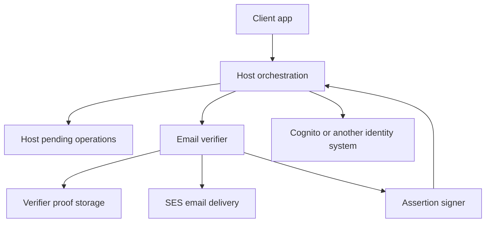
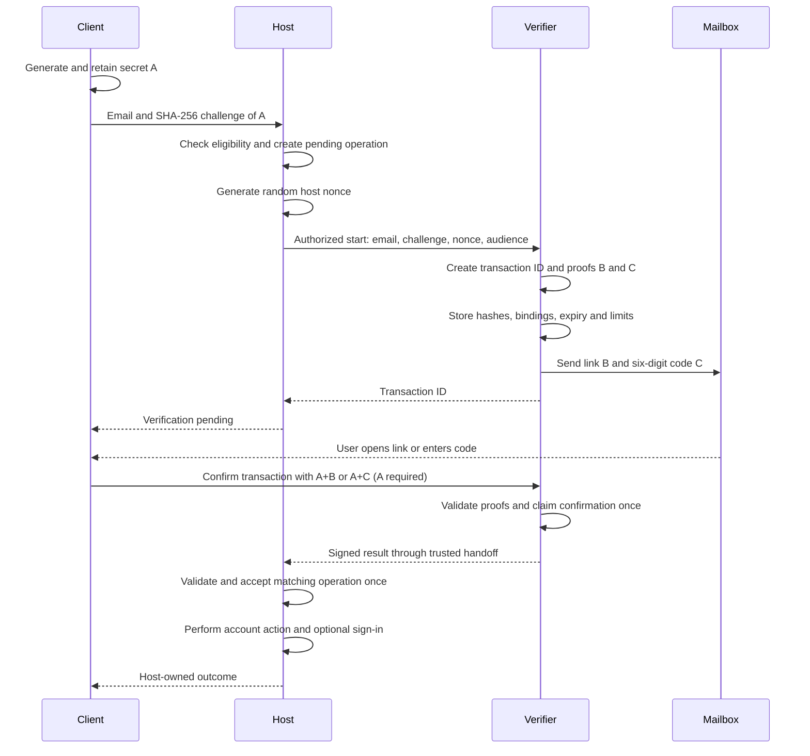
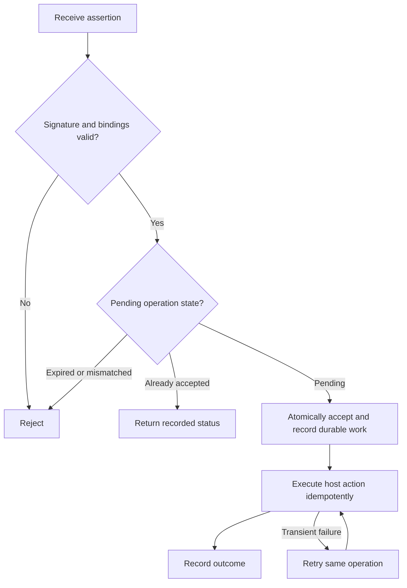
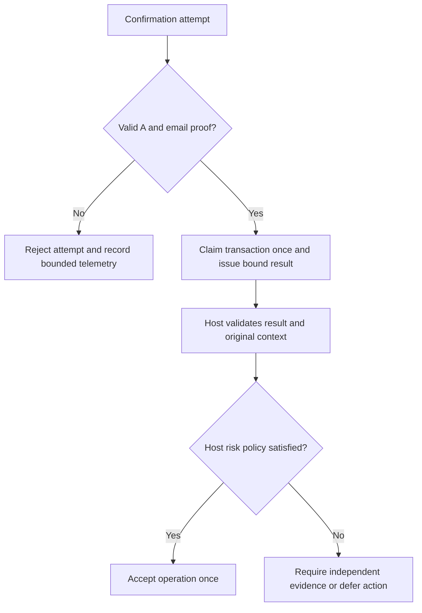

# Plan: verification-only email module

Status: planned architecture from our design discussion; not implemented.
The existing implementation in [go.apexfission.aws.verifyemail](https://github.com/lambdawalker/go.apexfission.aws.verifyemail) still checks Cognito eligibility, creates users,
and requests sessions. This new repository will implement the verification-only boundary.

The verifier will answer one question: **did someone demonstrate access to this
email address for this particular request?** It will return a signed verification
assertion. The host owns eligibility, accounts, Cognito, sessions, and the action
authorized by that evidence. Cognito integration belongs outside this repository;
its final repository location is still to be decided.

## Responsibility boundary

The host imports and deploys the module. These boxes are responsibility boundaries,
not a requirement for separate services. A composed handler can call the library
directly; separate Lambdas require authenticated, encrypted communication.
A signature does not make evidence independent of the host that controls the
verifier code and signing permissions.

| Responsibility | Existing verifyemail implementation | Planned owner |
| --- | --- | --- |
| Account eligibility lookup | Verifier's Cognito adapter | Host |
| A/B/C verification, expiry, limits and resend | Verifier | Verifier |
| Account creation and session issuance | Verifier's Cognito adapter | Host |
| Signed verification result | Not implemented | Verifier |
| Operation binding and single-use acceptance | New host contract needed | Host |

## Proposed verification flow

The sequence is logical: exact public routes and result delivery remain to be
specified. The verifier must accept host bindings only through an authorized
start path, not trust arbitrary client-supplied audience or nonce values.

A stays on the initiating client until confirmation; the backend stores its
challenge. The verifier generates B and C. Preserve the existing ten-minute
proof lifetime, hashed B, keyed digest of C, retry budgets, cooldowns, conditional
claims, and resend invalidation. A is mandatory: B+C must never complete verification.
The email may be opened elsewhere, but completion requires the initiating app's A.
If A is lost, restart verification rather than falling back to email-only completion.

## Signed result and request binding

The host generates a cryptographically random nonce (proposed: 32 bytes) and
stores its association with the expected email, intended operation, account or
signup context, initiating session, and expiry. The verifier creates its own
transaction ID. Keep the two identifiers separate; neither is an authorization
credential by itself.

| Signed field | Purpose |
| --- | --- |
| Issuer and audience | Identify the trusted verifier and intended host |
| Email and successful verification result | State what was verified |
| Host nonce | Bind evidence to the host's pending operation |
| Verifier transaction ID | Identify this verification transaction |
| Verification time, issuance time and expiration | Bound freshness and acceptance |
| Assertion ID | Identify the result for deduplication |

This is evidence of mailbox access, not an access token or proof of legal identity.
Operation names can remain private to the host through the nonce mapping.

## Replay prevention and crash recovery

A signature prevents tampering; it does not prevent replay or a thief submitting
first. Host acceptance must check the trusted key and allowed algorithm, issuer,
audience, time bounds, email, nonce, transaction, and original operation context.
Concurrent acceptance must have one winner. Atomically record acceptance and
durable follow-up work, then make external actions retry-safe. Do not claim a
distributed exactly-once guarantee.

The verifier also needs recoverable result issuance/delivery after successful
confirmation: retrying delivery must preserve the same verification identity,
never perform a new verification or authorize another operation. The persistence
and retry mechanism is still to be designed.

## Next implementation decisions

- Define the assertion schema, signing algorithm, trusted-key distribution and
  rotation. JWT/JWS is a candidate format, not an OAuth or OIDC flow.
- Define direct-call and separate-Lambda contracts, including authorized initiation,
  result delivery, recovery and client completion behavior.
- Move eligibility, Cognito enrollment and grants/session code to the host side;
  remove their permissions and integration requirements from the verifier.
- Add shared assertion validation and host acceptance contracts; keep signing
  keys separate from the existing proof HMAC key.
- Test replay races, wrong audience/email/nonce, expired results, stolen B without
  A, resend invalidation, and crashes before and after acceptance.
- Review applicable standards before claiming conformance. PKCE-style binding,
  signed assertions and webhook-style deduplication are design inspirations;
  no NIST compliance or EVP interoperability is claimed.

Keep proofs and signed assertions out of logs and result URLs. Deliver results
through a direct trusted return when composed, or an authenticated backend
handoff when separated. No AWS deployment, proof-key rotation or data migration
is part of this documentation change.

## Signup security, mailbox compromise, and standards

These are planned requirements and design rationale, not implemented guarantees.
This section supersedes the earlier discussion of an independent B+C fallback.

### Security decisions and limits

- Require A plus B or C for the same transaction. Stealing the email alone must
  not complete an existing request. A proves possession of a client secret, not
  physical-device identity. Keep A out of email, URLs, logs, and backups that
  would undermine that binding.
- A future stronger device-binding option is a non-exportable device key signing
  a fresh, transaction-bound challenge. Key registration and verification need
  their own design; installing the app is not proof of trust and endpoints can
  be called without the app.
- Keep the host nonce and verifier transaction ID separate and signed in the
  result. Hashing them together does not prevent interception or replay.
  Enforce issuer, audience, email, expiry, transaction, nonce, and original
  operation/session binding, with atomic single-use host acceptance.
- A signature authenticates signed data; it neither encrypts it nor proves that
  host-controlled code honestly executed. Use a trusted direct return when
  composed; authenticated encrypted delivery and scoped permissions when split.
- Email confirmation proves access at verification time, not exclusive mailbox
  ownership, legal identity, or MFA. If an attacker already controls the mailbox,
  they can start a new request with their own A. Neither A nor a newly enrolled
  passkey establishes that they are the legitimate mailbox owner.
- For signup, the host chooses whether mailbox access is sufficient or separate
  identity evidence is needed. For existing accounts, sensitive changes and
  recovery should require an appropriate existing trusted factor; email recovery
  must not silently bypass it. Host-owned options include trusted-device alerts,
  independent recovery contacts, and risk-based recovery delays. A notification
  only to the compromised mailbox is insufficient.

### IP and location signals

Record initiation and confirmation-attempt source IPs only through trusted ingress
metadata; do not trust arbitrary forwarded headers. Compare within the transaction
and expose useful risk signals to the host. Define limited retention, restricted
access, and masking/pseudonymization where appropriate; never log proof secrets or
full verification URLs.

Different countries or unfamiliar networks are signals, not authentication factors.
Mobile networks, VPNs, travel, and cross-border use can cause legitimate changes;
attackers can use nearby proxies. The backend cannot observe an email being read
unless that activity contacts it. A mail scanner opening a link is not successful
verification. Do not automatically cancel a valid request solely because another
IP submits an invalid proof; preserve bounded attempt limits while considering
denial-of-service abuse. Exact thresholds and host responses remain to be specified.

### Standards and practices we borrow

Normative requirements below apply within the cited standard's scope; design
inspiration does not imply protocol interoperability or whole-system conformance.

| Reference | What it establishes | Application and limits here |
| --- | --- | --- |
| [NIST SP 800-63A-4, section 3.8, Confirmation Codes](https://pages.nist.gov/800-63-4/sp800-63a.html) | In identity proofing/enrollment, confirmation codes establish access to an address for future communications; at least six decimal digits or equivalent from an approved random bit generator, at most 24 hours for email, invalidation upon use. | Preserve the planned ten-minute lifetime and single-use controls. Six digits and a shorter lifetime alone do not establish NIST conformance. This is not a universal mandate for every commercial signup. |
| [NIST SP 800-63B-4, section 3.1.3, Out-of-Band Devices](https://pages.nist.gov/800-63-4/sp800-63b.html) | Email is prohibited for out-of-band authentication; email-address confirmation codes are explicitly outside that prohibition. | Treat the result as mailbox-access evidence, not a NIST out-of-band authenticator or MFA. Host authentication is a separate responsibility. |
| [OWASP Email Validation and Verification](https://cheatsheetseries.owasp.org/cheatsheets/Email_Validation_and_Verification_Cheat_Sheet.html) | Secure random, single-use, time-limited verification tokens; verification before activation; monitoring without token leakage. | Apply token lifecycle controls and safe logging. This is security guidance, not a wire protocol. |
| [OAuth PKCE, RFC 7636](https://www.rfc-editor.org/rfc/rfc7636.html) | Protects authorization-code exchange using a client-held verifier and its challenge. | Borrow the secret/challenge binding principle for A. Our email flow is not OAuth or a claim of PKCE interoperability; mandatory A is an additional design decision. |
| [OpenID Connect Core 1.0, section 5.1](https://openid.net/specs/openid-connect-core-1_0.html#StandardClaims) | Defines the email_verified claim as reporting verification performed by the provider. | Borrow clear claim semantics; OIDC does not prescribe our email challenge procedure. A JWT alone does not make this an OIDC flow. |
| [Email Verification Protocol, draft-hardt-email-verification-02](https://datatracker.ietf.org/doc/html/draft-hardt-email-verification-02) | Proposes browser-mediated, issuer-signed email verification with request binding. | Inspiration for audience/nonce-bound results; an Internet-Draft, not an approved RFC. Our email delivery flow is different; no EVP interoperability is claimed. |
| [Stripe webhook practices](https://docs.stripe.com/webhooks) | Signed delivery timestamps help constrain replay; receivers track processed event IDs to handle duplicates. | Borrow authenticated freshness and durable deduplication. Fresh retry signatures must not turn a consumed verification into a new authorization or extend its acceptance window. This is an operational pattern, not an email-verification standard. |
| [OWASP Authentication](https://cheatsheetseries.owasp.org/cheatsheets/Authentication_Cheat_Sheet.html) and [MFA guidance](https://cheatsheetseries.owasp.org/cheatsheets/Multifactor_Authentication_Cheat_Sheet.html) | Risk-based checks, reauthentication for sensitive actions, and protected recovery/factor changes. | Host handles existing factors and recovery policy; IP/location alone are not identity proof. |
| [Google recovery security holds](https://support.google.com/accounts/answer/9412469) | Recovery requests can be delayed for security. | Example for host recovery design, not a requirement to delay ordinary email confirmation. |

### Acceptance scenarios to add before implementation is considered complete

- B alone, C alone, and B+C fail without A, including from a different device.
- Valid A+B and A+C complete only their bound transaction; A from another request fails.
- Lost A requires restart. Resend invalidates superseded email proofs and respects
  rate limits; email opening by a scanner does not consume verification.
- Expired proofs/results, wrong audience/email/nonce/transaction, and attempts to
  substitute the host operation or session are rejected.
- Simultaneous confirmations and result deliveries produce one acceptance; retries
  return recorded status only to authorized callers and never duplicate host work.
- Crashes before/after confirmation, issuance, and acceptance recover without
  losing durable work or granting a new operation.
- Legitimate IP changes do not bypass A or automatically fail verification;
  attacker-origin invalid attempts do not alone cancel the legitimate request.
- A compromised mailbox used to initiate a new signup is documented as a residual
  risk; high-assurance host policies require independent evidence.

References reviewed for this design on 2026-11-16. No NIST assurance level, MFA,
phishing-resistance guarantee, or standards certification is claimed.
