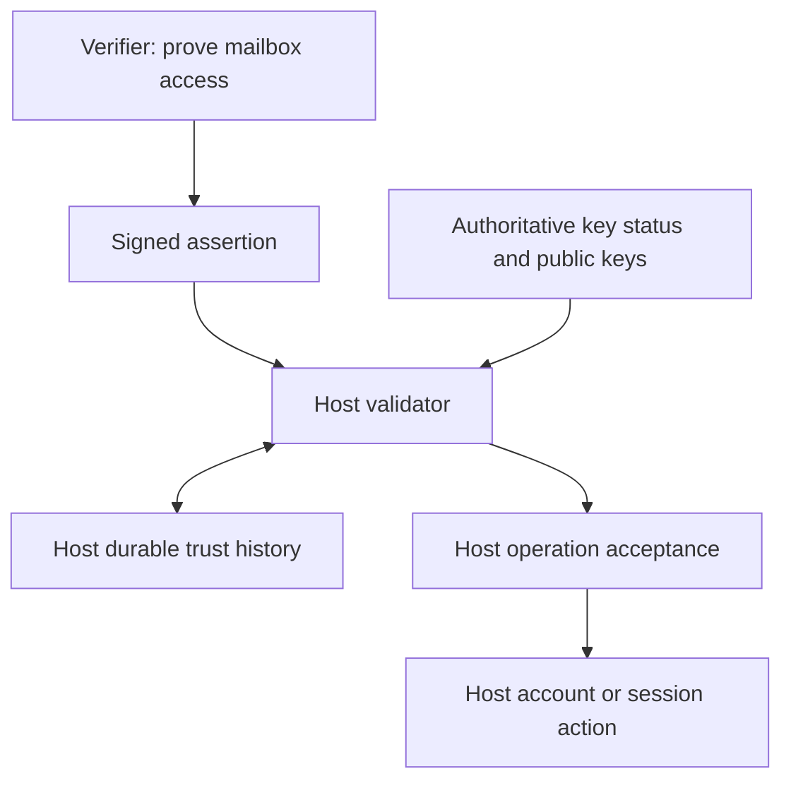

# Plan: verification-only email module

Status: target architecture from our design discussion. An initial executable core
is available; see [implementation status](implementation-status.md) for what is
implemented and what remains before production.
The existing implementation in [go.apexfission.aws.verifyemail](https://github.com/lambdawalker/go.apexfission.aws.verifyemail) still checks Cognito eligibility, creates users,
and requests sessions. This new repository will implement the verification-only boundary.

The verifier will answer one question: **did someone demonstrate access to this
email address for this particular request?** It will return a signed verification
assertion. The host owns eligibility, accounts, Cognito, sessions, and the action
authorized by that evidence. Cognito integration belongs outside this repository;
its final repository location is still to be decided.

## Default deployment

The verifier runs as an imported library inside the host process. Trusted internal
calls are the default; no extra host-to-verifier shared secret or network
endpoint is required for these calls. Separate-service deployment is deferred to
[its own design document](design/separate-deployment.md).

Default storage is DynamoDB on-demand with separate verifier and host tables.
See [storage ownership](design/storage-ownership.md) for record responsibilities,
result cleanup boundaries and adapter flexibility.

## Design documents

| Document | Contents |
| --- | --- |
| [Architecture and verification flow](design/architecture.md) | Core design |
| [Storage ownership and default database](design/storage-ownership.md) | Separate DynamoDB tables and retention responsibilities |
| [Retry, retention and timing validation](design/retry-retention-validation.md) | Five attempts, safe cleanup and required deployment checks |
| [Verification initiation](design/initiation.md) | Authorized start, idempotency and delivery diagrams |
| [Confirmation and recoverable issuance](design/confirmation.md) | Atomic proof consumption and signing recovery |
| [Result delivery and acknowledgment](design/result-delivery.md) | Trusted handoff, duplicate delivery and client completion |
| [Client status authorization](design/client-status.md) | Read-only token, lifetime and recovery |
| [Assertions and acceptance timing](design/assertions.md) | Core design |
| [Signing and key distribution](design/keys/signing-and-distribution.md) | Key management |
| [Cache policy and operational alerts](design/operations/cache-and-alerts.md) | Host operations |
| [Rotation and publication](design/keys/rotation.md) | Key management |
| [Public-key archive and signed records](design/keys/archive.md) | Key management |
| [Key lifecycle, revocation and retention](design/keys/lifecycle-and-revocation.md) | Key management |
| [Implementation decisions](design/implementation.md) | Core design |
| [Security and acceptance scenarios](design/security.md) | Core design |

## Next discussion

Authorized initiation and start idempotency are recorded in [Verification initiation](design/initiation.md).
Confirmation and durable issuance are recorded in [Confirmation](design/confirmation.md).
Trusted result delivery, acknowledgment and client completion ownership are recorded
in [Result delivery](design/result-delivery.md). The default is in-process library integration. [Client status authorization](design/client-status.md) now records the read-only
operation token and thirty-minute default. [Retry and retention](design/retry-retention-validation.md) now select five total
attempts and forty-eight hours after resolution, gated by duplicate-prevention
safety and executable configuration validation. Next: start-authorization validity
and missing-record recovery, then remaining timing and wire-contract details. Service-to-service
authentication details are deferred to the separate-deployment document.
Host-owned durable rollback storage and atomic concurrent updates are decided;
exact digest representation and retry bounds remain implementation details.
Per-key and revocation fields are decided.
The retrieval routes and freshness policy are decided. See [key lifecycle and revocation](design/keys/lifecycle-and-revocation.md)
and [implementation decisions](design/implementation.md).

## Separate drafts and references

- [Separate host and verifier deployment](design/separate-deployment.md): deferred elaboration.
- [IP and location signals](ip-location-signals-draft.md) remain an optional, unapproved draft.
- [Related efforts and reading list](related-efforts.md).

## Previous section links

The original sections have moved to the focused documents above. These headings
preserve existing deep links.

### Responsibility boundary

[Read this section](design/architecture.md#responsibility-boundary).

### Proposed verification flow

[Read this section](design/architecture.md#proposed-verification-flow).

### Signed result and request binding

[Read this section](design/architecture.md#signed-result-and-request-binding).

### Replay prevention and crash recovery

[Read this section](design/architecture.md#replay-prevention-and-crash-recovery).

### Assertion schema, signing, and trusted keys

[Read this section](design/assertions.md#assertion-schema-signing-and-trusted-keys).

### Format and initial schema

[Read this section](design/assertions.md#format-and-initial-schema).

### Configurable timing and host acceptance

[Read this section](design/assertions.md#configurable-timing-and-host-acceptance).

### Examples with the default configuration

[Read this section](design/assertions.md#examples-with-the-default-configuration).

### ID encoding and email comparison

[Read this section](design/assertions.md#id-encoding-and-email-comparison).

### Schema evolution

[Read this section](design/assertions.md#schema-evolution).

### Selected signing algorithm: ES256

[Read this section](design/keys/signing-and-distribution.md#selected-signing-algorithm-es256).

### Future TODO: quantum-resistant signatures

[Read this section](design/keys/signing-and-distribution.md#future-todo-quantum-resistant-signatures).

### AWS signing and public-key distribution

[Read this section](design/keys/signing-and-distribution.md#aws-signing-and-public-key-distribution).

### Public-key retrieval: direct AWS access or HTTPS JWKS

[Read this section](design/keys/signing-and-distribution.md#public-key-retrieval-direct-aws-access-or-https-jwks).

### Optional HTTPS publication

[Read this section](design/keys/signing-and-distribution.md#optional-https-publication).

### Cache refresh and outage policy

[Read this section](design/operations/cache-and-alerts.md#cache-refresh-and-outage-policy).

### Infrastructure plan: monitoring and alert delivery

[Read this section](design/operations/cache-and-alerts.md#infrastructure-plan-monitoring-and-alert-delivery).

### Future TODO: dedicated operational signal and incident system

[Read this section](design/operations/cache-and-alerts.md#future-todo-dedicated-operational-signal-and-incident-system).

### Rotation cadence

[Read this section](design/keys/rotation.md#rotation-cadence).

### Publication readiness and consumer responsibility

[Read this section](design/keys/rotation.md#publication-readiness-and-consumer-responsibility).

### First-draft public-key archive and signed records

[Read this section](design/keys/archive.md#first-draft-public-key-archive-and-signed-records).

### Signed public-key record format

[Read this section](design/keys/archive.md#signed-public-key-record-format).

### Explicitly accepted first-draft risks and limits

[Read this section](design/keys/archive.md#explicitly-accepted-first-draft-risks-and-limits).

### Rotation lifecycle

[Read this section](design/keys/lifecycle-and-revocation.md#rotation-lifecycle).

### Emergency revocation distribution and recovery

[Read this section](design/keys/lifecycle-and-revocation.md#emergency-revocation-distribution-and-recovery).

### Host-owned review of previously accepted proofs

[Read this section](design/keys/lifecycle-and-revocation.md#host-owned-review-of-previously-accepted-proofs).

### Retired KMS-key retention

[Read this section](design/keys/lifecycle-and-revocation.md#retired-kms-key-retention).

### Decisions still open for this item

[Read this section](design/keys/lifecycle-and-revocation.md#decisions-still-open-for-this-item).

### Next implementation decisions

[Read this section](design/implementation.md#next-implementation-decisions).

### Signup security, mailbox compromise, and standards

[Read this section](design/security.md#signup-security-mailbox-compromise-and-standards).

### Security decisions and limits

[Read this section](design/security.md#security-decisions-and-limits).

### Separate draft

[Read this section](design/security.md#separate-draft).

### Standards and practices we borrow

[Read this section](design/security.md#standards-and-practices-we-borrow).

### Acceptance scenarios to add before implementation is considered complete

[Read this section](design/security.md#acceptance-scenarios-to-add-before-implementation-is-considered-complete).

## Design diagram

## Composer implementation

The draft now includes [Composer integration](design/composer-integration.md):
a versioned infrastructure contract, separate Pulumi module, deployment timing
gate, host composition example and ownership diagrams. This provisions verifier
storage/signing only; see the implementation status for remaining production work.

## Isolated end-to-end testing

See [the internal test host](design/test-host.md) for its separate AWS stack,
private Go package boundary, test client and email-to-acceptance diagrams.
